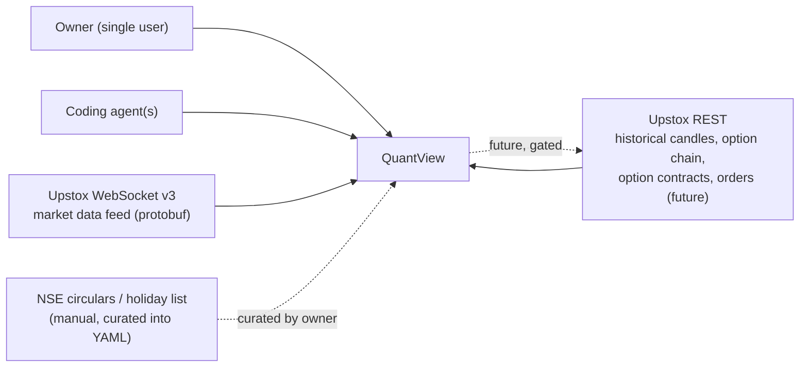
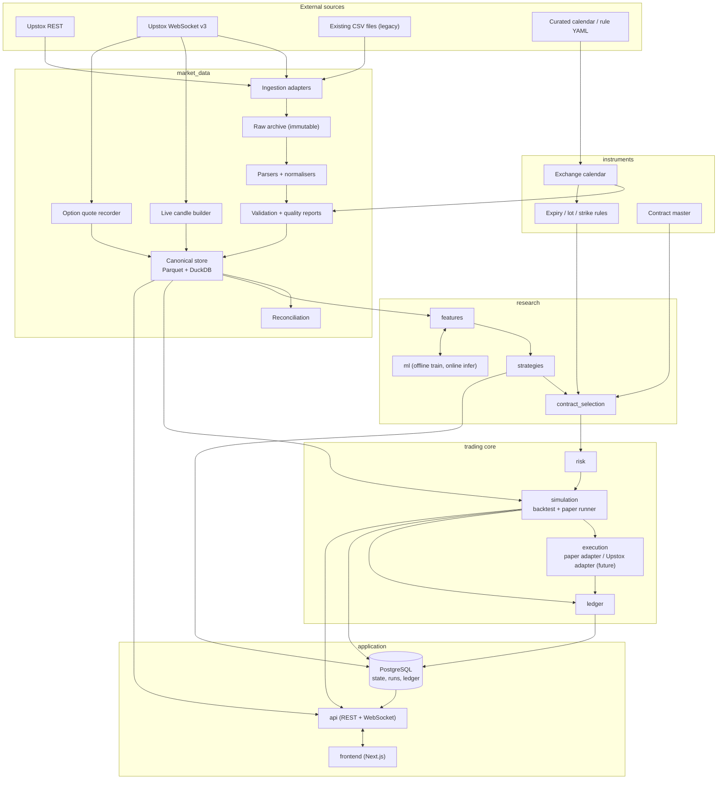
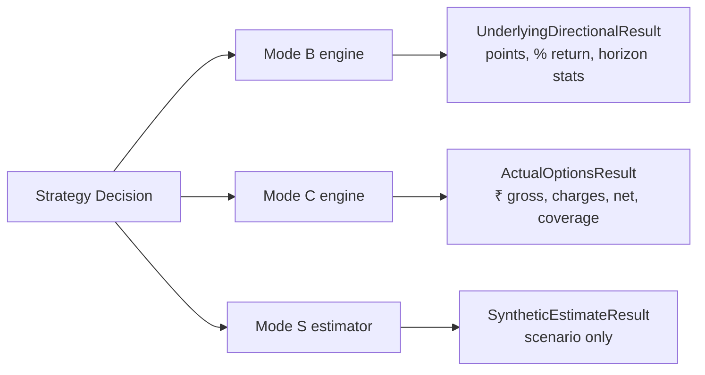

# QuantView — High-Level Design (HLD)

| Field | Value |
|---|---|
| Document | `docs/HIGH_LEVEL_DESIGN.md` |
| Companion | `docs/LOW_LEVEL_DESIGN.md` (LLD) — exact schemas, formulas, algorithms, tickets |
| Status | Baseline v1.1 (amends v1.0), supersedes `SYSTEM_ARCHITECTURE.md` and the architecture parts of `TECHNICAL_IMPLEMENTATION_SPEC.md` |
| Evidence date | 2026-10-09 (repository + `data_status.md` audit; external facts researched 2026-10-10); v1.1 amendments 2026-10-10 |
| Audience | Project owner, coding agents, reviewers |
| Primary market | NSE index derivatives, starting with NIFTY 50 and NIFTY weekly options |
| Initial scope | Research, historical backtesting, live paper trading |
| Future scope | Controlled live execution through Upstox (gated, Phase 9) |

## Revision history
| Version | Change | Rationale |
|---|---|---|
| 1.0 | Initial baseline | — |
| 1.1 | **Layered risk model and account-size independence** (P13, ADR-018, LLD §8.6) | Owner wants any account size (₹20k … ₹20 lakh) and per-strategy risk. v1.0's ₹5 lakh profile with a 10% outlay cap would have rejected almost every ATM weekly on a ₹20k account. |
| 1.1 | **`duration_profile` INTRADAY / OVERNIGHT** with overnight Mode B and Mode C rules (ADR-019) | Owner trades BTST-style (enter near the close, exit next open). v1.0 hard-coded "no overnight positions" in six places. |
| 1.1 | **Futures are recorded as data only**; WebSocket recorder also pins held contracts and records depth (ADR-021, ADR-022) | Index volume is unusable; irreplaceable data; held contracts must never fall out of the live subscription. |
| 1.1 | **ML scope widened to roles** (general, strategy meta/gated, regime, pattern, overnight) with a label registry and a holdout lifecycle (ADR-023, ADR-015 accepted) | Owner wants to explore many models, including strategy-specific ones. |
| 1.1 | **Pine porting protocol** (ADR-024) and **`ml` moved above `simulation` in the layer stack** (ADR-025) | Pine ports are the owner's main strategy source; v1.0's layering forbade ML from calling the Mode B engine it needs. |
| 1.1 | Option snapshots collect nearest **and next** weekly expiry (LLD §4.9.3) | Overnight and roll-over strategies need the next expiry; costs ≈ 60 extra calls per 30 min. |

**Authority rule.** HLD says *what the system is and why*. LLD says *exactly how to build it*. If they disagree, stop and record the conflict in the decision register (§16); do not choose silently.

**How an agent must use these two documents.** (v1.1 amendments are marked *[v1.1]* in LLD headings.) Read HLD §1–§6 once. Before each ticket, read the LLD section named in the ticket. LLD contains defaults for every parameter; an agent must not invent numbers. If a value is missing from LLD, that is a documentation bug: stop, ask, and add it to LLD.

---

# 1. Purpose, scope and non-goals

## 1.1 Purpose
QuantView is a TradingView-inspired research and trading platform with a quantitative engine behind it. One platform must let the owner:

1. See validated historical and live NIFTY charts, indicators and option-chain data.
2. Author strategies (declarative spec first, Python second) and see their signals on the chart.
3. Run causally correct backtests that never see the future and never invent option prices.
4. Paper trade the same strategies against live data with a real order lifecycle, ledger, charges and risk gates.
5. Train and deploy ML signal models only after they beat simple baselines out of sample.
6. Eventually route approved orders to Upstox, behind separate safeguards.

## 1.2 Non-goals (v1)
- Reproducing every TradingView feature (drawing tools, social features) and executing Pine Script natively. Pine strategies and indicators are *ported* to specs or trusted Python under the protocol in LLD §6.9.
- Multi-leg option structures, option selling, margin-based strategies, and *trading* futures. NIFTY futures are **recorded as data only** (ADR-021).
- Any instrument other than NIFTY 50 index and NIFTY weekly/monthly options.
- Microservices, message brokers, Kubernetes, a time-series database (see §11 trigger table).
- LLMs in the market-data-to-order path.
- Guaranteeing profit. The platform's job is to avoid fooling the owner, not to promise returns.

## 1.3 Success definition
The first proof is deliberately small and must pass before anything else is built:

> validated NIFTY 1m candles → chart in browser → one tested indicator → one deterministic strategy signal → leakage-safe directional backtest → visual report with assumptions.

Final success is the full chain: data → features → strategy → backtest → paper trade → ledger → report, with every number traceable to source records.

---

# 2. Non-negotiable principles (system invariants)

| ID | Invariant | Enforced by |
|---|---|---|
| P1 | **No look-ahead.** A decision at time `t` may use only records with `available_at <= t`. | As-of join API; truncate-and-recompute test (LLD §5.1.7); simulation clock |
| P2 | **No invented option prices.** Actual-options P&L uses only observed bid/ask/LTP from stored snapshots or recorded quotes. Synthetic premiums never enter fills, ledger or the headline metric. | `ResultKind` type separation; fill-model whitelist per mode (LLD §8) |
| P3 | **Result kinds are never mixed.** `UNDERLYING_DIRECTIONAL`, `ACTUAL_OPTIONS`, `SYNTHETIC_ESTIMATE`, `PAPER`, `LIVE` are distinct types with distinct fields. | Pydantic discriminated unions; DB check constraints |
| P4 | **One strategy contract, many environments.** Backtest, paper and live consume the same `Decision` objects through the same risk and order lifecycle. Only the clock, data feed and fill source differ. | `Engine` composition (LLD §8.1) |
| P5 | **Raw data is immutable.** Originals are never overwritten, repaired or deleted. Normalised and derived data is versioned and reproducible from raw. | Read-only raw directory; checksums; migration rules (LLD §4.1) |
| P6 | **Missing is not zero.** Absent values are null with a reason code. Missing snapshots are never interpolated or forward-filled for execution. | Canonical schemas with nullable fields; DQ rules (LLD §4.4) |
| P7 | **Explicit time semantics.** Every record carries separate `bar_start`, `bar_end`, `source_ts`, `ingested_at`, `available_at` as applicable. A bare `timestamp` is not allowed in canonical data. | Schema validators; lint test |
| P8 | **Fail safe.** Stale data, missing features, feed loss, unknown broker state or breached limits block new orders. | Risk engine + strategy health gate (LLD §8.6) |
| P9 | **Reproducible runs.** Every backtest persists data version, strategy hash, parameters, cost model, fill model, engine version and seed. | `RunManifest` (LLD §8.9) |
| P10 | **Money is exact.** Cash, fees, fills and ledger use integer paise. Floats are for indicators only. | `Paise` type; ruff rule; unit tests |
| P11 | **Boundaries are mechanical.** Module boundaries are enforced by import-linter in CI, not by convention. | LLD §1.3 |
| P12 | **Evidence before claims.** No gate is "passed" without a recorded artifact (report, test output, checksum). | Completion report (LLD §17.3) |
| P13 | **Risk is layered; strategies tighten, owners loosen.** Hard safety rules are never overridable. Account ceilings are owner policy. A strategy may declare its own risk only at or below the ceilings. Relaxing ceilings is possible only in an explicitly labelled research run, or by the owner publishing a new versioned account profile. | Risk engine rule classes and `RESEARCH_RELAXED` labelling (LLD §8.6) |

---

# 3. Context and constraints

## 3.1 Actors and external systems


## 3.2 Hard constraints (verified facts and owner decisions)

| # | Constraint | Consequence |
|---|---|---|
| C1 | Owner has **no Upstox Plus**. The expired-instrument historical candle API is unavailable. | Historical option prices exist only in the owner's own snapshots (from 2026-01-20). Actual-options backtests are limited to that window. Alternatives (licensed data) are a separate decision, not assumed. |
| C2 | Option-chain REST accepts one underlying and one expiry per call, and calling faster than about every 30 s triggers server errors (community-reported, to be re-verified in Phase 0). | 30 s is a provider-imposed snapshot floor; finer option data must come from the WebSocket feed. |
| C3 | Standard Upstox APIs: 50 req/s, 500/min, 2000/30 min. Order APIs for non-registered algos: 10 req/s. Source: Upstox rate-limit page. | Rate limiter is a mandatory component (LLD §4.9). |
| C4 | WebSocket v3: 2 connections per non-Plus user; modes `ltpc`, `full` (5-level depth + greeks), `option_greeks`; `full_d30` is Plus-only. | Quote recorder uses `full` for ≈ 45 instruments on one connection; limits re-verified in Phase 0 and stored in config. |
| C5 | NIFTY weekly expiry is Tuesday for contracts expiring on or after 2025-09-02; earlier Thursday. Lot size is 65 for expiries from 2026-01-06; 75 before (back to Nov 2024). | Expiry, lot size and strike step are effective-dated reference data (LLD §3). |
| C6 | Options STT on premium sold: 0.0625% → 0.10% (2024-10-01) → 0.15% (2026-04-01). Brokerage on Upstox options: flat ₹20 per executed order. | Cost model is effective-dated and verified against owner contract notes (LLD §8.5). |
| C7 | Owner develops on Windows (repo `C:\Algo\Options`); collector currently started manually; `Data/` is git-ignored. | Collector automation, backups and path-agnostic code are Phase 0 work. Case-sensitivity and path rules in LLD §1.2. |
| C8 | Solo developer with coding agents. | Fewer moving parts: Parquet + DuckDB for market data, one Postgres for state, one repo, one deployable. |
| C9 | The owner trades by **buying** NIFTY CE/PE, intraday and overnight (BTST-style: buy near the close, sell the next morning). | v1 supports single-leg long options only, with `duration_profile` INTRADAY or OVERNIGHT (ADR-019). Short options and spreads are out of scope. |

## 3.3 Current data reality (audit baseline)
Facts below come from `data_status.md` (2026-10-09) and the repository audit. Items marked ⚠ are unresolved and are Phase 0 tasks, not assumptions.

| Dataset | Evidence | Confidence |
|---|---|---|
| NIFTY 1m candles, 2022-01-03 → 2026-10-08, IST-aware timestamps, bar-open labelled (first 09:15, last 15:29) | Report + file samples | High on range; ⚠ row count: report 451,952 vs direct count 432,967 (432,967 ÷ 375 ≈ 1,154.6 sessions, consistent with 3m/5m/15m ≈ 1,156 sessions; the report's count is the outlier) |
| 3m, 5m, 15m (≈ 1,156 sessions), 1h and 4h (1,176 sessions each), 1d from 2021-02-01 (1,410 rows) | Row counts ÷ bars per session | ⚠ Session counts differ across timeframes by ≈ 20; cause unknown until the calendar-driven audit runs |
| 1m gaps: ≈ 15 days (Feb–Mar 2026) missing the 15:29 bar; 2026-02-12 missing 96 bars; 2026-02-16 missing 72; 2026-02-23 missing 57; 2026-02-21 is a Saturday with a single row | Report | Treat as *candidate* gaps until calendar-checked |
| Option-chain snapshots, 71,617 over 110 trading days from 2026-01-20; ≈ 651/day vs 750 expected at 30 s | Report | Counts depend on the audit parser; ⚠ three expiry folders (`2026-02-3`, `2026-03-2`, `2026-04-7`) are not zero-padded and appear to be missing from the report's expiry list |
| Three schemas: v1 (from 2026-01-20: ltp, oi, prev_oi, volume, bid, ask), v2 (from 2026-01-23: **no ltp**), v3 (from 2026-02-12: spot, bid/ask qty, chng, chng_oi, iv, delta, gamma, theta, vega) | Report | High |
| Option snapshot timestamps are timezone-naive | Repository audit | ⚠ Timezone resolved by the deterministic test in LLD §4.3 |
| Some Greeks recorded as 0 | Repository audit | Zero-sentinel rule in LLD §4.5 |
| Snapshot storage: one CSV file per snapshot under `Data/live/option_chain/nifty/<expiry>/<date>/snapshots/HH-MM-SS.csv` (≈ 71k files and growing) | Screenshots | High; compaction required |
| Only the nearest weekly expiry is collected | Folder structure | High; limits roll-over strategies |
| Collector start is manual; many sessions start late (09:30–10:50) and show gaps of 5–25 minutes | Report | Automation is Phase 0 |

**Consequence for research tracks** (carried into every result label):

| Track | Data window | Allowed claims |
|---|---|---|
| Underlying directional (Mode B) | 2022-01-03 → today (≈ 4.8 years) | Direction/point statistics on NIFTY. Never rupee option P&L. |
| Actual options (Mode C) | 2026-01-20 → today (~8.5 months), with Greeks only from 2026-02-12 | Option P&L with explicit coverage, using bid/ask snapshots. Statistical power is limited; reports must show effective sample size (days, trades). |
| Synthetic estimate (Mode S) | Any | Labelled scenario analysis only. Must be calibrated against Mode C on the overlap window and show the error (LLD §8.12). |

---

# 4. Operating modes

| Mode | Name | Data source | Fill source | Output kind | Orders leave the machine? |
|---|---|---|---|---|---|
| A | Research / charting | Historical + live | none | none | No |
| B | Underlying directional backtest | NIFTY candles | Simulated on spot (next bar) | `UNDERLYING_DIRECTIONAL` (points, % return) | No |
| C | Actual-options backtest | NIFTY candles + option snapshots/quotes | Simulated on observed bid/ask | `ACTUAL_OPTIONS` (₹, net of charges) | No |
| S | Synthetic option estimate | NIFTY candles + pricing model | Model price | `SYNTHETIC_ESTIMATE` (labelled) | No |
| D | Live paper trading | Live feed | Simulated on live quotes | `PAPER` | No (adapter has no broker import) |
| E | Live broker execution | Live feed | Broker-reported | `LIVE` | Yes — disabled by default, Phase 9 gate |

The mode is stored on every run, order, fill and ledger event, and shown in the UI header. Paper and live use separate processes, credentials and database schemas.

**Duration (v1.1).** Every strategy declares `duration_profile ∈ {INTRADAY, OVERNIGHT}`. INTRADAY positions are flattened at `force_flat_time`. OVERNIGHT positions are carried across sessions. Mode B can evaluate overnight strategies over the full 2022→today candle history because it needs only index candles (entry near the close, exit at the next session's open bar). Mode C can evaluate overnight strategies only where the option snapshots cover the next morning's open; coverage is reported and unresolved exits are never invented (LLD §8.4.7).

---

# 5. System architecture

## 5.1 Logical view


## 5.2 Runtime processes (one repository, several entry points)

| Process | Entry point | Runs when | Writes to | Notes |
|---|---|---|---|---|
| `collector-snapshots` | `python -m quantview.apps.collect_snapshots` | Scheduled 09:00 IST, trading days | `data/raw/option_chain_api`, canonical Parquet | Replaces the manual collector; heartbeat file; auto-restart |
| `collector-live` | `python -m quantview.apps.collect_live` | Scheduled 09:00 IST | Ticks, live candles, option quotes, near-month futures quotes and candles (Parquet) | One WebSocket connection; candle builder + quote recorder in one process |
| `eod-jobs` | `python -m quantview.apps.eod` | 16:30 IST | Historical candle fetch, reconciliation, compaction, backup | Idempotent; safe to rerun |
| `api` | `uvicorn quantview.api.main:app` | Always on | Postgres (state), reads Parquet | Also serves WebSocket to the UI |
| `paper-runner` | `python -m quantview.apps.paper_runner` | Per deployment | Postgres (orders, ledger), events | Subscribes to live events; never imports broker SDK |
| `backtest-worker` | In-process task or `python -m quantview.apps.backtest` | On demand | Postgres (runs), Parquet (result artifacts) | CPU-bound; separate process to keep the API responsive |
| `frontend` | `next start` | Always on | — | Talks only to `api` |

Processes communicate through (a) files/Parquet partitions and (b) Postgres tables, plus an in-process event bus inside each process. No external broker in v1. Live events reach `paper-runner` and `api` through a local UNIX-domain/TCP socket event stream published by `collector-live` (LLD §4.10) or, for single-process dev mode, an in-memory bus.

## 5.3 Dependency layers (enforced)
```
L7  api, apps                       (entry points and composition roots; may import anything below)
L6+ ml                              (datasets, labels, training, evaluation, predictor; may import simulation)  [v1.1]
L6  simulation                      (engine, paper runner, fill/cost models, metrics)
L5  execution                       (order interfaces; paper adapter; future upstox adapter)
L4  risk, ledger                    (independent; no import of each other)
L3  research (features, strategies, contract_selection)
L2  market_data
L1  instruments
L0  shared                          (ids, time, money, events, errors, config)
```
Rules: a package may import only from lower layers; `simulation`, `research` and `risk` never import `ml` — a trained model reaches the feature engine only through the `ExternalFeatureProvider` protocol (defined in `research.features`, implemented by `ml.predictor`, registered by `apps` at start-up) [v1.1, ADR-025]; `execution.upstox` may be imported only by `apps` and `api`; `research` and `simulation` must never import `upstox_client` or `execution.upstox`; `ledger` never imports `execution`; the frontend never contains trading or accounting logic.

## 5.4 Core data flows

### Historical path (research)
`CSV/API → raw archive → parser(version) → canonical rows + DQ flags → Parquet → DuckDB view → features (as-of) → strategy → simulation → report`

### Live path (paper)
`WebSocket tick → validate → candle builder → provisional/final candle events → incremental features → strategy runner → contract selection → risk → paper adapter (fill on live quote) → ledger → UI events`
After the session: `historical candle fetch → reconcile with live-built candles → revision records` (decisions already made are never rewritten).

### Backtest path
`RunConfig → DataProvider (as-of) → Clock → features → strategy → selection → risk → fill model → ledger → metrics → RunManifest + artifacts`

## 5.5 Result-kind separation (type-level)

`RunSummary` is a discriminated union on `result_kind`. The API and UI never sum or compare headline metrics across kinds.

---

# 6. Module catalogue

Each module lists purpose, ownership, interface, and the LLD section that specifies it.

| Module | Layer | Purpose | Owns | Exposes (public contract) | LLD |
|---|---|---|---|---|---|
| `shared` | L0 | Cross-cutting primitives | IDs, time helpers, `Paise`, event envelope, errors, config loader, clock | `Clock`, `new_id()`, `to_utc()`, `Paise`, `EventEnvelope`, error classes | §2 |
| `instruments` | L1 | Identity and time-dependent exchange rules | Calendar, expiry rules, lot/tick/strike rules, contract master | `Calendar`, `ExpiryRules`, `ContractMaster` | §3 |
| `market_data` | L2 | Ingest, preserve, normalise, validate, serve, collect live | Raw archive, canonical Parquet, DQ reports, live builder, quote recorder, reconciliation | `MarketDataRepository`, `OptionChainRepository`, `QuoteRepository`, `DQReport` | §4 |
| `research.features` | L3 | Indicators and option-chain features | Feature registry, batch + incremental calculators | `FeatureRegistry`, `FeatureEngine` | §5 |
| `research.strategies` | L3 | Strategy spec, runner, Python interface | Spec schema, evaluator, versioning | `StrategySpec`, `Strategy` protocol, `StrategyRunner`, `Decision` | §6 |
| `research.contract_selection` | L3 | Intent → eligible contract | Policies, tie-breaks, rejection reasons | `ContractSelector.select()` | §7 |
| `ml` | L6+ | Datasets, label registry, training, evaluation, registry, inference | Model artifacts, evaluation reports, experiment and holdout ledgers | `ModelRegistry`, `Predictor`, `LabelRegistry` | §11 |
| `risk` | L4 | Approve or reject intents | Rule set, risk profiles, kill switch | `RiskEngine.evaluate()` | §8.6 |
| `ledger` | L4 | Auditable accounting | Journal, positions projection, P&L | `Ledger.post_*()`, `Ledger.rebuild()` | §9 |
| `execution` | L5 | Order interface and adapters | Order state machine types, paper adapter, (future) Upstox adapter | `ExecutionAdapter` protocol | §8.7, §10 |
| `simulation` | L6 | Backtest engines, paper runner, fill/cost models, metrics | Run manifests, reports | `BacktestEngine`, `PaperRunner`, `FillModel`, `CostModel` | §8 |
| `api` | L7 | REST + WebSocket gateway | Request/response models | OpenAPI schema | §12 |
| `frontend` | — | Visual workspaces | Components, chart adapter | — | §13 |

## 6.1 Module responsibilities in one line each
- **market_data** answers "what did we know, and when did we know it?"
- **instruments** answers "what could be traded, with what rules, at that time?"
- **features** answers "what can be measured from what was known?"
- **strategies** answers "what do we want to do?" (never "how")
- **contract_selection** answers "which exact option does that mean?"
- **risk** answers "are we allowed to?"
- **simulation/execution** answers "what would have happened, and what actually happened?"
- **ledger** answers "what do we own, what did it cost, what did we make?"
- **ml** answers "does a model add value beyond a simple rule?"

---

# 7. Data architecture

## 7.1 Layers
| Layer | Location | Mutability | Content |
|---|---|---|---|
| Raw | `data/raw/` (read-only after write; includes legacy `Data/` mirrored by checksum manifest) | Append-only | Original CSVs, API JSON (gz), WebSocket tick logs; `MANIFEST.sha256` per directory |
| Canonical | `data/canonical/` | Rebuildable from raw | Parquet with fixed schemas, partitioned; `revision` column for corrections |
| Derived | `data/derived/` | Rebuildable | Resampled candles, feature tables, labels, model datasets; each with a lineage JSON |
| Quality | `data/quality/` | Append-only reports | DQ reports, quarantine files, reconciliation results |
| State | PostgreSQL | Transactional | Strategies, versions, runs, orders, fills, ledger, audit |

## 7.2 Time glossary (used everywhere)
| Term | Meaning |
|---|---|
| `bar_start` | Start of the candle interval (UTC instant). Source CSVs label bars by this. |
| `bar_end` | `min(bar_start + timeframe, session_close)`; for partial last bars the true session close, not the nominal interval end. |
| `source_ts` | Timestamp provided by the source (exchange/provider), if any. |
| `ingested_at` | When our system stored the record. |
| `available_at` | Earliest instant at which a decision may use the record. Candles: `bar_end`. Option snapshots: `observed_at + snapshot_available_lag` (LLD §4.3). Live: actual finalisation time. |
| `decision_at` | The instant a strategy evaluates (≥ `available_at` of every input). |
| `session_date` | Exchange-local (IST) trading date. |
All instants are stored as UTC with microsecond precision and rendered in `Asia/Kolkata`.

## 7.3 Quality states
Every record gets `quality_flags[]` (empty = clean). A *dataset-level* status is derived per `(dataset, session_date)`: `CLEAN`, `DEGRADED` (known gaps within tolerance), `UNUSABLE`, `UNVERIFIED` (calendar not confirmed). Backtests declare the minimum status they accept; the default is `CLEAN` or `DEGRADED` with excluded intervals reported.

## 7.4 Missing-data policy (summary; rules in LLD §4.4)
| Situation | Treatment |
|---|---|
| Exchange holiday / non-session | No rows expected; not a gap |
| Provider omitted a bar | Flag `MISSING_BAR`; never fabricate |
| No trade in interval | Not applicable to index (always has ticks); flag if volume-bearing instrument |
| Collector outage | Flag `COLLECTOR_GAP`; strategies needing fresh data are ineligible |
| Option snapshot late/missing | Decision rejected if latest snapshot older than `max_snapshot_age_s` |
| Schema lacks field (e.g. v2 LTP) | Field null, `greeks_status`/`ltp_status` explain |

## 7.5 Backups
Nightly checksummed copy of `data/raw`, `data/canonical`, `data/quality` and a Postgres dump to a second physical location (external drive or cloud bucket), with a monthly restore drill that rebuilds canonical data from raw and compares checksums. The option-chain history is irreplaceable and is backed up first.

## 7.6 Storage budget for the live feed (v1.1)
The 10–30 M rows/year figure in §11 covers **30-second REST snapshots only**. The WebSocket recorder is a different order of magnitude: if each of ≈ 45 subscribed contracts updates about once per second during a 6.25-hour session, that is on the order of 1 M raw rows per day, or ≈ 250 M rows per year (an assumption to be replaced by a measurement). Phase 0 gate G0.8 therefore requires a measured `ws_budget.json` (rows/day, MB/day compressed, quote update rate per instrument). Policy: raw ticks are kept compressed and immutable; derived 1-second quote bars are kept permanently; a daily size over `ws_daily_budget_mb` raises an alert, not a silent drop. Retention beyond 12 months is decided from the measurement.

---

# 8. Backtesting architecture (overview)

One deterministic, event-driven `Engine` runs all simulated modes. Components are injected:

| Component | Mode B | Mode C | Paper |
|---|---|---|---|
| Clock | `HistoricalClock` | `HistoricalClock` | `WallClock` |
| DataFeed | candles by `available_at` | candles + snapshots by `available_at` | live events |
| FillModel | `SPOT_NEXT_OPEN` / `SPOT_NEXT_CLOSE` | `OPT_SNAPSHOT_BIDASK` | `OPT_LIVE_BIDASK` |
| CostModel | none (points) with hurdle sensitivity | `UPSTOX_NSE_OPTIONS` (effective-dated) | same as Mode C |
| Ledger | none | yes | yes |

Event ordering is deterministic: `(available_at, stream_priority, sequence)`. Strategies are evaluated once per finalized bar after all events at that instant are applied. Stops and targets are resolved with conservative rules (LLD §8.3, §8.4). Full algorithm in LLD §8.

**Look-ahead defence in depth:** (1) as-of data API cannot return rows with `available_at > now`; (2) feature truncate-and-recompute tests; (3) a "poisoned future" test that replaces all future data with NaN and requires identical decisions; (4) fill models can only read data with `available_at ≥ order_submitted_at + latency`.

**Risk in simulation (v1.1).** Mode C and paper run the layered risk engine (§9, LLD §8.6) with an account profile whose equity is a parameter. For strategy research that should not be distorted by account size, runs use the `research_relaxed` profile with fixed 1 lot: ceilings are measured and reported but not enforced, and every such result carries `risk_mode = RESEARCH_RELAXED` and cannot be deployed to paper without an enforced re-run of the same strategy version or an explicit, audited acknowledgement (LLD §8.6.5).

---

# 9. Risk, paper trading and live-readiness (overview)

- **Risk engine** is a pure function `(intent, account, market_health, profile) → Approved | Rejected(rule_ids)`; no strategy can bypass it. Rules fall in three classes: **HARD** (kill switch, stale or missing data, instrument/side allowed, idempotency, account-state certainty, cash) — never overridable; **CEILING** (lots, outlay, risk per trade, daily loss, drawdown, entries, spread, expiry-day) — owner policy that strategies may only tighten; **PERMISSION** (entry windows, overnight allowed). Rules, defaults and boundary tests are in LLD §8.6.
- **Who defines risk (v1.1, ADR-018).** The *account profile* (owner, versioned, any equity) defines ceilings and the default risk per trade. Each *strategy* declares its own `risk` block (sizing, max risk per trade, max lots, daily loss) which is clamped to the ceilings and flagged `RISK_CLAMPED` when it asks for more. An account is the unit of risk; one strategy per account is recommended for clean attribution.
- **Paper trading** uses the same order state machine as live; fills are labelled `SIMULATED` with the fill-model name; every restart replays unacknowledged events idempotently.
- **Live execution** is a separate adapter behind an explicit enable flag, separate credentials and a manual go/no-go; see Phase 9. Outcome-unknown submissions block resubmission until reconciled.

---

# 10. Frontend architecture (overview)

| Workspace | Purpose | Key data |
|---|---|---|
| Market | Candles, overlays, indicator panes, replay, data-quality ribbon | `/candles`, `/features`, WS candle events |
| Options | Chain snapshot viewer, freshness, Greeks validity | `/option-chain/*` |
| Strategy | Spec editor (JSON form first), Python file reference, versions, validation | `/strategies/*` |
| Backtest | Config, progress, equity, drawdown, metrics, trades, assumptions, coverage | `/backtests/*` |
| Paper | Deployments, orders, fills, positions, P&L, ledger | `/paper/*`, WS order/account events |
| Operations | Collector health, feed freshness, gaps, kill switch, audit | `/health`, `/data-quality/*` |
| Settings | Risk profiles (create, version, compare), paper accounts (equity, profile), strategy risk declarations, instrument subscriptions | `/risk/profiles`, `/paper/accounts` |

Rules: the backend is the only source of decisions and numbers; charts display backend-provided series and overlays; every marker carries `run_id`/`strategy_version`; paper/backtest/live views use different colour themes and a persistent banner. Chart library: TradingView **Lightweight Charts** (open source; attribution notice required) behind a `ChartAdapter` interface (LLD §13.2). The commercial Advanced Charting Library is out of scope unless licensed.

---

# 11. Technology baseline (fixed decisions)

| Concern | Decision | Rationale | Revisit trigger |
|---|---|---|---|
| Language | Python 3.12 (backend), TypeScript 5 (frontend) | Owner's stack | — |
| API | FastAPI + Pydantic v2 + Uvicorn | Typed contracts, OpenAPI | — |
| Market data store | Parquet (zstd) + DuckDB | Zero-ops, fast scans; fits ≈ 0.5M 1m rows and ≈ 10–30M option rows/yr | Query p95 > 2 s on 1y chain scan after tuning |
| State store | PostgreSQL 16 (Docker compose in dev) | ACID ledger, JSONB, constraints | — |
| Numerics | NumPy, pandas (indicator I/O), numba **not** used in v1 | Simplicity; parity tests keep correctness | Backtest of 1 run > 10 min |
| Config | YAML files validated by Pydantic; env vars for secrets | Versionable | — |
| Logging | `structlog` JSON, correlation IDs | Traceability | — |
| Scheduling | OS scheduler (Windows Task Scheduler / systemd timers) + in-process APScheduler | No new infra | Multi-host |
| Event bus | In-process pub/sub; local socket between processes | No broker | > 3 consumers across hosts |
| ML | scikit-learn, LightGBM (XGBoost optional; any other family only through the same evaluation protocol) | Tabular first; many roles, one governance protocol | Baselines beaten and data justifies deep models |
| Frontend | Next.js (App Router), React, TanStack Query, Zustand, Tailwind, Lightweight Charts | Standard stack | — |
| Tests | pytest, hypothesis, import-linter, Playwright (E2E) | Mechanical boundaries | — |
| Packaging | `uv` + `pyproject.toml`; `ruff`, `mypy --strict` on `shared`, `ledger`, `risk` | Fast, strict where money lives | — |

**Not adopted by default:** Redis, Kafka, Kubernetes, TimescaleDB, microservices, numba. Each has a written trigger above.

---

# 12. Security, reliability and observability

| Area | Requirement |
|---|---|
| Secrets | `.env` only, never committed; access tokens in a token file with 0600/ACL; Upstox access token expires daily — the token manager (LLD §4.9) refreshes by owner-approved login flow |
| Environments | `dev`, `paper`, `live` config profiles; live requires `QV_LIVE_ENABLED=1` **and** a signed-off checklist file |
| Strategy code | Trusted local modules only in v1; Python strategies loaded by explicit allow-list; arbitrary upload execution is out of scope until a sandbox design exists |
| Logging | JSON logs with `correlation_id`, `run_id`, `strategy_version`, `order_id`; no secrets |
| Metrics | Feed lag, candle finalisation lag, reconnect count, snapshot success ratio, DQ status, strategy eval latency, order latency, ledger invariant check result |
| Health | `/health/live`, `/health/ready`, collector heartbeat files; alerting by local notification (email/Telegram optional) |
| Recovery | Restart is safe: collectors resume from last committed partition; runners replay from `event_id` checkpoints; ledger rebuild equals live projection |
| Audit | Append-only `audit_events` for config changes, deployments, kill-switch use, risk overrides |

## 12.1 Failure-mode table
| Failure | Detection | Automatic response | Operator action |
|---|---|---|---|
| WebSocket disconnect | No ticks for `feed_stale_s` | Mark instruments stale; strategies pause; reconnect with backoff | None unless > 5 min |
| Snapshot REST error / 5xx | HTTP status | Retry within the tick window; record `FAILED` row | Review if > 5% of day |
| Late/duplicate tick | `source_ts` ≤ last or after bar grace | Drop from candle, keep in tick log, flag | None |
| Postgres down | Connection error | Runner halts new orders; keeps cancelling/closing logic read-only | Restore DB |
| Ledger invariant fails | Post-event check | Kill switch trips; trading halts | Investigate; rebuild from journal |
| Token expired | 401 | Stop order/data calls; alert | Re-login |
| Unknown broker order state | Timeout on submit | Mark `UNKNOWN`; block duplicate; reconcile | Manual review |
| Collector not started | Missing heartbeat by 09:20 | Alert | Start/diagnose |

---

# 13. Quality strategy and gates

| Layer | Examples | Gate |
|---|---|---|
| Unit | Formula tests against hand-computed fixtures (LLD §5) | 100% of registered features have a fixture |
| Property | Candle invariants, ledger conservation, order state legality | hypothesis, ≥ 200 examples per property |
| Parity | Batch vs incremental features within 1e-9; vectorised vs event backtest on a sample | Zero failures |
| Look-ahead | Truncate-and-recompute; poisoned-future | Zero failures, run in CI |
| Replay | Record live day → replay through backtest engine → compare orders | Order intents identical; fills within model tolerance |
| Integration | Parquet round trip; Postgres migrations; API contract tests | CI |
| Data | DQ rule suite per canonical dataset | Reports committed as artifacts |
| End-to-end | Playwright: chart → run backtest → view report | Phase 5+ |

A phase gate is *passed* only if its checklist items each have a linked artifact (test log, report, checksum). The agent's completion report (LLD §17.3) must list each item as `PASS` / `FAIL` / `NOT RUN`.

---

# 14. Phased roadmap with go/no-go gates

Phases are ordered by dependency, not dates. A phase starts only when the previous gate is `PASS`.

| Phase | Name | Goal | Exit gate (all must pass) |
|---|---|---|---|
| 0 | Audit and collector hardening | Know what data is trustworthy; stop losing data | G0.1 Calendar YAML verified against NSE sources for 2021–2026 · G0.2 Audit v2 (calendar-driven) published; session counts equal across timeframes or exceptions listed · G0.3 All expiry folders parsed; missing-day report recomputed · G0.4 Timestamp semantics + option timezone resolved by the LLD §4.3 test · G0.5 1m → higher-timeframe resample matches fetched series ≥ 99.9% of bars · G0.6 Parquet conversion round-trips with checksums · G0.7 Scheduled collectors + heartbeat + nightly backup operating for 10 consecutive sessions with ≥ 95% snapshot coverage · G0.8 Quote recorder (WebSocket: index + ATM±10 options + near-month future + pinned held contracts, depth recorded) writing for ≥ 5 sessions, with a measured `ws_budget.json` (§7.6) · G0.9 Look-ahead test harness in CI |
| 1 | Skeleton and charts | Repo, CI, API, chart of validated candles | Repo layout per LLD §1; import-linter green; `/candles` serves 1m–1d; chart renders 450k-row history with lazy loading < 1 s per viewport; DQ ribbon shows flagged bars |
| 2 | Live data | Live candles, option quotes, reconciliation | Builder passes fixture tests; disconnect/reconnect test; EOD reconciliation report over 5 sessions within tolerance (LLD §4.11) |
| 3 | Feature engine | Tested catalogue | All catalogue features have fixtures; batch/incremental parity; truncate-and-recompute passes |
| 4 | Strategy engine | Spec + Python strategies, runner | Two reference strategies produce identical signals from spec and Python forms on the same data |
| 5 | Directional backtester (Mode B) | Leakage-safe spot research, INTRADAY and OVERNIGHT strategies | Determinism, poisoned-future, accounting-free invariants; sensitivity tables; report in UI |
| 6 | Actual-options backtester (Mode C) | Option P&L from snapshots | Contract selection tests; coverage report; fill + cost tests; Mode S vs Mode C calibration report |
| 7 | Paper trading + ledger | Live paper accounts (any starting equity; layered risk profiles) | Restart/duplicate/stale tests; ledger rebuild equality; 10 paper sessions without invariant violation; fee reconciliation vs owner's real contract notes within ₹1 per trade |
| 8 | ML | Baselines, then models in several roles (general, strategy-specific, regime, pattern, overnight) | Walk-forward + purged evaluation; holdout untouched; promotion criteria (LLD §11.8) |
| 9 | Live broker (optional) | Controlled Upstox execution | Written readiness checklist signed by owner; tiny size; kill switch tested; regulatory check |
| 10 | Hardening | Performance, ops | Measured triggers only |

**First end-to-end milestone (end of Phase 5):** pick a documented strategy, run Mode B over 2022-01 → 2026-10 with a walk-forward report, view equity/drawdown/trades on the chart, rerun and get an identical manifest hash.

---

# 15. Risks and open items

| ID | Risk / unknown | Impact | Mitigation / owner task |
|---|---|---|---|
| R1 | Only ~8.5 months of option snapshots | Weak statistical power; regime coverage limited | Report effective sample size; do not tune on the holdout; start quote recording now; evaluate licensed data separately |
| R2 | Snapshot cadence floor (~30 s) | Stops/targets cannot be resolved inside a snapshot | Path-blind rules (LLD §8.4); WebSocket recording for future data |
| R3 | Audit correctness (parser skipped folders; row-count conflict) | Wrong coverage claims | Phase 0 gates G0.2–G0.3 |
| R4 | Cost parameters change (STT, exchange charges) | Misstated net P&L | Effective-dated YAML + reconciliation with real contract notes (G7) |
| R5 | NSE exchange transaction rate for index options: sources show 0.03503% (Oct 2024) and 0.03553% (later) | ±0.00050% of premium turnover | Use the higher until verified in an NSE circular |
| R6 | Upstox feed field semantics (cumulative volume, index volume, timestamps) | Wrong volume/time features | Phase 0 fixture capture from a live session; document in LLD addendum table (§4.7) |
| R7 | Single developer + agents → inconsistent changes | Drift | Two-document authority, tickets, CI gates |
| R8 | Regulatory/broker rules for algorithmic orders | Live blocked | Verify current SEBI/Upstox/NSE requirements before Phase 9 (registration, static IP, order-rate caps, strategy identification) |
| R9 | Windows paths/case, laptop sleep | Gaps, bugs | Path utilities, power settings, always-on host recommended |
| R10 | Overfitting through many experiments | False confidence | Experiment registry counts trials; holdout lock; bootstrap CIs |
| R11 | Model-selection bias: many models, labels and features tried on the same history | A best-looking model is partly luck; false confidence | Trial counting per experiment family, holdout lifecycle with a cap on looks, forward shadow period (LLD §11.12) |
| R12 | Small accounts vs 65-unit lots | A single ATM lot can be 30–60% of a ₹20k account; percentage risk rules cannot be honoured | Account-size-independent research profile; explicit `RISK_BELOW_ONE_LOT` rejections surfaced in reports (LLD §8.6) |
| R13 | WebSocket volume is far larger than snapshot volume | Disk growth, slow scans | Measured budget in G0.8; derived 1-second bars; retention policy (§7.6) |
| R14 | Overnight holds add gap, theta and IV-change risk that index-only Mode B cannot price | Overstated BTST edge | Overnight hurdle report (LLD §8.12.3); Mode C evidence accumulates from now; labelled `OVERNIGHT` in every report |

---

# 16. Decision register

| ID | Status | Decision | Rationale | Affected |
|---|---|---|---|---|
| ADR-001 | Accepted | Modular monolith; one repo; entry-point processes | Solo dev; simple deploy | all |
| ADR-002 | Accepted | Raw immutable; canonical/derived rebuildable | Provenance | market_data |
| ADR-003 | Accepted | Result kinds are separate types | Prevent misleading claims | simulation, api, ui |
| ADR-004 | Accepted | No broker SDK imports outside `execution.upstox`, `apps`, `api` | Strategy independence | all |
| ADR-005 | Accepted | Point-in-time access uses `available_at`, backward as-of, explicit freshness limits | No look-ahead | features, simulation |
| ADR-006 | Accepted | Ten packages in layers L0–L7 (§5.3), `risk` separate from `simulation` | Risk is shared by paper and live | all |
| ADR-007 | Accepted (supersedes "exactly two docs" wording) | Two maintained specs: this HLD and the LLD | Clear split: why vs how | docs |
| ADR-008 | Accepted | `available_at = bar_end`, where `bar_end` is clipped to the real session close for partial bars | Reviewer correction | market_data |
| ADR-009 | Accepted | 1m is the canonical intraday series; higher timeframes are derived; provider-native timeframes are kept for reconciliation only | One source of truth | market_data |
| ADR-010 | Accepted | Parquet + DuckDB for market data; PostgreSQL for state; no Redis/Timescale/Kafka | Simplicity | storage |
| ADR-011 | Accepted | v1 trades single-leg **long** options only | Matches owner's trading; avoids margin modelling | selection, risk, ledger |
| ADR-012 | Accepted | Option fills in Mode C use observed bid/ask from the first snapshot at/after `decision_at + latency`; stops are path-blind (checked only at snapshots) | Honest about 30 s resolution | simulation |
| ADR-013 | Accepted | Strategy spec (JSON AST) and trusted Python modules first; visual builder UI later | Cost/value | strategies, ui |
| ADR-014 | Accepted | Record option quotes via WebSocket from now on | Irrecoverable data | market_data |
| ADR-015 | Accepted (v1.1) | Holdouts are chronological blocks frozen before tuning and governed by a lifecycle (`FROZEN → LOOKED_AT (≤ 3 looks per experiment family) → BURNED`); a burned holdout is replaced by a forward holdout made of sessions recorded after the burn date. Mode B default: 2026-01-01 → freeze date. Mode C: chosen after the coverage review (LLD §8.11, §11.12) | Selection bias; not "last 30 days" | simulation, ml |
| ADR-016 | Proposed | Synthetic-option acceptance thresholds are set per use-case before the calibration run, not a fixed 15% | Reviewer correction | simulation |
| ADR-017 | Accepted | ML starts after Phase 5 baselines; LightGBM + logistic baseline; promotion by bootstrap CI on frozen holdout | Avoid unvalidated models | ml |
| ADR-018 | Accepted (v1.1) | Layered risk: HARD rules, owner CEILING rules in a versioned account profile with any equity, strategy `risk` clamped to ceilings (`RISK_CLAMPED`), `RESEARCH_RELAXED` runs for strategies needing more risk (labelled, never promotable). Paper/live ceilings change only by a new profile version with an audit event | Strategies need their own risk; owners need control; nothing is bypassed silently | risk, simulation, strategies, api, ui |
| ADR-019 | Accepted (v1.1) | `duration_profile` INTRADAY / OVERNIGHT on every strategy; overnight entry window, exit by `exit_session_offset` + `time_exit`, carried positions in ledger and recorder, overnight hurdle. Mode B evaluates BTST on index candles; Mode C only where the open is covered | Owner trades BTST; index candles cover 4.8 years | strategies, simulation, ledger, risk, market_data |
| ADR-020 | Accepted (v1.1) | Strategy research uses a capital-agnostic profile (`research_relaxed`, 1 lot, results per lot) before any account-sized paper run | Account size must not decide which strategies look good | simulation |
| ADR-021 | Accepted (v1.1) | NIFTY near-month futures are recorded as data only (WebSocket `full` + EOD 1m candles). No futures trading. Futures features are optional and built only on owner request | Index has no volume; recording is cheap and irrecoverable | market_data, features |
| ADR-022 | Accepted (v1.1) | WebSocket recorder pins every contract with an open position in `full` mode regardless of the strike band, and records 5-level depth | A held contract must never go unmonitored; order-flow research needs depth history | market_data, simulation |
| ADR-023 | Accepted (v1.1) | ML roles: GENERAL, STRATEGY_META, STRATEGY_GATED, REGIME, PATTERN, OVERNIGHT; labels live in a registry; strategy-specific models are bound to a strategy `spec_hash` | Owner wants strategy-specific and general models | ml |
| ADR-024 | Accepted (v1.1) | Pine Script is never executed; it is ported under the LLD §6.9 protocol with TradingView-export parity tests and look-ahead/repaint review | Pine ports are the main strategy source and the main look-ahead risk | strategies, features |
| ADR-025 | Accepted (v1.1) | `ml` sits above `simulation` in the layer stack; trained models reach features only through `ExternalFeatureProvider` registered in `apps` | ML evaluation and strategy-outcome labels need the Mode B engine; v1.0's layering forbade that | all |

Rule: a decision may change only by adding a new ADR that supersedes it, with consequences and migration notes.

---

# 17. Glossary
| Term | Meaning |
|---|---|
| ATM | At-the-money: strike nearest to the spot at decision time |
| DTE | Days (or fraction) to expiry |
| IPFT | NSE Investor Protection Fund Trust charge |
| OI | Open interest |
| STT | Securities Transaction Tax |
| MIS | Intraday product type (positions squared off by the broker at day end) |
| As-of join | Join each row to the latest right-side row with `available_at ≤` left `decision_at` |
| Mode B/C/S | Underlying directional / actual-options / synthetic backtest |
| Hurdle | Underlying move needed to cover costs and option decay (LLD §8.12) |
| Duration profile | `INTRADAY` (flat by `force_flat_time`) or `OVERNIGHT` (may be carried across sessions) |
| BTST | Buy today, sell tomorrow: an OVERNIGHT strategy that enters near the close and exits at the next open |
| Pinned key | A WebSocket instrument kept subscribed because a position in it is open |
| Gate | A pass/fail checklist with linked evidence |
