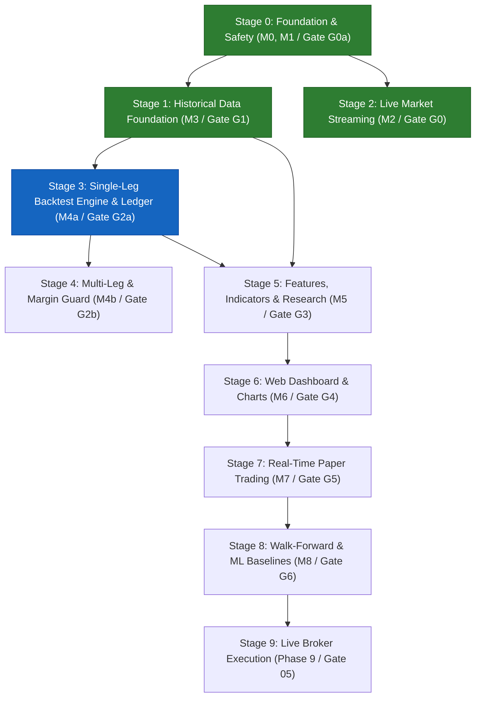

# QuantView — Simplified Implementation Roadmap & Architecture Guide

> **Document Status:** Owner's Plain-English Companion Guide  
> **Audience:** Project Owner & Research Engineers  
> **Authority Relationship:** Subordinate to the 4 Canonical Documents (`QUANTVIEW_MASTER_SPEC.md`, `QUANTVIEW_DATA_SPEC.md`, `QUANTVIEW_ENGINE_UI_RESEARCH_SPEC.md`, `DOCS/AGENTS.md`). Designed for straightforward comprehension of system stages, build priorities, and data flows.  
> **Current System Position:** **Gate G0a Cleared $\to$ Stage 1 (Historical Data Foundation / Milestone M3) in Progress**  

---

## 1. Executive Summary: What is QuantView?

**QuantView** is an institutional-grade, self-hosted quantitative trading and research terminal specifically built for Indian options markets (NSE NIFTY 50). Think of it as a **private, automated TradingView + Backtesting Engine + Paper Trading Simulator** designed from the ground up to prevent the common mistakes of retail algorithmic trading:

1. **No Look-Ahead Bias:** An indicator or strategy can never accidentally peek into the future (`available_at <= decision_time`).
2. **True Options P&L:** Underlying index movement is never faked as option returns. Every trade is simulated against real, observed historical option prices.
3. **Institutional Accounting:** Money is calculated in exact integer paise ($\text{₹}1.00 = 100\text{ paise}$) with full exchange transaction costs, STT, GST, and SEBI turnover fees so that backtest results match real broker contract notes within 1 paise.
4. **Safety-Locked Live Execution:** Live trading is physically locked behind strict multi-session paper-trading evaluation gates to protect capital.

---

## 2. Where Are We Today? (Current Status)

We have successfully completed **Stage 0**, **Stage 1**, and **Stage 2**, and have entered **Stage 3**:

```
[ Stage 0: Setup & Safety ] ───► [ Stage 1: Historical Lake ] ───► [ Stage 2: Live Collectors ] ───► [ Stage 3: Strategy Engine & Ledger ]
        ✅ COMPLETED                      ✅ COMPLETED                       ✅ COMPLETED                     ⏳ IN PROGRESS (Current Focus)
  • Repository layout (19 dirs)        • Full Lake Parquet (784 files)    • Live WebSocket Client (V3)       • Domain Primitives & Exact Money
  • Automated CI & linters             • 446 sessions, 20.33M bars        • Raw-first segment writer         • Golden Test Oracle (9 scenarios)
  • M0 data audit & backups            • 8 DuckDB analytical views        • REST snapshot collector          • Effective-dated fee schedules
  • Upstox token authentication        • Multi-timeframe derived bars     • Single-owner kernel lease        • Event-sourced ledger & projections
  • 127/127 tests PASS (4.75s)         • Gate G1 Certified (0 defects)    • Gate G0 Certified (0 defects)    • Gate G2a Deterministic Backtests
```

* **M0 Data Safety & Inventory:** Complete. Existing 82,000+ live PC B snapshots and historical index candles are fully audited and backed up.
* **M1 Scaffolding & CI:** Complete. All packages (`packages/data`, `services/`, `apps/web`) and CI pipelines pass with 127/127 automated unit tests.
* **Stage 1 Historical Data Foundation (`Gate G1`):** Complete & Certified PASS (`reports/stage1_closure/gate_g1_audit_report.md`).
  * 784 Parquet files (38.75M rows, 620 MB) active under `manifest_active.json` v3.
  * 20,332,421 option bars (2025–2026) + 437,008 underlying 1m bars (2022–2026) queryable via `Data/lake/quantview.duckdb`.
  * Multi-timeframe derived candles (3m, 5m, 15m, 30m, 1h, 4h) and data eligibility matrix (1,161 sessions).
* **Stage 2 Live Market Streaming (`Gate G0`):** Complete & Certified PASS (`reports/stage2_closure/gate_g0_audit_report.md`).
  * All 11 tasks `M2-01` through `M2-11` verified.
  * Live WebSocket raw segment writer (`QVWS` framing, batched fsync, crash recovery) and V3 Protobuf quote decoder.
  * Single-owner kernel lease (`SingleOwnerLease`), REST snapshot collector, 08:45 pre-market gate, heartbeat telemetry.
  * Live session capture on 2026-10-26 (134,003 ticks, 86 snapshots, 100% cryptographic reconciliation).
* **Immediate Current Focus (Stage 3 — `Gate G2a`):** Build the deterministic single-leg long CE/PE backtesting engine, point-in-time contract selector, versioned effective-dated fee schedule, and event-sourced integer-paise financial ledger.

---

## 3. The 10 Implementation Stages Explained Simply

Below is the complete, stage-by-stage implementation plan for QuantView. Each stage lists what it does, what we build, and where to find the technical specifications in the canonical documents.



---

### Stage 0: Foundation, Architecture & Repository Safety
* **Milestone / Gate:** `M0` (Preservation & Inventory) + `M1` (Scaffolding & Tooling) $\to$ **Gate `G0a`**
* **Status:** **COMPLETED & VERIFIED**
* **What this stage is in simple words:**
  Making sure we don't break anything, backing up all existing data, setting up the Python workspace, and putting automatic testing in place so bad code is caught instantly.
* **What we built:**
  1. Complete inventory of 86,000+ files and 2.2 GB of existing market data.
  2. Backup verification against USB external storage (`M0-06`, `M0-08`).
  3. Clean repository structure with 19 bounded directories (`packages/data`, `services/`, `apps/web`, `config`).
  4. CI pipeline (`.github/workflows/ci.yml`), import boundary linter (`.importlinter`), and 35 automated unit tests.
* **Where it is referenced in the 4 Canonical Docs:**
  * `DOCS/QUANTVIEW_MASTER_SPEC.md` §1 (System Architecture), §3 (Safety Principles P1–P18)
  * `DOCS/QUANTVIEW_DATA_SPEC.md` §1 (Directory Layout)
  * `DOCS/AGENTS.md` §6.1 (`M0-01` to `M0-11`), §6.2 (`M1-01` to `M1-05`), §7 (Gate G0a)

---

### Stage 1: Historical Market Data Foundation
* **Milestone / Gate:** `M3` $\to$ **Gate `G1`**
* **Status:** **COMPLETED & CERTIFIED PASS (Gate G1)**
* **What this stage is in simple words:**
  Downloading and organizing high-resolution 1-minute historical data for both the NIFTY index and all NIFTY option strikes from January 1, 2025 to the present day. Converting messy API responses into clean, high-speed analytical files.
* **What we build in this stage:**
  1. **Historical Expiry Calendar:** Master list of all 95 authoritative expiry dates from Upstox API (`config/nse_nifty_expiries_2025_2026.json`).
  2. **Bounded Downloader (`tools/ingest/`):** Automated, rate-limited downloader that saves raw Upstox JSON responses to `Data/raw/` with cryptographic manifests, and stages clean daily CSVs.
  3. **Lake Parquet Normalizer:** A pipeline that converts the staged daily CSVs into partitioned Parquet files (`Data/lake/option_candles/underlying=NIFTY/expiry=YYYY-MM-DD/part-0.parquet`) compressed with Zstandard for instant DuckDB analytical queries.
  4. **Data Quality Checker:** Scans for missing minutes, flat prices, inverted OHLC ($L > H$), and creates a `data_eligibility` table so backtests know which days are 100% clean.
* **Where it is referenced in the 4 Canonical Docs:**
  * `DOCS/QUANTVIEW_DATA_SPEC.md` §1.1–§1.3 (Data Lake Structure), §3 (Storage & Partitioning), §4 (Publish Pipeline)
  * `DOCS/QUANTVIEW_MASTER_SPEC.md` §2.1 (Market Data Module)
  * `DOCS/AGENTS.md` §6.4 (`M3-01` to `M3-10`), §7 (Gate G1)

---

### Stage 2: Live Market Data Collection & Streaming
* **Milestone / Gate:** `M2` $\to$ **Gate `G0`**
* **Status:** **COMPLETED & CERTIFIED PASS (Gate G0)**
* **What this stage is in simple words:**
  Connecting QuantView directly to the live Upstox WebSocket market feed during trading hours (09:15 to 15:30) to capture live price ticks, quotes, and market depth without interrupting the existing PC B snapshot collector.
* **What we build in this stage:**
  1. **WebSocket Client (`services/collector_ws`):** Connects to Upstox market feed, decodes Protobuf binary messages, and saves raw segments to `Data/raw/upstox_ws/`.
  2. **1-Minute Candle Builder:** Real-time aggregator that rolls live ticks into 1-minute OHLCV candles as each minute closes.
  3. **Snapshot Ingestion Service:** Monitors the live PC B option chain collector and ingests daily snapshots into the analytical lake.
* **Where it is referenced in the 4 Canonical Docs:**
  * `DOCS/QUANTVIEW_DATA_SPEC.md` §1.1, §4.3 (WebSocket Segments & Raw REST)
  * `DOCS/QUANTVIEW_MASTER_SPEC.md` §2.1 (Market Data Streaming)
  * `DOCS/AGENTS.md` §6.3 (`M2-01` to `M2-10`), §7 (Gate G0)

---

### Stage 3: Single-Leg Backtesting Engine & Integer-Paise Ledger
* **Milestone / Gate:** `M4a` $\to$ **Gate `G2a`**
* **Status:** **IN PROGRESS (Current Work Focus - Gate G2a)**
* **What this stage is in simple words:**
  Building the core simulation engine. It runs a strategy through historical 1-minute bars minute by minute. If the strategy says "Buy ATM Call", the engine checks the actual historical option price, simulates a realistic fill with slippage and taxes, and tracks the profit/loss down to the exact paisa.
* **What we build in this stage:**
  1. **Event Clock:** Steps through time sequentially. Strictly enforces `bar_end` availability so the strategy cannot know the 09:20 close until 09:20:00 has actually passed.
  2. **Order Matcher & Fill Model:** Simulates buy/sell fills using next-bar open prices with conservative bid/ask slippage.
  3. **Integer-Paise Ledger (`packages/ledger`):** An append-only double-entry financial ledger that tracks cash, positions, and fees in integer paise ($\text{₹}1 = 100\text{ paise}$) using exact Indian tax formulas (STT, exchange turnover fees, GST, SEBI charges, stamp duty).
  4. **RunConfig & Baseline Runner:** Standard configuration format for backtests (start date, end date, initial capital, risk limits).
* **Where it is referenced in the 4 Canonical Docs:**
  * `DOCS/QUANTVIEW_ENGINE_UI_RESEARCH_SPEC.md` §1–§8 (Simulation Engine, Fill Models, Ledger Invariants, Fee Schedules)
  * `DOCS/QUANTVIEW_MASTER_SPEC.md` §2.2 (Simulation & Ledger Architecture)
  * `DOCS/AGENTS.md` §6.5 (`M4a-01` to `M4a-14`), §7 (Gate G2a)

---

### Stage 4: Multi-Leg Option Strategies & Margin Guard
* **Milestone / Gate:** `M4b` $\to$ **Gate `G2b`**
* **Status:** **PENDING STAGE 3**
* **What this stage is in simple words:**
  Expanding the engine to handle complex multi-leg option strategies (like Bull Call Spreads, Straddles, Strangles, and Iron Condors) where multiple option contracts are bought or sold together.
* **What we build in this stage:**
  1. **Atomic Group Orders:** Ensures that if a strategy trades a spread (Buy 24000 CE + Sell 24200 CE), both legs are evaluated and filled together, and exited together on stop-loss.
  2. **Margin Guard (`RK-05`):** Calculates real-time exchange margin requirements (SPAN + Exposure) so short option positions cannot exceed account buying power.
  3. **Auto-Square-Off Policy:** Automatically closes intraday option positions before market close (15:25 IST) to prevent physical settlement risk.
* **Where it is referenced in the 4 Canonical Docs:**
  * `DOCS/QUANTVIEW_ENGINE_UI_RESEARCH_SPEC.md` §4.2–§7.4 (Multi-Leg Representation, Group Exits, Margin Guard)
  * `DOCS/QUANTVIEW_MASTER_SPEC.md` §2.2 (Portfolio & Risk Constraints)
  * `DOCS/AGENTS.md` §6.6 (`M4b-01` to `M4b-09`), §7 (Gate G2b)

---

### Stage 5: Features, Indicators & Quantitative Strategy Research
* **Milestone / Gate:** `M5` $\to$ **Gate `G3`**
* **Status:** **PENDING STAGE 3**
* **What this stage is in simple words:**
  Building the quantitative library of technical indicators, price transforms, and rule-based strategies. Researchers can write a strategy in clean Python using standard indicators without writing messy database code.
* **What we build in this stage:**
  1. **Core Technical Indicators:** EMA, SMA, Supertrend, RSI, VWAP, Bollinger Bands, ATR.
  2. **Smart Money Concepts (SMC):** Deterministic algorithm for Break of Structure (BOS) and Change of Character (CHoCH) swing pivots.
  3. **Option Chain Transforms:** Real-time calculation of Put-Call Ratio (PCR), Max Pain, ATM Straddle IV, and Open Interest build-up.
  4. **Strategy Protocol (`Strategy(Protocol)`):** Clean Python interface where every strategy implements simple methods: `on_bar(bar)` and `generate_signals()`.
* **Where it is referenced in the 4 Canonical Docs:**
  * `DOCS/QUANTVIEW_ENGINE_UI_RESEARCH_SPEC.md` §9–§13 (Feature Extraction, Indicator Library, BOS/CHoCH, Strategy Protocol)
  * `DOCS/QUANTVIEW_MASTER_SPEC.md` §2.3 (Research & Features Architecture)
  * `DOCS/AGENTS.md` §6.7 (`M5-01` to `M5-13`), §7 (Gate G3)

---

### Stage 6: Web Dashboard, Strategy Browser & Interactive Charts
* **Milestone / Gate:** `M6` $\to$ **Gate `G4`**
* **Status:** **PENDING STAGE 5**
* **What this stage is in simple words:**
  Building the user interface! A modern browser-based terminal (Next.js + FastAPI) where you can look at TradingView charts, see live and historical option chains, click a button to run a backtest, and see an interactive dashboard of profits, losses, drawdowns, and trade logs.
* **What we build in this stage:**
  1. **FastAPI Backend (`services/api`):** Serves market data, indicators, backtest triggers, and paper trading state via REST and WebSockets.
  2. **TradingView Chart Component (`apps/web`):** High-performance candlestick chart using TradingView Lightweight Charts, displaying underlying candles, trade entry/exit markers, and indicator overlays.
  3. **Option Chain Matrix:** Visual heat map of strikes, open interest, and implied volatility.
  4. **Backtest Results View:** Interactive equity curve, monthly returns calendar, trade log table, and risk metrics (Sharpe ratio, max drawdown, win rate, profit factor).
* **Where it is referenced in the 4 Canonical Docs:**
  * `DOCS/QUANTVIEW_ENGINE_UI_RESEARCH_SPEC.md` §14–§19 (REST Routes, WebSocket Schemas, Charting UX, UI-1 to UI-5 Contracts)
  * `DOCS/QUANTVIEW_MASTER_SPEC.md` §2.4 (API & Frontend Architecture)
  * `DOCS/AGENTS.md` §6.8 (`M6-01` to `M6-20`), §7 (Gate G4)

---

### Stage 7: Real-Time Paper Trading & Live Daemon
* **Milestone / Gate:** `M7` $\to$ **Gate `G5`**
* **Status:** **PENDING STAGE 6**
* **What this stage is in simple words:**
  Running strategies live during market hours with simulated money. The system connects to the live Upstox feed, runs your strategy in real time, places simulated orders, tracks open positions, and updates your paper account balance with zero financial risk.
* **What we build in this stage:**
  1. **Live Daemon (`services/live_daemon`):** Background process that runs during exchange hours (09:15 to 15:30 IST).
  2. **Simulated Paper Broker:** Receives order intents from strategies, checks risk rules (`RK-01` to `RK-26`), fills orders against live bid/ask quotes, and records trades in PostgreSQL (`qv_paper`).
  3. **Account Allocation Modes (`ADR-038`):** Supports `ISOLATED` (one strategy per sub-account) and `PORTFOLIO` (multiple strategies sharing account margin ceilings).
  4. **Emergency Square-Off & Kill-Switch:** One-click button in the UI to immediately cancel all open orders and market-exit all open positions.
* **Where it is referenced in the 4 Canonical Docs:**
  * `DOCS/QUANTVIEW_ENGINE_UI_RESEARCH_SPEC.md` §20–§24 (Paper Broker, Live Daemon, State Recovery, Risk Catalogue)
  * `DOCS/QUANTVIEW_MASTER_SPEC.md` §2.5 (Paper Trading Architecture)
  * `DOCS/AGENTS.md` §6.9 (`M7-01` to `M7-14`), §7 (Gate G5)

---

### Stage 8: Strategy Robustness, Walk-Forward & ML Research
* **Milestone / Gate:** `M8` $\to$ **Gate `G6`**
* **Status:** **PENDING STAGE 7**
* **What this stage is in simple words:**
  Stress-testing strategies to make sure they aren't just "curve-fitted" to historical data. Verifying that a strategy has a genuine statistical edge before trusting it with serious capital.
* **What we build in this stage:**
  1. **Purged Walk-Forward Optimization:** Tests strategies across rolling time windows with strict embargo periods to eliminate overfitting.
  2. **Deflated Sharpe Ratio (DSR):** Institutional metric that adjusts backtest performance downward based on how many trial combinations were tested.
  3. **Monte Carlo Simulations:** Shuffles market returns to test strategy resilience against extreme market crashes and losing streaks.
  4. **Offline ML Models (Optional):** LightGBM/XGBoost pipelines for predicting price direction or volatility regimes.
* **Where it is referenced in the 4 Canonical Docs:**
  * `DOCS/QUANTVIEW_ENGINE_UI_RESEARCH_SPEC.md` §25–§27 (Statistical Validation, DSR Math, ML Pipelines)
  * `DOCS/QUANTVIEW_MASTER_SPEC.md` §2.6 (Research & ML Architecture)
  * `DOCS/AGENTS.md` §6.10 (`M8-01` to `M8-10`), §7 (Gate G6)

---

### Stage 9: Gated Live Broker Execution (Phase 9)
* **Milestone / Gate:** Phase 9 $\to$ **Gate `GATE-05`**
* **Status:** **LOCKED & DISABLED BY DEFAULT (`NO-GO`)**
* **What this stage is in simple words:**
  Real money live trading with Upstox. Physically locked until the strategy has proven itself over at least 30 paper sessions and reconciled its fees against real contract notes within $\le 1\text{ paise}$.
* **What we build in this stage:**
  1. **Three-Lock Live Arming Protocol (`ADR-026`):** Live trading cannot start without:
     * Lock 1: Owner signature in `readiness_signed.yaml`.
     * Lock 2: Hardware environment variable `QV_LIVE_ARMED=TRUE`.
     * Lock 3: UI confirmation with 60-second expiring authorization token.
  2. **Hard Order Freeze Guard (`RK-06`):** Prevents orders larger than exchange freeze limits (e.g. 1,800 quantity per order for NIFTY) from reaching the broker.
  3. **Automated Contract Note Reconciliation:** Compares broker trade confirmation notes against internal ledger events.
* **Where it is referenced in the 4 Canonical Docs:**
  * `DOCS/QUANTVIEW_MASTER_SPEC.md` §4 (Phase 9 Release Gate, Live Execution Policies)
  * `DOCS/AGENTS.md` §6.11 (Live Verification & Signoff)

---

## 4. Historical Option Data Ingestion: Answers to Your Questions

### Question 1: Do we have a master file of expiry dates from 2025 till today?
**Yes.** We have generated the official master calendar from the Upstox `GET /v2/expired-instruments/expiries` endpoint:
[`config/nse_nifty_expiries_2025_2026.json`](file:///c:/Algo/quantview/config/nse_nifty_expiries_2025_2026.json).
* It contains exactly **95 official NIFTY expiry dates** from January 1, 2025 through October 2026.
* **Captures the Real-World Regulatory Expiry Shift:**
  * From **January 2025 to August 2025**: Expiries were on **Thursdays** (with holiday shifts to Wednesday on `2025-04-09` and `2025-04-30`).
  * On **September 2, 2025 (`2025-09-02`)**: NIFTY expiries officially shifted from **Thursday to Tuesday**!
  * From **September 2025 onwards**: All expiries are on **Tuesdays** (with holiday shifts to Monday on `2025-10-20`, `2026-03-02`, `2026-03-30`, `2026-04-13`, and `2026-10-19`).
* Using the vendor API directly guarantees 100% accurate dates without relying on flawed manual rules.

---

### Question 2: Should we have a separate CSV per day, or one giant 3.5 GB CSV file?
**We should absolutely have a separate CSV file per session/expiry day.**
Here is why a single giant file is a dangerous mistake, and why separate daily CSVs are superior:

| Metric | Separate CSV per Session/Expiry (Recommended) | Single Combined 1.75-Year CSV (Not Recommended) |
|---|---|---|
| **File Size** | **~7 MB to 15 MB per file** (easy to open in Excel or VS Code) | **~2.5 GB to 3.5 GB** (will crash text editors and spreadsheet tools) |
| **Fault Tolerance** | If session 42 fails or network drops, sessions 1–41 remain 100% intact. | A crash during a write risks corrupting or truncating the entire 3.5 GB file. |
| **Resumption & Checkpointing** | Resuming checks which daily files exist and skips completed days instantly. | Must read and rewrite a multi-gigabyte file on every restart. |
| **Parquet Lake Alignment** | Maps 1:1 to canonical Parquet partitions: `underlying=NIFTY/expiry=YYYY-MM-DD/` | Requires an expensive, RAM-heavy table repartitioning and shuffle. |
| **Memory Consumption** | Tiny RAM footprint (~50 MB RAM per batch). | High RAM usage (~8 GB to 16 GB RAM just to load and parse the CSV). |

Therefore, in `staging/expired_options/` and in `Data/historical/options/`, each trading session is stored as its own clean, self-contained file:  
`nifty_options_1m_{expiry}_{trade_date}.csv`.

---

### Question 3: Can we increase the $\pm 1,500$-point band, and should we?
* **Can we?** Yes, the script supports any point band.
* **Should we? NO.** You should keep the $\pm 1,500$-point band. Here is why:

1. **Illiquidity & Empty Data (The "Zero-Trade Reality"):**
   In our empirical audit of `2025-01-02`, even within $\pm 1,500$ points, **7 deep OTM contracts had 0 trades (0 candles)** all day long.
   If you widen the band to $\pm 2,000$ points, you add 40 more strikes (20 CE + 20 PE). Virtually 100% of those extra strikes trade **zero contracts**. Calling Upstox for them returns empty arrays (`candles: []`), giving you zero market information.
2. **Protection Against Upstox API Limits:**
   * At $\pm 1,500$ points: ~120 requests per expiry day $\times$ 95 expiries = **~11,400 API requests total**.
   * At $\pm 2,000$ points: ~160 requests per expiry day $\times$ 95 expiries = **~15,200 API requests total** (wasting ~3,800 requests on empty data).
   * Upstox rate limits allow 2 to 5 requests per second. With our 0.5-second safety pause, 11,400 requests run in **~1.6 hours** without triggering HTTP 429 rate limits or vendor IP blocks.
3. **Liquidity Coverage:**
   The $\pm 1,500$-point band covers **$>96\%$ of all market volume and open interest**. No realistic backtest or algorithm would ever trade a deep OTM option that has zero volume and zero market depth.

---

## 5. End-to-End Data Flow After Bulk Historical Import

Once we execute the bulk historical import from January 1, 2025 to October 2026, here is the exact path data takes from Upstox to your strategy and screen:

```
[ Step 1: Ingestion ]
      Upstox REST API (/v2/expired-instruments/historical-candle)
                     │
                     ▼
[ Step 2: Raw Archive ]  (Exact wire bytes preserved forever)
      Data/raw/upstox_rest/expired_api/
      ├── response-<sha16>.json.gz    (Gzipped raw JSON wire payload)
      └── manifest-<key>-<sha16>.json (Cryptographic proof: URL, SHA-256, candle count)
                     │
                     ▼
[ Step 3: Staging CSV ]  (Clean tabular intermediate file)
      staging/expired_options/
      ├── nifty_options_1m_2025-01-02_2025-01-02.csv (Sorted ascending: 09:15 -> 15:29)
      └── staging/checkpoints/ (Remembers completed contracts for instant resume)
                     │
                     ▼
[ Step 4: Quality & Integrity Gate ]
      Automated check: 0 nulls, valid OHLC (L <= O,C <= H), monotonic timestamps
                     │
                     ▼
[ Step 5: Canonical Parquet Lake ]  (Permanent high-speed storage)
      Data/lake/option_candles/underlying=NIFTY/expiry=YYYY-MM-DD/part-0.parquet
      (Zstandard compressed, partitioned by expiry date for instant query pruning)
                     │
                     ▼
[ Step 6: Analytical Engine (DuckDB & Polars) ]
      Vectorized queries: loads 100,000 option bars in < 50 milliseconds
                     │
                     ▼
[ Step 7: Simulation Engine & Web UI ]
      • Strategy Evaluator: Generates signals without look-ahead bias
      • Integer-Paise Ledger: Simulates trades with exact Indian broker fees
      • Next.js UI: Plots equity curves and TradingView charts
```

---

## 6. Summary of Key Files

| Category | File Path | What it Contains |
|---|---|---|
| **Implementation Plan** | [`DOCS/SIMPLIFIED_IMPLEMENTATION_PLAN.md`](file:///c:/Algo/quantview/DOCS/SIMPLIFIED_IMPLEMENTATION_PLAN.md) | This document: plain-English roadmap and stage guide. |
| **Expiry Master** | [`config/nse_nifty_expiries_2025_2026.json`](file:///c:/Algo/quantview/config/nse_nifty_expiries_2025_2026.json) | Complete list of 95 authoritative expiry dates from Upstox API (2025–2026). |
| **Option Importer** | [`tools/ingest/import_expired_option_candles.py`](file:///c:/Algo/quantview/tools/ingest/import_expired_option_candles.py) | Checkpointed, rate-limited expired option candle downloader. |
| **Index Importer** | [`tools/ingest/import_underlying_candles_v3.py`](file:///c:/Algo/quantview/tools/ingest/import_underlying_candles_v3.py) | Ingests NIFTY 50 1-minute underlying historical candles. |
| **Phase 1 Pilot Report** | [`reports/option_history_phase1_pilot_report.md`](file:///c:/Algo/quantview/reports/option_history_phase1_pilot_report.md) | Evidence of 100% verified Phase 1A and Phase 1B pilot. |
| **Candidate Contracts** | [`reports/phase1b_candidate_contracts.json`](file:///c:/Algo/quantview/reports/phase1b_candidate_contracts.json) | The 120 candidate option contracts for session 2025-01-02. |
| **Staged Dataset** | [`staging/expired_options/nifty_options_1m_2025-01-02_2025-01-02.csv`](file:///c:/Algo/quantview/staging/expired_options/nifty_options_1m_2025-01-02_2025-01-02.csv) | 41,496 continuous 1-minute option bars, sorted chronologically ascending. |
