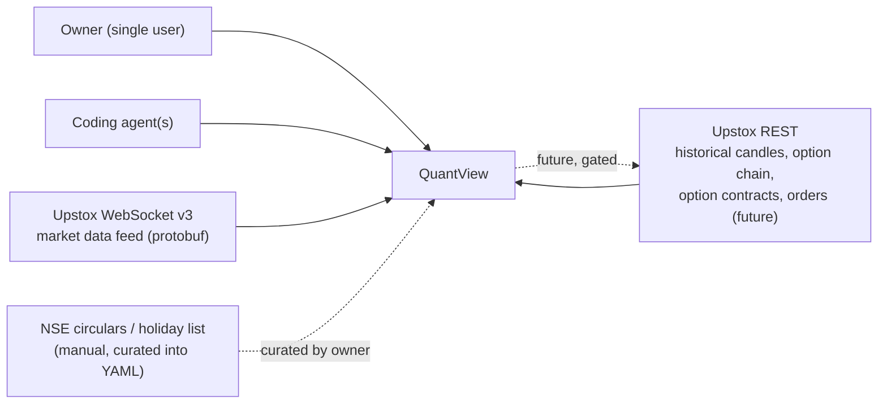
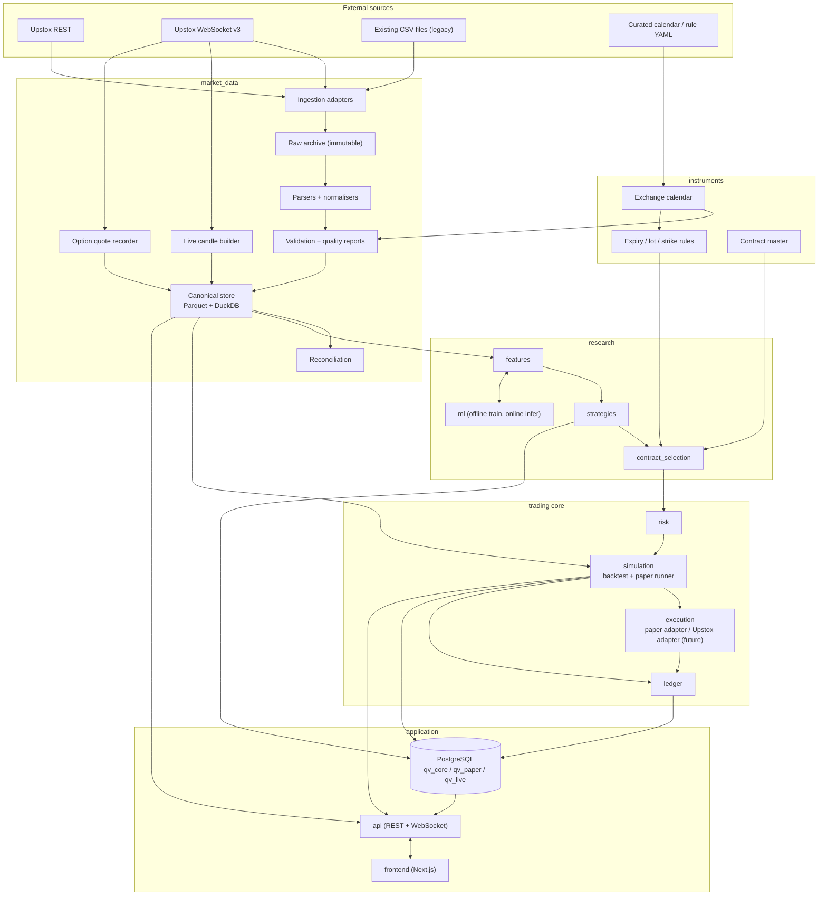
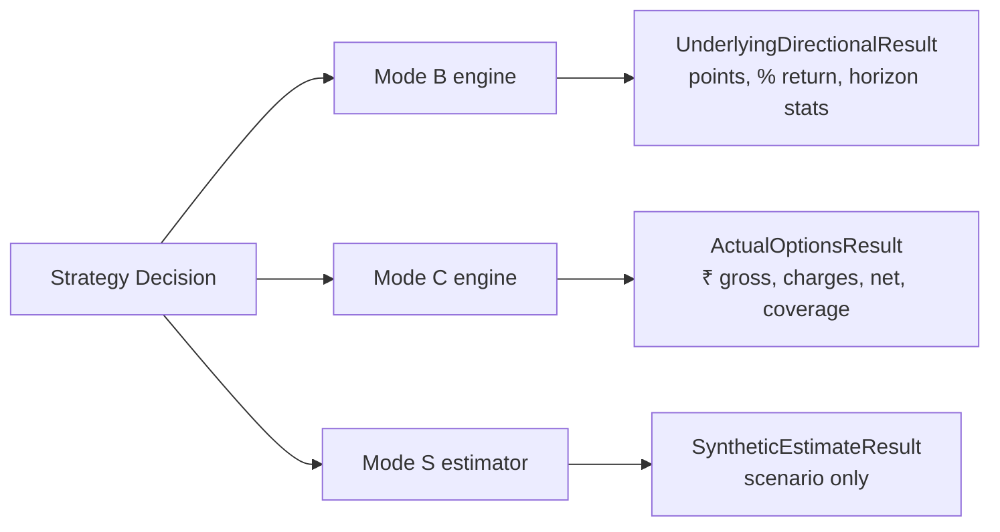
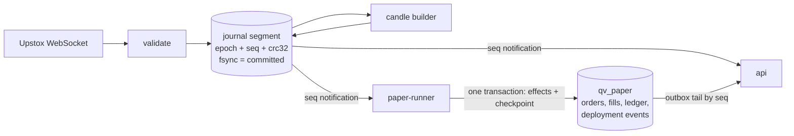

# QuantView — High-Level Design (HLD)

| Field | Value |
|---|---|
| Document | `DOCS/final/HIGH_LEVEL_DESIGN.md` (**Tier 2 · System Contract** in the `DOCS/final/` hierarchy) |
| Document ID & Version | `QV-HLD-001` · **`v1.4 (Hardened Implementation Baseline)`** |
| Release Date | **`2026-10-12`** (Evidence baseline `2026-10-09`; `v1.1` amendments `2026-10-10`; `v1.2/v1.3` reconciliation `2026-10-11`; `v1.4` hardening & implementation gate baseline `2026-10-12`) |
| Tier 1 Authority | Owner-Approved Architecture Decisions in [ADR_REGISTER.md](ADR_REGISTER.md) (`status = OWNER_APPROVED`) |
| Tier 3 Build Contract | [LOW_LEVEL_DESIGN.md](LOW_LEVEL_DESIGN.md) (Exact schemas, formulas, algorithms, state machines, APIs, tickets, test IDs) |
| Tier 4 Specialized Contracts | [CHARTING_UX.md](CHARTING_UX.md) · [BACKTESTING_REPORT_SPEC.md](BACKTESTING_REPORT_SPEC.md) · [OPTIONS_CHAIN_UI.md](OPTIONS_CHAIN_UI.md) · [PAPER_TRADING_UI.md](PAPER_TRADING_UI.md) (Strictly subordinate to HLD and LLD) |
| Cross-Cutting Control Documents | [SOURCE_OF_TRUTH_INDEX.md](SOURCE_OF_TRUTH_INDEX.md) · [TRACEABILITY_MATRIX.md](TRACEABILITY_MATRIX.md) · [RECONCILIATION_AND_CHANGE_LOG.md](RECONCILIATION_AND_CHANGE_LOG.md) · [UNRESOLVED_DECISIONS_REGISTER.md](UNRESOLVED_DECISIONS_REGISTER.md) · [VALIDATION_REPORT.md](VALIDATION_REPORT.md) |
| Implementation Status | **`DESIGNED` only.** Nothing in this document is `IMPLEMENTED`, `TESTED`, or `VERIFIED` yet (see `P12` and LLD App. C). Phase 0 readiness: **GO**; Phase 1 deterministic vertical slice: **GO**; Full implementation: **CONDITIONAL GO** (gated phase-by-phase on executed evidence); Live execution: **NO-GO** until Phase 0–7 evidence and Phase 9 approval exist. |
| Audience | Project owner, coding agents, reviewers |
| Primary market | NSE index derivatives, starting with NIFTY 50 and NIFTY weekly/monthly options |
| Initial scope | Research, historical backtesting, isolated and combined-portfolio live paper trading, manual paper trading |
| Future scope | Controlled live execution through Upstox (gated, Phase 9, three-lock arming) |

## Revision history
| Version | Date | Change | Rationale |
|---|---|---|---|
| 1.0 | 2026-10-09 | Initial baseline | — |
| 1.1 | 2026-10-10 | **Layered risk model and account-size independence** (`P13`, `ADR-018`, LLD §8.6) | Owner wants any account size (₹20k … ₹20 lakh) and per-strategy risk. v1.0's ₹5 lakh profile with a 10% outlay cap would have rejected almost every ATM weekly on a ₹20k account. |
| 1.1 | 2026-10-10 | **`duration_profile` INTRADAY / OVERNIGHT** with overnight Mode B and Mode C rules (`ADR-019`) | Owner trades BTST-style (enter near the close, exit next open). v1.0 hard-coded "no overnight positions" in six places. |
| 1.1 | 2026-10-10 | **Futures are recorded as data only**; WebSocket recorder also pins held contracts and records depth (`ADR-021`, `ADR-022`) | Index volume is unusable; irreplaceable data; held contracts must never fall out of the live subscription. |
| 1.1 | 2026-10-10 | **ML scope widened to roles** (general, strategy meta/gated, regime, pattern, overnight) with a label registry and a holdout lifecycle (`ADR-023`, `ADR-015`) | Owner wants to explore many models, including strategy-specific ones. |
| 1.1 | 2026-10-10 | **Pine porting protocol** (`ADR-024`) and **`ml` moved above `simulation` in the layer stack** (`ADR-025`) | Pine ports are the owner's main strategy source; v1.0's layering forbade ML from calling the Mode B engine it needs. |
| 1.1 | 2026-10-10 | Option snapshots collect nearest **and next** weekly expiry (LLD §4.9.3) | Overnight and roll-over strategies need the next expiry; costs ≈ 60 extra calls per 30 min. |
| 1.2 | 2026-10-11 | **Durable event delivery** (`P14`, `ADR-027`, LLD §2.3), **Paper/live 3-DB isolation** (`P15`, `ADR-026`), **Option risk quantification** (`ADR-032`), **Manual paper accounts** (`ADR-028`), **Deployment state machine & visualization** (`ADR-029`, `ADR-035`, `P17`), **Live option chain** (`ADR-030`), **Chart replay** (`ADR-033`), **Metric inspector** (`ADR-031`, `P16`), **Coverage matrix & WS fills** (`ADR-034`, `ADR-036`), **Status vocabulary** (`ADR-037`) | Operational hardening, durability, inspectability, and honest data/execution boundaries. |
| 1.3 | 2026-10-11 | **Reconciled Baseline & Audit Pass (`Q1–Q6`):** Allocation modes `ISOLATED` vs `PORTFOLIO` multi-strategy execution (`P18`, `ADR-038`), `RK-25` conflict policies (`ALLOW_CONCURRENT` default), deployment-scoped positions `(account_id, owner_scope_id, instrument_id)`, Three-Lock Live Arming & `CREDENTIAL_LEAK` guard (`ADR-026`), multiple named manual accounts + archival + `MARKET`-only v1 (`ADR-028`, `ADR-039` `DEFERRED`), calendar-relative expiry cutoffs & `EXPIRY_UNRESOLVED` retention, `STARTING` + `ERROR` Position Guardian + `auto_resume = false` default (`ADR-029`), strictly optional ML rule (`ADR-040`), canonical UTC chart timestamp contract (`ADR-041`), and 4-tier document authority rules | Reconciles Person 2 baseline with Person 1 review, owner rulings `Q1–Q6`, and the pre-implementation documentation audit. |
| 1.4 | 2026-10-12 | **Documentation Hardening & Implementation Gate Baseline:** Canonical vocabulary for all operating modes (`RESEARCH`, `UNDERLYING_DIRECTIONAL`, `ACTUAL_OPTIONS`, `SYNTHETIC_OPTIONS_ESTIMATE`, `MANUAL_PAPER`, `STRATEGY_PAPER`, `LIVE`) and allocation modes (`ISOLATED`, `PORTFOLIO`); causal live availability (`available_at = finalized_at = bar_end + grace_period`) vs historical assumed availability (`HISTORICAL_ASSUMED_AVAILABILITY`); `RK-06` (`HARD_ORDER_FREEZE_LIMIT`) vs `RK-26` (`ADVISORY_ORDER_LOT_CEILING`) split; Phase 7 paper acceptance gate (`GATE-04`, $\ge 10$ paper sessions, paper evaluation only, NOT live authorized) vs Phase 9 live readiness gate (`GATE-05`, $\ge 30$ paper sessions, $\le 1\text{ paise}$ contract note fee reconciliation per transaction and aggregate level); `ADR-039` LIMIT-order deferral mapping fix; deterministic Phase-1 vertical slice | Establishes unambiguous, mathematically and structurally verified baseline for Phase 0 start and Phase 1 build. |

## Document Hierarchy and Conflict Resolution Rules (Mandatory)

Coding agents must never treat the twelve files in `DOCS/final/` as twelve independent sources of truth. `DOCS/final/` is the **only active specification set** (`DOCS/person_1/` and `DOCS/person_2/` are immutable historical review inputs). All work is governed by this four-tier hierarchy:

1. **Tier 1 · Authority — Owner-Approved Architecture Decisions ([`ADR_REGISTER.md`](ADR_REGISTER.md)):** Settles explicit architectural choices. An ADR holds Tier 1 authority **only when its status is `OWNER_APPROVED`**. Once `OWNER_APPROVED`, a decision cannot be silently reversed by any lower-tier document.
2. **Tier 2 · System Contract — `HIGH_LEVEL_DESIGN.md` (this document):** Defines system scope, principles, operating modes, boundaries, architecture, and phase gates (*what the system is and why*).
3. **Tier 3 · Build Contract — [`LOW_LEVEL_DESIGN.md`](LOW_LEVEL_DESIGN.md):** Defines schemas, algorithms, formulas, module boundaries, API contracts, implementation tickets, and test requirements (*exactly how to build it*).
4. **Tier 4 · Specialized Contracts — [`CHARTING_UX.md`](CHARTING_UX.md), [`BACKTESTING_REPORT_SPEC.md`](BACKTESTING_REPORT_SPEC.md), [`OPTIONS_CHAIN_UI.md`](OPTIONS_CHAIN_UI.md), [`PAPER_TRADING_UI.md`](PAPER_TRADING_UI.md):** Define detailed screen and interaction behavior. They may refine `LOW_LEVEL_DESIGN.md` but must never contradict `HIGH_LEVEL_DESIGN.md`, `LOW_LEVEL_DESIGN.md`, or an `OWNER_APPROVED` ADR.
5. **Cross-Cutting Control Documents — [`SOURCE_OF_TRUTH_INDEX.md`](SOURCE_OF_TRUTH_INDEX.md), [`TRACEABILITY_MATRIX.md`](TRACEABILITY_MATRIX.md), [`RECONCILIATION_AND_CHANGE_LOG.md`](RECONCILIATION_AND_CHANGE_LOG.md), [`UNRESOLVED_DECISIONS_REGISTER.md`](UNRESOLVED_DECISIONS_REGISTER.md), [`VALIDATION_REPORT.md`](VALIDATION_REPORT.md):** Track requirements, document conflicts, identify what remains undecided, and record validation evidence. These are governance controls, not alternative architecture specifications.

**Six Mandatory Rules for Conflicts:**
1. A newly approved owner decision must be recorded in an ADR (`status = OWNER_APPROVED`) and applied to all affected documents.
2. HLD defines system-level intent; LLD defines implementation details.
3. A specialized specification (`Tier 4`) cannot silently override either the HLD or LLD.
4. The reconciliation log records changes; it does not independently override an approved decision.
5. The validation report records evidence; a `PASS` or `DESIGN_REVIEW_PASS` in that report is not a substitute for the underlying executed test evidence.
6. If an unresolved decision or `[VERIFY]` item affects a ticket, **that ticket is blocked** until the item is resolved with recorded evidence or explicitly scoped out.

---

# 1. Purpose, scope and non-goals

## 1.1 Purpose
QuantView is a TradingView-inspired research and trading platform with a quantitative engine behind it. One platform must let the owner:

1. See validated historical and live NIFTY charts, indicators and option-chain data.
2. Author strategies (declarative spec first, Python second) and see their signals on the chart.
3. Run causally correct backtests that never see the future and never invent option prices.
4. Paper trade multiple strategies concurrently against live market data — both in **isolated strategy accounts (`allocation_mode = 'ISOLATED'`)** for uncontaminated individual evaluation and in **combined portfolios (`allocation_mode = 'PORTFOLIO'`)** under shared capital and portfolio risk controls — with a real order lifecycle, ledger, charges, risk gates, and side-by-side comparison.
5. Optionally train and deploy ML signal/filter models (`Phase 8`, `ADR-040`) **only after** they beat simple baselines out of sample. **ML is strictly optional:** any strategy without ML (`ml_role: null`) must execute independently across backtest, paper, and live without `quantview.ml` loaded.
6. Eventually route approved orders to Upstox, behind separate three-lock safeguards.
7. Take **manual paper trades** (`MARKET` orders in v1) at any time in named manual paper accounts that are independent of every strategy and portfolio (v1.2/v1.3).
8. **Inspect everything**: replay history without seeing the future, see exactly why each marker exists, toggle a deployed strategy's markers and indicators on the chart, and click any metric to see its formula, inputs and trades (v1.2/v1.3).


## 1.2 Non-goals (v1)
- Reproducing every TradingView feature (drawing tools, social features) and executing Pine Script natively. Pine strategies and indicators are *ported* to specs or trusted Python under the protocol in LLD §6.9.
- Multi-leg option structures, option selling, margin-based strategies, and *trading* futures. NIFTY futures are **recorded as data only** (ADR-021).
- Any instrument other than NIFTY 50 index and NIFTY weekly/monthly options.
- Microservices, message brokers, Kubernetes, a time-series database (see §11 trigger table).
- LLMs in the market-data-to-order path.
- Guaranteeing profit. The platform's job is to avoid fooling the owner, not to promise returns.
- Guaranteeing full-chain real-time coverage (live breadth is bounded by the WebSocket subscription cap) or simulating queue position for resting limit orders (v1 manual and paper orders are `MARKET`-only; `LIMIT` is deferred per ADR-028 and LLD §8.7.3).

## 1.3 Success definition
The first proof is deliberately small and must pass before anything else is built:

> validated NIFTY 1m candles → chart in browser → one tested indicator → one deterministic strategy signal → leakage-safe directional backtest → visual report with assumptions.

Final success is the full chain: data → features → strategy → backtest → isolated & combined-portfolio paper trade → ledger → report, with every number traceable to source records.

---

# 2. Non-negotiable principles (system invariants)

| ID | Invariant | Enforced by |
|---|---|---|
| P1 | **No look-ahead.** A decision at time `t` may use only records with `available_at <= t`. | As-of join API; truncate-and-recompute test (LLD §5.1.7); simulation clock |
| P2 | **No invented option prices.** Actual-options P&L uses only observed bid/ask from stored snapshots or recorded quotes. LTP is never an executable price (it feeds display, features and labelled marks only). Synthetic premiums never enter fills, ledger or the headline metric. | `ResultKind` type separation; fill-model whitelist per mode (LLD §8) |
| P3 | **Result kinds are never mixed.** `UNDERLYING_DIRECTIONAL`, `ACTUAL_OPTIONS`, `SYNTHETIC_ESTIMATE`, `PAPER`, `LIVE` are distinct types with distinct fields. | Pydantic discriminated unions; DB check constraints |
| P4 | **One strategy contract, many environments.** Backtest, paper and live consume the same `Decision` objects through the same risk and order lifecycle. Only the clock, data feed and fill source differ. *[v1.2]* Manual orders enter the same order lifecycle as a `ManualOrderRequest` (origin `MANUAL`), never as a `Decision`. | `Engine` composition (LLD §8.1) |
| P5 | **Raw data is immutable.** Originals are never overwritten, repaired or deleted. Normalised and derived data is versioned and reproducible from raw. | Read-only raw directory; checksums; migration rules (LLD §4.1) |
| P6 | **Missing is not zero.** Absent values are null with a reason code. Missing snapshots are never interpolated or forward-filled for execution. | Canonical schemas with nullable fields; DQ rules (LLD §4.4) |
| P7 | **Explicit time semantics.** Every record carries separate `bar_start`, `bar_end`, `source_ts`, `ingested_at`, `available_at` as applicable. A bare `timestamp` is not allowed in canonical data. | Schema validators; lint test |
| P8 | **Fail safe.** Stale data, missing features, feed loss, unknown broker state or breached limits block new orders. | Risk engine + strategy health gate (LLD §8.6) |
| P9 | **Reproducible runs.** Every backtest persists data version, strategy hash, parameters, cost model, fill model, engine version and seed. | `RunManifest` (LLD §8.9) |
| P10 | **Money is exact.** Cash, fees, fills and ledger use integer paise. Floats are for indicators only. | `Paise` type; ruff rule; unit tests |
| P11 | **Boundaries are mechanical.** Module boundaries are enforced by import-linter in CI, not by convention. | LLD §1.3 |
| P12 | **Evidence before claims.** No gate is "passed" without a recorded artifact (report, test output, checksum). Every capability carries exactly one status: `DESIGNED` (spec text exists), `IMPLEMENTED` (code merged), `TESTED` (named tests pass, output attached) or `VERIFIED` (gate artifact reviewed by the owner). A document never upgrades a status. | Completion report (LLD §17.3), feature register (LLD App. C) |
| P13 | **Risk is layered; strategies tighten, owners loosen.** Hard safety rules are never overridable. Account and portfolio ceilings are owner policy. A strategy or deployment allocation may declare its own risk only at or below the ceilings. Relaxing ceilings is possible only in an explicitly labelled research run, or by the owner publishing a new versioned profile. | Risk engine rule classes (`HARD`, `CEILING`, `PERMISSION`), 3-tier sizing/clamping, and `RESEARCH_RELAXED` labelling (LLD §8.6) |
| P14 | **Durable before visible.** An event is acted on only after it is committed to durable storage. Delivery is at-least-once with idempotent consumers that resume from checkpoints committed in the same transaction as their effects; a sequence gap or a stale feed blocks new entries. | Journal, outbox and checkpoints (LLD §2.3); fault-injection suite (`T-EVT-*`) |
| P15 | **Accounts and ownership scopes are isolated.** Every order, fill, position and ledger event carries `mode`, `account_kind`, `origin`, and ownership scope (`deployment_id` or `MANUAL`), validated by database constraints. Paper processes hold no order-capable credential and cannot reach the live database. | Separate databases (`qv_core`, `qv_paper`, `qv_live`) and roles; composite foreign keys; endpoint allow-list (LLD §9.5, §10.5) |
| P16 | **Every number is inspectable.** Each displayed metric, marker and indicator resolves to a backend-supplied definition, inputs and source records. The frontend never computes authoritative values. | Metric registry, chart-event and feature-explain contracts (LLD §8.10.5, §6.6, §5.1.9) |
| P17 | **Visualization never controls.** Showing, hiding or filtering markers, levels and indicators reads persisted history and cannot start, stop, pause or alter a deployment, portfolio, order or account. | Read-only visualization endpoints and database role split (LLD §8.8.5) |
| P18 | **Portfolio and attribution honesty.** Isolated strategy evaluation (allocation mode `ISOLATED`) and combined portfolio evaluation (allocation mode `PORTFOLIO`) are distinct workflows. A comparison view never sums the P&L of isolated strategy accounts and labels it the P&L of an executable combined portfolio. Strategy-attributed results and account-level financial results are explicitly distinguished, and any analytical allocation denominator is labelled as an analytical convention. | `Portfolio` model, deployment-scoped positions, attribution contract (ADR-038, LLD §8.8.6, §8.10.6) |

---

# 3. Context and constraints

## 3.1 Actors and external systems


## 3.2 Hard constraints (verified facts, `[VERIFY]` blockers, and owner decisions)

> **Rule on External Broker, Tax, and Exchange Facts (`[VERIFY]` Hard Blockers):** External rate limits, subscription caps, lot sizes, expiry schedules, and statutory charge schedules (`C2`–`C6`) must never be treated as permanently settled constants inside code. Each item tagged `[VERIFY]` requires a primary-source URL/circular reference and an effective date in configuration (`config/broker_limits.yaml`, `config/market_calendar.yaml`, `config/cost_schedule.yaml`), and acts as a **hard blocker (`UNVERIFIED_BLOCKER`)** for its dependent implementation ticket until verified against a live session or official circular/contract note.

| # | Constraint | Verification & Blocker Status | Consequence |
|---|---|---|---|
| C1 | Owner has **no Upstox Plus**. The expired-instrument historical candle API is unavailable. | `OWNER_CONFIRMED` | Historical option prices exist only in the owner's own snapshots (from 2026-01-20). Actual-options backtests are limited to that window. Alternatives (licensed data) are a separate decision, not assumed. |
| C2 | Option-chain REST accepts one underlying and one expiry per call, and calling faster than about every 30 s triggers server errors. | `[VERIFY: G0.7 / T0.6]` — Re-verify against Upstox v2 `/option/chain` docs and 10-session collector logs | 30 s is a provider-imposed snapshot floor; finer option data must come from the WebSocket feed. |
| C3 | Standard Upstox APIs: 50 req/s, 500/min, 2000/30 min. Order APIs for non-registered algos: 10 req/s. | `[VERIFY: G0.12 / T0.11]` — Record primary Upstox rate-limit documentation URL and effective date in `config/broker_limits.yaml` | Rate limiter is a mandatory component (LLD §4.9). |
| C4 | WebSocket v3: 2 connections per non-Plus user; modes `ltpc`, `full` (5-level depth + greeks), `option_greeks`; `full_d30` is Plus-only. | `[VERIFY: G0.8 / T0.7]` — Measure and record actual connection/instrument cap in `ws_budget.json` | Quote recorder uses `full` for ≈ 45 instruments on one connection; limits re-verified in Phase 0 and stored in config. |
| C5 | NIFTY weekly expiry is Tuesday for contracts expiring on or after 2025-09-02; earlier Thursday. Lot size is 65 for expiries from 2026-01-06; 75 before (back to Nov 2024). | `[VERIFY: G0.1 / T0.1]` — Record NSE circular numbers and effective dates in `config/market_calendar.yaml` (`S1` blocker before `T1.2`) | Expiry, lot size and strike step are effective-dated reference data (LLD §3). |
| C6 | Options STT on premium sold: 0.0625% → 0.10% (2024-10-01) → 0.15% (2026-04-01). Brokerage on Upstox options: flat ₹20 per executed order. | `[VERIFY: G7.3 / T6.2]` — Verify against Finance Act / NSE circular and 5 real owner Upstox contract notes (`S2` blocker before `T6.2`) | Cost model is effective-dated and verified against owner contract notes (LLD §8.5). |
| C7 | Owner develops on Windows (repo `C:\Algo\quantview`); collector currently started manually; `Data/` is git-ignored. | `OWNER_CONFIRMED` | Collector automation, backups and path-agnostic code are Phase 0 work. Case-sensitivity and path rules in LLD §1.2. |
| C8 | Solo developer with coding agents. | `OWNER_CONFIRMED` | Fewer moving parts: Parquet + DuckDB for market data, one Postgres for state, one repo, one deployable. |
| C9 | The owner trades by **buying** NIFTY CE/PE, intraday and overnight (BTST-style: buy near the close, sell the next morning). | `OWNER_CONFIRMED` (`ADR-011`, `ADR-019`) | v1 supports single-leg long options only, with `duration_profile` INTRADAY or OVERNIGHT (ADR-019). Short options and spreads are out of scope. |
| C10 | The WebSocket `full` subscription cap (≈ 45 instruments on one connection, verified in Phase 0) bounds how many strikes can update live. The REST option chain refreshes about every 30 s for every strike. | `[VERIFY: G0.8 / G7.7]` | The live chain shows per-field source and age; strikes outside the subscribed band are labelled `SNAPSHOT ONLY` and are never presented as live (ADR-030, LLD §4.15). Full-chain real-time coverage is not promised. |

## 3.3 Current data reality (audit baseline)
Facts below come from `data_status.md` (2026-10-09) and the repository audit. Items marked ⚠ are unresolved and are Phase 0 tasks, not assumptions.

| Dataset | Evidence | Confidence |
|---|---|---|
| NIFTY 1m candles, 2022-01-03 → 2026-10-08, IST-aware timestamps, bar-open labelled (first 09:15, last 15:29) | Report + file samples | High on range; ⚠ row count: report 451,952 vs direct count 432,967 (432,967 ÷ 375 ≈ 1,154.6 sessions, consistent with 3m/5m/15m ≈ 1,156 sessions; the report's count is the outlier) |
| 3m, 5m, 15m (≈ 1,156 sessions), 1h and 4h (1,176 sessions each), 1d from 2021-02-01 (1,410 rows) | Row counts ÷ bars per session | ⚠ Session counts differ across timeframes by ≈ 20; cause unknown until the calendar-driven audit runs |
| 1m gaps: ≈ 15 days (Feb–Mar 2026) missing the 15:29 bar; 2026-02-12 missing 96 bars; 2026-02-16 missing 72; 2026-02-23 missing 57; 2026-02-21 is a Saturday with a single row | Report | Treat as *candidate* gaps until calendar-checked |
| Option-chain snapshots, 71,617 over 110 trading days from 2026-01-20; ≈ 651/day vs 750 expected at 30 s | Report | Counts depend on the audit parser; ⚠ three expiry folders (`2026-02-3`, `2026-03-2`, `2026-04-7`) are not zero-padded and appear to be missing from the report's expiry list |
| Three schemas: v1 (from 2026-01-20: ltp, oi, prev_oi, volume, bid, ask), v2 (from 2026-01-23: **no ltp**), v3 (from 2026-02-12: spot, bid/ask qty, chng, chng_oi, iv, delta, gamma, theta, vega) | Report | High |
| Option snapshot timestamps are timezone-naive | Repository audit | ⚠ Timezone resolved by the deterministic test in LLD §4.3 |
| Some Greeks recorded as 0 | Repository audit | Zero-sentinel rule in LLD §4.5 |
| Snapshot storage: one CSV file per snapshot under `Data/live/option_chain/nifty/<expiry>/<date>/snapshots/HH-MM-SS.csv` (≈ 71k files and growing) | Screenshots | High; compaction required |
| Only the nearest weekly expiry is collected | Folder structure | High; limits roll-over strategies |
| Collector start is manual; many sessions start late (09:30–10:50) and show gaps of 5–25 minutes | Report | Automation is Phase 0 |

**Consequence for research tracks** (carried into every result label):

| Track (Canonical Result Kind) | Legacy Alias | Data window | Allowed claims |
|---|---|---|---|
| `UNDERLYING_DIRECTIONAL` | Mode B | 2022-01-03 → today (≈ 4.8 years) | Direction/point statistics on NIFTY 50 index. Never rupee option P&L. |
| `ACTUAL_OPTIONS` | Mode C | 2026-01-20 → today (~8.5 months), with Greeks only from 2026-02-12 | Option P&L with explicit coverage, using observed bid/ask snapshots. Statistical power is limited; reports must show effective sample size (days, trades). |
| `SYNTHETIC_OPTIONS_ESTIMATE` | Mode S | Any | Labelled scenario analysis only. Must be calibrated against `ACTUAL_OPTIONS` on the overlap window and show calibration error (`LLD §8.12`). |

---

# 4. Operating modes and allocation modes

### 4.1 Canonical operating modes (§2.1)

| Canonical Operating Mode | Legacy Alias | Phase Arrival (Aligned with §10, §14, LLD §17.2) | Data source | Fill source | Authoritative Output Kind | Orders leave machine? |
|---|---|---|---|---|---|---|
| `RESEARCH` | Mode A | Phase 1 (historical `/chart`), Phase 2 (live + `/research/chain`), Phase 3 (indicators + `CHART_REPLAY`) | Historical + live | None | None | No |
| `UNDERLYING_DIRECTIONAL` | Mode B | Phase 5 (`T5.1–T5.4`, `/backtests`) | NIFTY candles | Simulated on spot (next bar open) | `UNDERLYING_DIRECTIONAL` (points, R-multiples, % return) | No |
| `ACTUAL_OPTIONS` | Mode C | Phase 6 (`T6.1–T6.5`, `/backtests`) | NIFTY candles + option snapshots/quotes | Simulated on observed bid/ask | `ACTUAL_OPTIONS` (₹, net of itemized statutory charges) | No |
| `SYNTHETIC_OPTIONS_ESTIMATE` | Mode S | Phase 6 (`T6.5`, `/backtests` calibrated against actual options) | NIFTY candles + pricing model | Black-76 model price | `SYNTHETIC_OPTIONS_ESTIMATE` (permanently labelled estimate) | No |
| `MANUAL_PAPER` | Mode D (manual) | Phase 7 (`T7.4`, `T-MAN-*`, `/paper/manual`) | Live feed | Simulated on live quotes | `MANUAL_PAPER` (discretionary simulated trades) | No |
| `STRATEGY_PAPER` | Mode D (strategy) | Phase 7 (`T7.1–T7.16`, `/paper`) | Live feed | Simulated on live quotes | `STRATEGY_PAPER` (strategy simulated trades) | No (adapter has no broker import) |
| `LIVE` | Mode E | Phase 9 (`T9.1`, gated on Phase 7 evidence + Three-Lock Live Arming) | Live feed | Broker-reported | `LIVE` | Yes — disabled by default; Phase 9 gate + three-lock arming required |

### 4.2 Orthogonal allocation modes and legacy alias migration (§2.1)
Allocation is strictly separate from operating mode:
- `ISOLATED`: Each strategy deployment has an independent paper account. Exactly one active deployment per isolated account (enforced via partial unique index).
- `PORTFOLIO`: Deployments participate in a defined combined portfolio (`portfolios` table) with shared capital and portfolio-level risk controls (`RK-25`), defaulting to conflict policy `ALLOW_CONCURRENT`.

**Legacy Alias Mapping (for backward compatibility and migration):**
| Legacy Reference | Canonical Concept & Field Value | Domain Concept | Migration Rule |
|---|---|---|---|
| "Mode A backtest/research" | `operating_mode: RESEARCH` | Operating Mode | Deprecated; use `RESEARCH` |
| "Mode B backtest" | `operating_mode: UNDERLYING_DIRECTIONAL` | Operating Mode | Deprecated; use `UNDERLYING_DIRECTIONAL` |
| "Mode C backtest" | `operating_mode: ACTUAL_OPTIONS` | Operating Mode | Deprecated; use `ACTUAL_OPTIONS` |
| "Mode S backtest" | `operating_mode: SYNTHETIC_OPTIONS_ESTIMATE` | Operating Mode | Deprecated; use `SYNTHETIC_OPTIONS_ESTIMATE` |
| "Mode D paper" | `operating_mode: STRATEGY_PAPER` or `MANUAL_PAPER` | Operating Mode | Deprecated; split by order origin |
| "Mode E live" | `operating_mode: LIVE` | Operating Mode | Deprecated; use `LIVE` |
| "Mode A allocation" | `allocation_mode: ISOLATED` | Allocation Mode | Deprecated; use `ISOLATED` |
| "Mode B allocation" | `allocation_mode: PORTFOLIO` | Allocation Mode | Deprecated; use `PORTFOLIO` |

The operating mode, account kind (`BACKTEST`, `PAPER_STRATEGY`, `PAPER_MANUAL`, `LIVE`), allocation mode (`ISOLATED`, `PORTFOLIO`, `MANUAL`), order origin (`STRATEGY` or `MANUAL`), and ownership scope (`deployment_id` or `MANUAL`) are stored on every run, order, fill, position and ledger event and displayed in UI headers. Paper and live use separate processes, credentials, and **databases** (`ADR-026`). Manual, isolated-strategy, and combined-portfolio paper trading use separate accounts, ledgers, and P&L (`ADR-028`, `ADR-038`) while sharing the same order state machine, fill models, and market-data services (§5.6). Every operating mode works with pure rule/indicator strategies (`ml_role: null`) without requiring the Phase 8 ML layer (`ADR-040`).

**Duration (v1.1).** Every strategy declares `duration_profile ∈ {INTRADAY, OVERNIGHT}`. INTRADAY positions are flattened at `force_flat_time`. OVERNIGHT positions are carried across sessions. `UNDERLYING_DIRECTIONAL` evaluation can evaluate overnight strategies over the full 2022→today candle history because it needs only index candles (entry near the close, exit at the next session's open bar). `ACTUAL_OPTIONS` evaluation can evaluate overnight strategies only where option snapshots cover the next morning's open; coverage is reported and unresolved exits are never invented (`LLD §8.4.7`).

---

# 5. System architecture

## 5.1 Logical view


## 5.2 Runtime processes (one repository, several entry points)

| Process | Entry point | Runs when | Writes to | Notes |
|---|---|---|---|---|
| `collector-snapshots` | `python -m quantview.apps.collect_snapshots` | Scheduled 09:00 IST, trading days | `data/raw/option_chain_api`, canonical Parquet | Replaces the manual collector; heartbeat file; auto-restart |
| `collector-live` | `python -m quantview.apps.collect_live` | Scheduled 09:00 IST | Ticks, durable journal segments, live candles, option quotes, near-month futures quotes and candles (Parquet) | One WebSocket connection; candle builder + quote recorder in one process |
| `eod-jobs` | `python -m quantview.apps.eod` | 16:30 IST | Historical candle fetch, reconciliation, compaction, backup | Idempotent; safe to rerun |
| `api` | `uvicorn quantview.api.main:app` | Always on | `qv_core` (strategies, runs, profiles, viz_preferences), `qv_paper.order_requests` (insert only); reads `qv_paper` and Parquet | Serves REST + WebSocket to UI; never writes directly to `orders`, `fills`, or `ledger_events` in `qv_paper` |
| `paper-runner` | `python -m quantview.apps.paper_runner` | Always on during sessions (sole writer per `qv_paper` database) | `qv_paper` (accounts, portfolios, deployments, orders, fills, ledger, positions, checkpoints); reads the journal and `qv_core` via read-only connection pool | Sole writer for all paper accounts (isolated strategy, combined portfolio, and manual); never imports a broker SDK; holds no order-capable credential |
| `backtest-worker` | In-process task or `python -m quantview.apps.backtest` | On demand | `qv_core` (runs), Parquet (result artifacts) | CPU-bound; separate process to keep the API responsive |
| `frontend` | `next start` | Always on | — | Talks only to `api` |

Processes communicate through (a) files/Parquet partitions, (b) the **durable event journal** written by `collector-live` for market and health streams (LLD §2.3.1), and (c) Postgres tables in `qv_paper`, which are the transactional outbox for trading events (`order_events`, `ledger_events`, `deployment_events`, `decisions`; LLD §9.5). No external message broker is used in v1. The local socket carries only low-latency *notifications* of events that are already committed; a consumer that misses or doubts a notification reads the journal from its checkpoint. If `paper-runner`'s heartbeat is older than 15 s, `api` refuses new manual commands with `503 RUNNER_UNAVAILABLE` rather than queueing indefinitely (LLD §8.8.3). A single-process dev mode uses the same interfaces with an in-memory journal.

## 5.3 Dependency layers (enforced)
```
L7  api, apps                       (entry points and composition roots; may import anything below)
L6+ ml                              (datasets, labels, training, evaluation, predictor; may import simulation)  [v1.1]
L6  simulation                      (engine, paper runner, deployment & portfolio managers, fill/cost models, metrics)
L5  execution                       (order interfaces; paper adapter; future upstox adapter)
L4  risk, ledger                    (independent; no import of each other)
L3  research (features, strategies, contract_selection)
L2  market_data
L1  instruments
L0  shared                          (ids, time, money, events, journal, http gateway, errors, config)
```
Rules: a package may import only from lower layers; `simulation`, `research` and `risk` never import `ml` — a trained model reaches the feature engine only through the `ExternalFeatureProvider` protocol (defined in `research.features`, implemented by `ml.predictor`, registered by `apps` at start-up) [v1.1, ADR-025]; `execution.upstox` may be imported only by `apps` and `api`; `research` and `simulation` must never import `upstox_client` or `execution.upstox`; `ledger` never imports `execution`; the frontend never contains trading or accounting logic.

## 5.4 Core data flows

### Historical path (research)
`CSV/API → raw archive → parser(version) → canonical rows + DQ flags → Parquet → DuckDB view → features (as-of) → strategy → simulation → report`

### Live path (paper)
`WebSocket tick → validate → journal commit (fsync) → candle builder → provisional (ephemeral) / final (journaled) candle events → incremental features → strategy runner (per active deployment) → contract selection → 3-tier risk (strategy + deployment allocation + account/portfolio ceiling) → paper adapter (fill on live quote) → ledger (account + deployment scope) → UI outbox events`
After the session: `historical candle fetch → reconcile with live-built candles → revision records` (decisions already made are never rewritten).

### Backtest path
`RunConfig → DataProvider (as-of) → Clock → features → strategy → selection → risk → fill model → ledger → metrics → RunManifest + artifacts`

## 5.5 Result-kind separation (type-level)

`RunSummary` is a discriminated union on `result_kind`. The API and UI never sum or compare headline metrics across kinds.

## 5.6 Account, deployment, and portfolio model and isolation [v1.2]

### 5.6.1 Seven core domain concepts (ADR-028, ADR-029, ADR-038)
These concepts are distinct domain and database entities and are never collapsed:
1. **Paper-trading environment:** The overall `PAPER` runtime environment (`paper-runner` process, `qv_paper` database, `OPT_LIVE_BIDASK` fill model, live journal streams, zero broker credentials).
2. **Paper account (`accounts`):** A logical account in `qv_paper` with independent `starting_equity_paise`, `account_kind` (`PAPER_STRATEGY` or `PAPER_MANUAL`), `allocation_mode` (`ISOLATED`, `PORTFOLIO`, or `MANUAL`), `status` (`ACTIVE` or `ARCHIVED`), `risk_profile_ref`, double-entry ledger, cash balance, orders, fills, positions, charges, realized/unrealized P&L, and history. Multiple accounts of each kind may coexist (governed by configurable operational limits, not a hard-coded single-account cap).
3. **Strategy (`strategies`, `strategy_versions`):** An immutable, versioned strategy definition (`spec_hash`, parameters, required `feature_versions`, `duration_profile`, strategy `risk` declaration) stored in `qv_core`.
4. **Strategy deployment (`deployments`):** A specific running instance of a `strategy_version` bound to a `PAPER_STRATEGY` account (and to a `portfolio_id` when `allocation_mode = 'PORTFOLIO'`), with immutable snapshots of its strategy spec, parameters, feature versions, risk configuration, lifecycle state (`CREATED, STARTING, RUNNING, PAUSED_USER, PAUSED_AUTO, DRAINING, STOPPED, ERROR`), and runtime state.
5. **Portfolio (`portfolios`):** An explicitly defined collection of strategy deployments bound to a `PAPER_STRATEGY` account with `allocation_mode = 'PORTFOLIO'`, governed by a defined `capital_allocation_policy` (`FIXED_BUDGET` or `SHARED_POOL`), a cross-deployment `conflict_policy` (default `ALLOW_CONCURRENT`, or `REJECT_OPPOSITE_DIRECTION` / `ONE_POSITION_PER_CONTRACT`), and a portfolio-level risk ceiling profile (`portfolio_risk_profile_ref`).
6. **Execution and accounting ownership:** Every order, fill, charge, adjustment, and ledger event carries `account_id`, `mode`, `account_kind`, `origin` (`STRATEGY` or `MANUAL`), and `owner_scope_id` (`deployment_id` for strategy orders, `'MANUAL'` for manual orders; plus `portfolio_id` when in a portfolio). Open positions in `positions` are keyed by `(account_id, owner_scope_id, instrument_id)` with an account-level aggregate view `account_positions_view(account_id, instrument_id)`. Consequently, stopping, draining, or flattening one deployment operates exclusively on its own `(account_id, deployment_id, instrument_id)` position rows and never closes or alters another deployment's position.
7. **Performance attribution:** Per-deployment gross P&L, exact fill charges, net realized/unrealized P&L, and trade statistics are **exact accounting facts** derived from that deployment's owned orders, fills, and position rows. Account-level and portfolio-level cash, equity, drawdown, and total P&L are **exact financial facts** of the `account_id` ledger. Analytical metrics that require a capital denominator for an individual deployment inside a shared-capital portfolio (e.g., deployment return %, Sharpe, Sortino, and percentage drawdown under `SHARED_POOL` vs. `FIXED_BUDGET`) are explicitly labelled as **analytical attribution conventions** (`attribution_basis`), never presented as interchangeable with account-level financial P&L.

### 5.6.2 Account kinds, allocation modes, and multi-strategy evaluation (`ISOLATED` vs. `PORTFOLIO`)

| Account kind | Allocation mode | Workflow | Created by | Orders originate from | Risk & sizing governance | Ledger & position scope |
|---|---|---|---|---|---|---|
| `BACKTEST` | `ISOLATED` | Historical backtest run (`UNDERLYING_DIRECTIONAL`, `ACTUAL_OPTIONS`, `SYNTHETIC_OPTIONS_ESTIMATE`) | each run | the engine | `ENFORCE` or `RESEARCH_RELAXED` | in memory, discarded with run (artifacts kept) |
| `PAPER_STRATEGY` | `ISOLATED` (**Isolated Strategy Evaluation**) | Single strategy evaluated in isolation on its own paper account | owner | 1 active deployment at a time (`STRATEGY`) | 2-tier `ENFORCE`: `min(strategy, account_profile)` | `qv_paper`, own `account_id`; uncontaminated single-strategy ledger & P&L |
| `PAPER_STRATEGY` | `PORTFOLIO` (**Combined Portfolio Evaluation**) | Multiple strategies deployed concurrently in one combined portfolio account | owner | multiple concurrent deployments (`STRATEGY`) in `portfolio_id` | 3-tier `ENFORCE`: `min(strategy, deployment_allocation, portfolio_account_profile)` + `conflict_policy` (`RK-25`) | `qv_paper`, shared `account_id` cash/ledger with deployment-scoped `positions(account_id, deployment_id, instrument_id)` |
| `PAPER_MANUAL` | `MANUAL` (**Discretionary Manual Paper**) | Multiple named manual accounts (archivable) | owner | manual order ticket (`MANUAL`, `MARKET`-only in v1) | `HARD` safety rules enforced + designated `CEILING` rules evaluated as `ADVISORY` warnings; no strategy sizing | `qv_paper`, own `account_id`, `owner_scope_id = 'MANUAL'` |
| `LIVE` | `ISOLATED` / `PORTFOLIO` | Phase 9 only (gated) | owner (Phase 9) | approved deployments | live profile + adapter hard caps | `qv_live` (separate database) |

**Comparison honesty rule (P18):** A comparison screen comparing isolated strategy runs (`allocation_mode = 'ISOLATED'`) against a combined portfolio run (`allocation_mode = 'PORTFOLIO'`) never sums the P&L of isolated strategy accounts and labels it the P&L of an executable combined portfolio. It displays the actual executed combined portfolio alongside the isolated accounts and surfaces shared-cash contention, `PORTFOLIO_CLAMPED` sizing adjustments, and `conflict_policy` rejections (`LLD §8.8.6, §8.10.6, §13.11`).

### 5.6.3 Paper/live isolation layers (ADR-026)

| Isolation layer | Mechanism |
|---|---|
| Database & connection pools | Separate PostgreSQL databases: `qv_core` (strategies, versions, runs, risk profiles, audit, `viz_preferences`), `qv_paper` (paper accounts, portfolios, deployments, orders, fills, ledger, positions), and `qv_live` (created only in Phase 9). Each database has dedicated roles (`REVOKE CONNECT ON DATABASE qv_live FROM PUBLIC`). Native PostgreSQL foreign keys and SQL views **do not** cross database boundaries; processes use separate role-restricted connection pools (`core_db` RO + `paper_db` RW) and store immutable JSON snapshots of strategy specs, feature pins, and risk profiles directly on `qv_paper.deployments` (LLD §9.5, §10.5). |
| Process and credential | Only the Phase 9 `live-runner` process ever receives an order-capable Upstox credential. `paper-runner`, `api`, and collectors fail startup with `CREDENTIAL_LEAK` if live order credentials or `QV_LIVE_ENABLED` (`ENV_CONFLICT`) are present in their environment (LLD §10.5). |
| Network and code | Every data client goes through `HttpGateway`, which allow-lists read-only market-data GET/WS endpoints and refuses all order paths; `import-linter` and a runtime `sys.modules` guard forbid paper-side modules from importing `upstox_client` or `execution.upstox`. |
| Three-lock live arming | Phase 9 live execution requires three independent locks simultaneously: (1) `QV_LIVE_ENABLED=1` in the `live-runner` environment only; (2) `config/live/readiness_signed.yaml` with owner signature, checklist hash, and 90-day expiry; (3) an audited per-session command `qv live arm --until HH:MM` with typed confirmation recorded in `audit_events` (LLD §10.3, §10.5). |
| Verification tests | `T-ISO-1…10`: proves a paper configuration cannot submit an order to Upstox even under misconfiguration, credential injection, deployment restart, or unknown state. |

## 5.7 Durable event delivery [v1.2]

Rules (ADR-027, LLD §2.3):
1. **Commit before publish:** An event is *committed* when its journal record (`producer_epoch`, `seq`, `crc32`, canonical JSON) is `fsync`ed (`CONTROL` events fsync immediately; `BULK` quote records group-commit every ≤ 250 ms or 1,000 lines), and only committed events are notified to consumers.
2. **At-least-once delivery + idempotent effects:** Every consumer applies an event's state changes and advances its `consumer_checkpoints` row (`stream`, `producer_epoch`, `last_seq`, `last_event_id`) in **one** atomic Postgres transaction, deriving deterministic `idempotency_key`s from the event/decision identity so replay never duplicates orders, fills, or ledger entries.
3. **Recovery vs. stale entry gating (`STALE_REPLAY`):** After a restart, `paper-runner` reloads active deployments/portfolios and replays missed `CONTROL` events from its checkpoint. Any `candle.finalized` event whose `bar_end` is older than `max_replay_decision_age_s` (120 s) updates incremental features and evaluates protective exits/stops, but **blocks new entry orders** with reason `STALE_REPLAY`.
4. **Exact scope of quote persistence vs. quote non-replay:** Raw WebSocket quotes (`option.quote`) are durably persisted in the `BULK` journal / Parquet quote store for audit, EOD compaction, and historical Mode C `OPT_WS_QUOTE_BIDASK` backtesting. However, missed historical quotes are **never replayed into live paper order matching after downtime** (to prevent filling paper orders against vanished historical quotes); live paper order matching (`OPT_LIVE_BIDASK`) evaluates only fresh quotes with `received_at ≥ submit_time + latency_ms` within `max_wait_s`.
5. **Gap and corruption safety:** A sequence gap or mid-segment CRC error that cannot be repaired from the journal marks the stream `DEGRADED` and blocks new entries (`RK-17`). Provisional candles (`candle.provisional`) are ephemeral: never journaled, never replayed, and never used for strategy decisions or indicators.

---

# 6. Module catalogue

Each module lists purpose, ownership, interface, and the LLD section that specifies it.

| Module | Layer | Purpose | Owns | Exposes (public contract) | LLD |
|---|---|---|---|---|---|
| `shared` | L0 | Cross-cutting primitives | IDs, time helpers, `Paise`, event envelope, **event journal**, **HTTP gateway (endpoint allow-list)**, errors, config loader, clock | `Clock`, `new_id()`, `to_utc()`, `Paise`, `EventEnvelope`, `JournalWriter`/`JournalReader`, `HttpGateway`, error classes | §2 |
| `instruments` | L1 | Identity and time-dependent exchange rules | Calendar, configurable expiry/cutoff/lot/tick/strike rules, contract master | `Calendar`, `ExpiryRules`, `ContractMaster` | §3 |
| `market_data` | L2 | Ingest, preserve, normalise, validate, serve, collect live | Raw archive, canonical Parquet, DQ reports, coverage matrix, live builder, quote recorder, live chain service, reconciliation | `MarketDataRepository`, `OptionChainRepository`, `QuoteRepository`, `CoverageRepository`, `LiveChainService`, `DQReport` | §4 |
| `research.features` | L3 | Indicators and option-chain features | Feature registry, display/explain/repaint metadata, batch + incremental calculators, `FeatureStore` | `FeatureRegistry`, `FeatureEngine`, `FeatureStore` | §5 |
| `research.strategies` | L3 | Strategy spec, runner, Python interface | Spec schema, evaluator, versioning, `ChartEvent` / `TradeInspection` contracts | `StrategySpec`, `Strategy` protocol, `StrategyRunner`, `Decision` | §6 |
| `research.contract_selection` | L3 | Intent → eligible contract | Policies, tie-breaks, rejection reasons | `ContractSelector.select()` | §7 |
| `ml` | L6+ | Datasets, label registry, training, evaluation, registry, inference | Model artifacts, evaluation reports, experiment and holdout ledgers | `ModelRegistry`, `Predictor`, `LabelRegistry` | §11 |
| `risk` | L4 | Approve or reject intents across strategy, deployment, account, and portfolio layers | Rule set (`RK-01…RK-25`), risk profiles, advisory evaluator, kill switch | `RiskEngine.evaluate()`, `RiskEngine.preview_manual()` | §8.6 |
| `ledger` | L4 | Auditable double-entry accounting | Journal, deployment-scoped & account-level position projections, P&L, EOD snapshots, reconciliation | `Ledger.post_*()`, `Ledger.rebuild()`, `Ledger.verify()`, `Ledger.reconcile()` | §9 |
| `execution` | L5 | Order interface and adapters | Order state machine types, paper adapter, (future) Upstox adapter with three-lock guard | `ExecutionAdapter` protocol | §8.7, §10 |
| `simulation` | L6 | Backtest engines, paper runner, fill/cost models, metrics, **replay, deployments, portfolios, attribution, manual orders, chart-event history, metric registry** | Run manifests, reports, deployment state, portfolio state | `BacktestEngine`, `PaperRunner`, `ReplayService`, `DeploymentManager`, `PortfolioManager`, `ManualOrderService`, `FillModel`, `CostModel`, `MetricRegistry` | §8 |
| `api` | L7 | REST + WebSocket gateway | Request/response models, conflated telemetry & outbox resync | OpenAPI schema | §12 |
| `frontend` | — | Visual workspaces | Components, chart adapter, replay, live chain, manual order ticket, deployment, portfolio & visualization controls, metric inspector | — | §13 |

## 6.1 Module responsibilities in one line each
- **market_data** answers "what did we know, and when did we know it?"
- **instruments** answers "what could be traded, with what rules, at that time?"
- **features** answers "what can be measured from what was known?"
- **strategies** answers "what do we want to do?" (never "how")
- **contract_selection** answers "which exact option does that mean?"
- **risk** answers "are we allowed to under strategy, deployment, account, and portfolio limits?"
- **simulation/execution** answers "what would have happened, and what actually happened?"
- **ledger** answers "what does each account and deployment own, what did it cost, and what did it make?"
- **ml** answers "does a model add value beyond a simple rule?"

---

# 7. Data architecture

## 7.1 Layers
| Layer | Location | Mutability | Content |
|---|---|---|---|
| Raw | `data/raw/` (read-only after write; includes legacy `Data/` mirrored by checksum manifest) | Append-only | Original CSVs, API JSON (gz), WebSocket tick logs; `MANIFEST.sha256` per directory |
| Canonical | `data/canonical/` | Rebuildable from raw | Parquet with fixed schemas, partitioned; `revision` column for corrections |
| Derived | `data/derived/` | Rebuildable | Resampled candles, feature tables, labels, model datasets; each with a lineage JSON |
| Quality | `data/quality/` | Append-only reports | DQ reports, quarantine files, reconciliation results |
| State | PostgreSQL | Transactional | Strategies, versions, runs, orders, fills, ledger, audit |

## 7.2 Time glossary (used everywhere)
| Term | Meaning |
|---|---|
| `bar_start` | Start of the candle interval (UTC instant). Source CSVs label bars by this. |
| `bar_end` | `min(bar_start + timeframe, session_close)`; for partial last bars the true session close, not the nominal interval end. |
| `source_ts` | Timestamp provided by the source (exchange/provider), if any. |
| `ingested_at` | When our system stored the record. |
| `available_at` | Earliest instant at which a decision may use the record. Candles: `bar_end`. Option snapshots: `observed_at + snapshot_available_lag` (LLD §4.3). Live: actual finalisation time. |
| `decision_at` | The instant a strategy evaluates (≥ `available_at` of every input). |
| `session_date` | Exchange-local (IST) trading date. |
All instants are stored as UTC with microsecond precision and rendered in `Asia/Kolkata`.

## 7.3 Quality states
Every record gets `quality_flags[]` (empty = clean). A *dataset-level* status is derived per `(dataset, session_date)`: `CLEAN`, `DEGRADED` (known gaps within tolerance), `UNUSABLE`, `UNVERIFIED` (calendar not confirmed). Backtests declare the minimum status they accept; the default is `CLEAN` or `DEGRADED` with excluded intervals reported.

## 7.4 Missing-data policy (summary; rules in LLD §4.4)
| Situation | Treatment |
|---|---|
| Exchange holiday / non-session | No rows expected; not a gap |
| Provider omitted a bar | Flag `MISSING_BAR`; never fabricate |
| No trade in interval | Not applicable to index (always has ticks); flag if volume-bearing instrument |
| Collector outage | Flag `COLLECTOR_GAP`; strategies needing fresh data are ineligible |
| Option snapshot late/missing | Decision rejected if latest snapshot older than `max_snapshot_age_s` |
| Schema lacks field (e.g. v2 LTP) | Field null, `greeks_status`/`ltp_status` explain |

## 7.5 Backups
Nightly checksummed copy of `data/raw`, `data/canonical`, `data/quality` and a Postgres dump to a second physical location (external drive or cloud bucket), with a monthly restore drill that rebuilds canonical data from raw and compares checksums. The option-chain history is irreplaceable and is backed up first.

## 7.6 Storage budget for the live feed (v1.1)
The 10–30 M rows/year figure in §11 covers **30-second REST snapshots only**. The WebSocket recorder is a different order of magnitude: if each of ≈ 45 subscribed contracts updates about once per second during a 6.25-hour session, that is on the order of 1 M raw rows per day, or ≈ 250 M rows per year (an assumption to be replaced by a measurement). Phase 0 gate G0.8 therefore requires a measured `ws_budget.json` (rows/day, MB/day compressed, quote update rate per instrument). Policy: raw ticks are kept compressed and immutable; derived 1-second quote bars are kept permanently; a daily size over `ws_daily_budget_mb` raises an alert, not a silent drop. Retention beyond 12 months is decided from the measurement.


## 7.7 Observation states, coverage matrix and eligibility [v1.2]
Quality *flags* describe a record; an **observation state** explains why an expected observation exists or does not. Every expected observation (session × expiry × strike × source schema × timeframe or snapshot slot) is assigned exactly one state, derived from the calendar, collector heartbeats, the snapshot index and the schema, and never from the absence of a row alone:

| State | Meaning | Usable for fills/features? |
|---|---|---|
| `OBSERVED_OK` | Present and valid | Yes |
| `CLOSED_MARKET` | Calendar says no session or outside session hours | Not expected; not a gap |
| `COLLECTOR_DOWN` | Expected, but the collector heartbeat shows it was not running | No; counts against coverage |
| `MISSING_OBSERVATION` | Collector was up, provider returned nothing or the request failed (`FAILED` snapshot row) | No |
| `UNATTRIBUTED_GAP` | Expected but absent in legacy data recorded before collector heartbeat history existed; the cause cannot be known and is never relabelled as a collector failure or a provider omission | No; reported separately |
| `STALE_QUOTE` | Present but older than the limit for its use | Display only |
| `NOT_COLLECTED_BY_DESIGN` | The schema never carried the field (for example v2 has no LTP) | No; reported as such |
| `INVALID` | Failed a validity rule (crossed, zero-sentinel, out of range) | No; nulls with reason code |
| `UNVERIFIED_CALENDAR` | The calendar is not verified for that date | Findings carry `CALENDAR_UNVERIFIED` |

The **coverage matrix** (`data/quality/coverage_matrix/`, LLD §4.14) stores these states by session, expiry, strike, source schema and quote source (REST snapshot or WebSocket). It is versioned with the calendar version and is an input to every backtest. **Eligibility:** a run or deployment declares the minimum dataset status and per-day coverage it needs; if the data does not meet it, the run is refused with the failing cells, or the excluded intervals are listed and the result is labelled `INCOMPLETE`. A paper deployment is blocked from starting, and new entries are blocked while running, when the data it needs is `UNUSABLE` or stale (RK-17).

---

# 8. Backtesting architecture (overview)

One deterministic, event-driven `Engine` runs all simulated modes. Components are injected:

| Component | Mode B | Mode C | Paper |
|---|---|---|---|
| Clock | `HistoricalClock` | `HistoricalClock` | `WallClock` |
| DataFeed | candles by `available_at` | candles + snapshots by `available_at` | live events |
| FillModel | `SPOT_NEXT_OPEN` / `SPOT_NEXT_CLOSE` | `OPT_SNAPSHOT_BIDASK` or `OPT_WS_QUOTE_BIDASK` (per session, recorded in every fill) | `OPT_LIVE_BIDASK` |
| CostModel | none (points) with hurdle sensitivity | `UPSTOX_NSE_OPTIONS` (effective-dated) | same as Mode C |
| Ledger | none | yes | yes |

Event ordering is deterministic: `(available_at, stream_priority, deployment_eval_order, deployment_id, sequence)`. Strategies are evaluated once per finalized bar after all events at that instant are applied. Stops and targets are resolved with conservative rules (LLD §8.3, §8.4). Full algorithm in LLD §8.

**Look-ahead defence in depth:** (1) as-of data API cannot return rows with `available_at > now`; (2) feature truncate-and-recompute tests; (3) a "poisoned future" test that replaces all future data with NaN and requires identical decisions; (4) fill models can only read data with `available_at ≥ order_submitted_at + latency`.

**Risk in simulation (v1.1).** Mode C and paper run the layered risk engine (§9, LLD §8.6) with an account profile whose equity is a parameter. For strategy research that should not be distorted by account size, runs use the `research_relaxed` profile with fixed 1 lot: ceilings are measured and reported but not enforced, and every such result carries `risk_mode = RESEARCH_RELAXED` and cannot be deployed to paper without an enforced re-run of the same strategy version or an explicit, audited acknowledgement (LLD §8.6.5).

**Fill provenance and entry spread-widening guard (v1.2, ADR-034).** Every Mode C and paper fill records its quote source (`SNAPSHOT_30S`, `WS_QUOTE`, `LIVE_QUOTE`), quote age, spread and visible depth. For entry orders, if the relative spread widens above `fill_max_spread_rel` (`0.10` default) between decision time and the fill snapshot, the order expires as `EXPIRED (SPREAD_WIDENED_AT_FILL)` rather than filling on an untradable book. A snapshot fill never claims to know the price path between snapshots. WebSocket quote history exists only from the first recorded session and is never back-filled or reconstructed for earlier dates. Ambiguous and unresolved exits are classified, counted, bounded (best case and worst case) and shown in every report (LLD §8.4.8).

**Eligibility (v1.2, ADR-036).** A run starts only if the data it needs meets its declared minimum quality, coverage and calendar status; otherwise it is refused with the failing matrix cells (§7.7, LLD §4.14).

**Inspectability (v1.2, P16, ADR-031).** Every metric in a result carries a `metric_id`. The backend serves its formula, variable definitions, substituted intermediate values (`substitution`) and trade references; the frontend only renders them (LLD §8.10.5, [BACKTESTING_REPORT_SPEC.md](BACKTESTING_REPORT_SPEC.md)).

---

# 9. Risk, paper trading and live-readiness (overview)

- **Risk engine** is a pure function `(intent, account, portfolio, market_health, profile) → Approved | Rejected(rule_ids) | ApprovedWithAdvisories`; no strategy or manual ticket can bypass it. Rules fall in three classes: **HARD** (kill switch, stale or missing data, instrument/side allowed, idempotency, account-state certainty, cash, exchange freeze limit) — never overridable; **CEILING** (lots, outlay, risk per trade, daily loss, drawdown, entries, spread, expiry-day, portfolio exposure & conflict ceiling `RK-25`) — owner policy that strategies may only tighten; **PERMISSION** (entry windows, overnight allowed). Rules, defaults and boundary tests are in LLD §8.6.
- **Who defines risk (v1.1 / v1.2, ADR-018, ADR-038).** The *account profile* (owner, versioned, any equity) defines ceilings and the default risk per trade. Each *strategy* declares its own `risk` block (sizing, max risk per trade, max lots, daily loss) which is clamped to the ceilings and flagged `RISK_CLAMPED` when it asks for more. In allocation mode `ISOLATED`, an account hosts one active strategy deployment for clean single-strategy attribution. In allocation mode `PORTFOLIO`, a portfolio entity governs multiple concurrent deployments sharing one `PAPER_STRATEGY` account under a 3-tier ceiling `min(strategy_risk, deployment_allocation, portfolio_profile)` and configurable conflict policy (`RK-25`, LLD §8.6.10, §8.8.6).
- **Paper trading** uses the same order state machine as live; fills are labelled `SIMULATED` with the fill-model name; every restart replays unacknowledged events idempotently (with `STALE_REPLAY` blocking delayed entry fills).
- **Live execution** is a separate adapter behind a **Three-Lock Live Arming** gate (`QV_LIVE_ENABLED=1`, a 90-day owner-signed `config/live/readiness_signed.yaml`, and an audited per-session `qv live arm --until HH:MM`), separate credentials and a manual go/no-go; see Phase 9. Outcome-unknown submissions block resubmission until reconciled.
- **Option risk quantification and overshoot tracking (v1.2, ADR-032).** A long option's loss is bounded only by its outlay plus charges. An underlying-basis stop is an *exit trigger*, not a loss cap: it creates an exit order that fills at the next observable bid, which can be far from the level. Sizing therefore uses a premium stop with a stressed estimate or the full outlay; an order whose risk cannot be quantified is rejected (`RISK_UNQUANTIFIABLE`, `RK-22`); a one-lot fallback never overrides HARD, affordability or outlay rules. Closed trades record `planned_risk_paise`, `realized_loss_paise`, `overshoot_paise` and `overshoot_reason` (`GAP_OPEN`, `SNAPSHOT_JUMP`, `SPREAD_WIDENING`, `FORCE_EXIT_SLIPPAGE`). Exit priority when several triggers coincide: kill-switch/hard flatten, then forced exits (force-flat, expiry), then stops, targets, signal exits, time exits; one open exit order per position (`owner_scope_id`, `instrument_id`) (LLD §8.2.1, §8.6.8).
- **Manual paper trading and configurable expiry lifecycle (v1.2, ADR-028, ADR-039).** Multiple named `PAPER_MANUAL` accounts are supported, each with its own capital, orders, fills, positions, P&L, charges, ledger and non-destructive archival (`ACTIVE` / `ARCHIVED`). Manual accounts enforce all `HARD` safety rules (`RK-01, 02, 04, 06, 13, 16, 17, 18, 22, 23, 24`) without inheriting strategy sizing, and evaluate designated `CEILING` rules (`RK-05, 07, 08, 09, 10, 11, 12, 14, 15, 20, 26`) in `ADVISORY` mode (returning non-blocking `advisories[]` warnings in the ticket preview). v1 manual orders are **`MARKET`-only** (`LIMIT` orders are `DESIGNED (DEFERRED / POST-v1)` under `ADR-039`). Expiry and session cutoffs are never hard-coded to `15:15` / `15:20` IST; they are configured in `config/rules/nifty_rules.yaml` and the risk profile as calendar-relative offsets before `Calendar.session_close(session_date)`. An exit attempt is never treated as a fill unless `OPT_LIVE_BIDASK` fills it on a valid observed bid; if market data or execution state is unavailable at expiry or force-exit, the position is retained and marked `EXPIRY_UNRESOLVED` / `EXIT_PENDING_NO_QUOTE` (never erased or settled at an invented price; manual `EXPIRY_SETTLEMENT` requires an audited NSE settlement reference `evidence_ref`) (§5.6, LLD §3.7, §8.8.3).
- **Deployments and Position Guardian (v1.2, ADR-029).** States: `CREATED, STARTING, RUNNING, PAUSED_USER, PAUSED_AUTO, DRAINING, STOPPED, ERROR`. `STARTING` runs mandatory pre-flight checks (strategy hash, pinned feature versions, account/portfolio mode, eligibility matrix, stream health). Stopping never deletes a position: the default `STOP_NEW_ENTRIES` keeps managing exits until flat (`DRAINING`), and `FLATTEN_NOW` is an explicit, audited action scoped strictly to that deployment's `owner_scope_id = deployment_id`. When a deployment enters `ERROR` with open positions, new strategy evaluation halts (`StrategyRunner` disabled), while independently validated, engine-owned protective **Position Guardian** rules (frozen stop/target/trailing/time-exit/force-flat from `positions.exit_state`) continue managing the open position; if position or ledger invariants (`RK-16`, `ledger.verify()`) are uncertain, the position is flagged `POSITION_UNMANAGED` and requires explicit owner recovery. **`auto_resume` defaults to `false` in v1** (no blanket 60-second timer resume; any opted-in auto-resume is fault-specific and requires feed health, feature validity, `ledger.verify()`, and risk checks to pass; ledger invariant failures, sequence gaps, kill switches, and `POSITION_UNMANAGED` always require explicit owner recovery) (LLD §8.8.2).
- **Visualization (v1.2, ADR-029, P17).** Per-deployment markers (`underlying_ref_px` on the NIFTY spot chart; never option premium on the spot axis), stop/target levels and indicators are drawn from persisted signal, order, fill and deployment indicator rows, off by default and independently toggleable. Toggling is a read operation; it cannot alter a deployment. Indicators appear automatically, and only while the deployment's visualization is on, from the feature definitions the strategy actually uses, at the version it was deployed with; a version mismatch refuses to render (`FEATURE_VERSION_DRIFT`) rather than computing a different formula (ADR-035, LLD §5.1.9, §8.8.5).
- **Isolation (v1.2, ADR-026).** Paper and live do not share a database, role or credential (`qv_core`, `qv_paper`, and Phase 9 `qv_live`); cross-DB references are validated in the application layer and never rely on cross-database SQL foreign keys or views (§5.6, LLD §9.5, §10.5).

---

# 10. Frontend architecture (overview)

| Workspace | Purpose | Key data | Detailed UI Spec |
|---|---|---|---|
| Market `/chart` | Candles (historical and live), indicator overlays and panes, DQ ribbon, provisional vs final bars, missing bars as gaps, **3-mode replay (`CHART_REPLAY`, `EVENT_REPLAY`, `BACKTEST_REPLAY`)**, optional per-deployment overlays (markers, levels, indicators; off by default) | `/candles`, `/features`, `/replay/*`, `/paper/deployments/{id}/chart-*` | [CHARTING_UX.md](CHARTING_UX.md) |
| Options `/options` | **Live-only** broker-style chain (CE and PE around the strike) with per-field source, age and validity, a market-closed state, and quick-trade into the manual ticket | `/live/option-chain`, WS `live_chain` | [OPTIONS_CHAIN_UI.md](OPTIONS_CHAIN_UI.md) |
| Research chain `/research/chain` | Historical snapshot picker and option features; never labelled live | `/option-chain/*` | [OPTIONS_CHAIN_UI.md](OPTIONS_CHAIN_UI.md) |
| Strategy | Spec editor (JSON form first), Python file reference, versions, validation, templates | `/strategies/*` | LLD §13 |
| Backtest | Config, progress, summary, equity, drawdown, trades, coverage and eligibility, assumptions, sensitivity, bootstrap CI, **click-to-explain metric inspector**, run manifest | `/backtests/*` | [BACKTESTING_REPORT_SPEC.md](BACKTESTING_REPORT_SPEC.md) |
| Paper `/paper` | Strategy deployments with state controls; **combined portfolios (`/paper/portfolios`) and side-by-side comparison (`/paper/comparison`)**; **manual accounts and order ticket**; orders, fills, positions, P&L and ledger per account and per deployment | `/paper/*`, `/manual/*`, WS order/account/deployment events | [PAPER_TRADING_UI.md](PAPER_TRADING_UI.md) |
| Operations | Collector health, feed lag, journal and consumer lag, stream state, DQ status, kill switch, audit | `/health`, `/data-quality/*`, `/ops/*` | LLD §13 |
| Settings | Risk profiles (create, version, compare), accounts by kind & allocation mode (`ISOLATED`, `PORTFOLIO`, `MANUAL`), portfolios, strategy risk declarations, instrument subscriptions and pinned contracts | `/risk/profiles`, `/paper/accounts`, `/paper/portfolios`, `/manual/accounts` | LLD §13 |

Rules: the backend is the only source of decisions and numbers; charts, tables and inspectors render backend-provided series, markers, formulas and states and never compute authoritative trading values (`P16`); every marker carries `deployment_id` or `run_id` and `strategy_version`; paper/backtest/live views use different colour themes and a persistent banner; visualization controls read persisted history and never control execution (`P17`); portfolio and comparison views distinguish exact accounting attribution from analytical return denominators (`P18`). Chart library: TradingView **Lightweight Charts** (open source; attribution notice required) behind a `ChartAdapter` interface (LLD §13.2). The commercial Advanced Charting Library and native Pine execution are out of scope unless licensed.

## 10.1 Required user workflows [v1.2] (detailed contracts in LLD §13.5–13.11 and subordinate UI specs)
1. **Replay** a historical start point: play, pause, step either way, change speed, see the exact replay time; no future bar, indicator value or label is ever sent to the browser; deterministic. Ordinary `CHART_REPLAY` is distinct from `EVENT_REPLAY` (recorded paper deployments) and `BACKTEST_REPLAY` (completed backtest runs) and never implies a paper deployment existed.
2. **Live option chain**: live during market hours only, with last-update time, quote age, feed status and Greeks validity on every row; market-closed state afterwards; historical snapshots live in `/research/chain`.
3. **Manual paper trade** at any time without any strategy: `MARKET`-only v1 ticket, estimate, `HARD` + `ADVISORY` validation, submit, explicit exit; independent named accounts with non-destructive archival.
4. **Deploy, pause, resume, stop** a strategy—either in an `ISOLATED` single-strategy account or inside a multi-strategy `PORTFOLIO`—with defined semantics for open positions (`STOP_NEW_ENTRIES` vs `FLATTEN_NOW` scoped strictly to that deployment).
5. **Visualize** one or more deployments: markers (`underlying_ref_px` on spot chart, premium in tooltip/pane), stop/target levels and automatically resolved indicators, per deployment, without side effects.
6. **Inspect and compare** any entry, exit, isolated strategy deployment, or combined portfolio down to signal, order and fill timestamps, indicator values, exact per-deployment accounting P&L, and aggregate account exposure.
7. **Explain** any backtest or paper metric: exact formula, variables, substituted intermediate values, period, treatment of open/unresolved/breakeven trades, and the trades behind it.

---

# 11. Technology baseline (fixed decisions)

| Concern | Decision | Rationale | Revisit trigger |
|---|---|---|---|
| Language | Python 3.12 (backend), TypeScript 5 (frontend) | Owner's stack | — |
| API | FastAPI + Pydantic v2 + Uvicorn | Typed contracts, OpenAPI | — |
| Market data store | Parquet (zstd) + DuckDB | Zero-ops, fast scans; fits ≈ 0.5M 1m rows and ≈ 10–30M option rows/yr | Query p95 > 2 s on 1y chain scan after tuning |
| State store | PostgreSQL 16 (Docker compose in dev; separate `qv_core`, `qv_paper`, and Phase 9 `qv_live` databases) | ACID ledger, JSONB, constraints, role isolation | — |
| Numerics | NumPy, pandas (indicator I/O), numba **not** used in v1 | Simplicity; parity tests keep correctness | Backtest of 1 run > 10 min |
| Config | YAML files validated by Pydantic; env vars for secrets | Versionable | — |
| Logging | `structlog` JSON, correlation IDs | Traceability | — |
| Scheduling | OS scheduler (Windows Task Scheduler / systemd timers) + in-process APScheduler | No new infra | Multi-host |
| Event delivery | Append-only journal files (market streams) + Postgres outbox tables (trading streams) + local socket for notifications; no broker | Restart-safe and replayable with no new infrastructure | Consumers on more than one host, or journal commit lag p99 > 250 ms after tuning |
| ML | scikit-learn, LightGBM (XGBoost optional; any other family only through the same evaluation protocol) | Tabular first; many roles, one governance protocol | Baselines beaten and data justifies deep models |
| Frontend | Next.js (App Router), React, TanStack Query, Zustand, Tailwind, Lightweight Charts | Standard stack | — |
| Tests | pytest, hypothesis, import-linter, Playwright (E2E) | Mechanical boundaries | — |
| Packaging | `uv` + `pyproject.toml`; `ruff`, `mypy --strict` on `shared`, `ledger`, `risk` | Fast, strict where money lives | — |

**Not adopted by default:** Redis, Kafka, Kubernetes, TimescaleDB, microservices, numba. Each has a written trigger above.

---

# 12. Security, reliability and observability

| Area | Requirement |
|---|---|
| Secrets | `.env` only, never committed; access tokens in a token file with 0600/ACL; Upstox access token expires daily — the token manager (LLD §4.9) refreshes by owner-approved login flow |
| Environments | `dev`, `paper`, `live` config profiles; live requires **Three-Lock Live Arming**: (1) `QV_LIVE_ENABLED=1` in `live-runner` only (`ENV_CONFLICT` if set in paper); (2) owner-signed `config/live/readiness_signed.yaml` (≤ 90 days old); (3) per-session audited `qv live arm --until HH:MM` |
| Isolation (v1.2) | Order-capable credentials exist only in the Phase 9 live process environment (`CREDENTIAL_LEAK` check halts paper/research on startup if live env vars are present). Collectors and the API use the data token through `HttpGateway` (data-endpoint allow-list; order paths refused). Whether Upstox can issue a read-only data token is `[VERIFY]` in Phase 0 (G0.12); until proven, the gateway and import rules are the barrier. Paper and live databases (`qv_paper`, `qv_live`) have separate roles and separate connection pools (LLD §10.5) |
| Strategy code | Trusted local modules only in v1; Python strategies loaded by explicit allow-list; arbitrary upload execution is out of scope until a sandbox design exists |
| Logging | JSON logs with `correlation_id`, `run_id`, `strategy_version`, `deployment_id`, `portfolio_id`, `order_id`; no secrets |
| Metrics | Feed lag, candle finalisation lag, reconnect count, snapshot success ratio, DQ status, strategy eval latency, order latency, ledger invariant check result |
| Health | `/health/live`, `/health/ready`, collector and `paper-runner` heartbeat files; alerting by local notification (email/Telegram optional) |
| Recovery | Restart is safe: the journal tolerates torn tails (only uncommitted bytes are dropped), consumers resume from checkpoints committed in the same transaction as their effects, duplicate events are idempotent, delayed entry events (> `max_replay_decision_age_s`) are blocked as `STALE_REPLAY`, a sequence gap blocks new entries, and the ledger rebuild equals the live projection (LLD §2.3, §9.9, §14.5) |
| Audit | Append-only `audit_events` for config changes, deployments, portfolio changes, kill-switch use, risk overrides, expiry settlements |

## 12.1 Failure-mode table
| Failure | Detection | Automatic response | Operator action |
|---|---|---|---|
| WebSocket disconnect | No ticks for `feed_stale_s` | Mark instruments stale; strategies pause (`PAUSED_AUTO`); reconnect with backoff | Explicit resume after reconnect unless `auto_resume` is explicitly enabled for `FEED_STALE` |
| Snapshot REST error / 5xx | HTTP status | Retry within the tick window; record `FAILED` row | Review if > 5% of day |
| Late/duplicate tick | `source_ts` ≤ last or after bar grace | Drop from candle, keep in tick log, flag | None |
| Postgres down | Connection error | Runner halts new orders; keeps cancelling/closing logic read-only | Restore DB |
| Ledger invariant fails | Post-event check (`RK-16`) | Kill switch trips; trading halts; open positions marked `POSITION_UNMANAGED` | Investigate; rebuild from journal; explicit owner recovery |
| Token expired | 401 | Stop order/data calls; alert | Re-login |
| Unknown broker order state | Timeout on submit | Mark `UNKNOWN`; block duplicate; reconcile | Manual review |
| Collector not started | Missing heartbeat by 09:20 | Alert | Start/diagnose |
| Journal torn tail after crash or power loss | CRC/newline check at writer start | Drop the uncommitted tail only; log `JOURNAL_TORN_TAIL_REPAIRED`; sequence continues | None |
| Journal corruption mid-file | CRC mismatch on read | Stream `DEGRADED`; new entries blocked; exits only on fresh quotes | Restore segment from backup and replay |
| Consumer sequence gap | `seq ≠ last + 1` | Read the journal; if the events are absent, stream `DEGRADED` | Investigate; explicit owner recovery |
| Paper-runner crash | Heartbeat / PID (> 15s stale returns `503 RUNNER_UNAVAILABLE` on order endpoints) | Restart, replay from checkpoint, no duplicate orders; expired queued commands rejected (`COMMAND_EXPIRED`) | Review `deployment_events` |
| Deployment enters `ERROR` | Exception or invariant failure | New entries blocked (`StrategyRunner` halted); open position stays managed by **Position Guardian** (frozen stop/target/time-exit/force-flat), or is flagged `POSITION_UNMANAGED` with an alert if `RK-16` / position state is uncertain | Resolve fault, then explicit owner resume |
| No executable quote for an exit or expiry | No valid bid by the deadline or session close | Retry, alert, retain position and flag `EXIT_PENDING_NO_QUOTE` or `EXPIRY_UNRESOLVED`; a settlement price is never fabricated | Audited manual `EXPIRY_SETTLEMENT` with authoritative NSE settlement `evidence_ref` |

---

# 13. Quality strategy and gates

| Layer | Examples | Gate |
|---|---|---|
| Unit | Formula tests against hand-computed fixtures (LLD §5) | 100% of registered features have a fixture |
| Property | Candle invariants, ledger conservation, order state legality, deployment-scoped position isolation | hypothesis, ≥ 200 examples per property |
| Parity | Batch vs incremental features within 1e-9; vectorised vs event backtest on a sample | Zero failures |
| Look-ahead | Truncate-and-recompute; poisoned-future | Zero failures, run in CI |
| Replay | Record live day → replay through backtest engine → compare orders | Order intents identical; fills within model tolerance |
| Integration | Parquet round trip; Postgres migrations across `qv_core` and `qv_paper`; API contract tests | CI |
| Data | DQ rule suite per canonical dataset | Reports committed as artifacts |
| End-to-end | Playwright: chart → run backtest → view report | Phase 5+ |
| Fault injection (v1.2) | Kill -9 and discarded-unsynced-bytes tests on the journal, consumer crash between effect and checkpoint, Postgres down mid-apply | Zero duplicate orders/fills/ledger entries; recovery within documented limits (LLD §2.3.4, §14.5) |
| Acceptance (v1.2) | The 16 owner acceptance tests `T-ACC-1…16` and portfolio suite `T-PRT-1…10` (LLD §15.1) | Each phase gate lists the `T-ACC` and `T-PRT` tests it owns; untested = `NOT RUN`, never `PASS` |
| UI contract (v1.2) | Playwright against a recorded API: replay leakage, ticket, visualization toggles, metric inspector, portfolio comparison | PR from Phase 3 for replay, Phase 5 for inspector, Phase 7 for the rest |

A phase gate is *passed* only if its checklist items each have a linked artifact (test log, report, checksum). The agent's completion report (LLD §17.3) must list each item as `PASS` / `FAIL` / `NOT RUN`.

---

# 14. Phased roadmap with go/no-go gates

Phases are ordered by dependency, not dates. A phase starts only when the previous gate is `PASS`.

| Phase | Name | Goal | Exit gate (all must pass) |
|---|---|---|---|
| 0 | Audit and collector hardening | Know what data is trustworthy; stop losing data | G0.1 Calendar YAML verified against NSE sources for 2021–2026 · G0.2 Audit v2 (calendar-driven) published; session counts equal across timeframes or exceptions listed · G0.3 All expiry folders parsed; missing-day report recomputed · G0.4 Timestamp semantics + option timezone resolved by the LLD §4.3 test · G0.5 1m → higher-timeframe resample matches fetched series ≥ 99.9% of bars · G0.6 Parquet conversion round-trips with checksums · G0.7 Scheduled collectors + heartbeat + nightly backup operating for 10 consecutive sessions with ≥ 95% snapshot coverage · G0.8 Quote recorder (WebSocket: index + ATM±10 options + near-month future + pinned held contracts, depth recorded) writing for ≥ 5 sessions, with a measured `ws_budget.json` (§7.6) · G0.9 Look-ahead test harness in CI · G0.10 Observation states and the coverage matrix published; calendar version recorded (LLD §4.14) · G0.11 Journal fault-injection suite green: torn tail, mid-file corruption, kill -9, duplicate delivery (LLD §2.3.4) · G0.12 Token-scope evidence and `HttpGateway` allow-list test: the data token cannot reach order endpoints through any QuantView client (LLD §4.9.5) |
| 1 | Skeleton and charts | Repo, CI, API, chart of validated candles | Repo layout per LLD §1; import-linter green; `/candles` serves 1m–1d; chart renders 450k-row history with lazy loading < 1 s per viewport; DQ ribbon shows flagged bars · missing bars render as gaps (never interpolated) and provisional vs final bars look different · databases `qv_core` and `qv_paper` and their roles exist and the `T-ISO-*` isolation tests pass (`qv_live` is not created until Phase 9) |
| 2 | Live data | Live candles, option quotes, reconciliation, historical chain viewer | Builder passes fixture tests; disconnect/reconnect test; EOD reconciliation report over 5 sessions within tolerance (LLD §4.11); historical snapshot viewer `/research/chain` (`T2.3`) operational and clearly labelled historical |
| 3 | Feature engine | Tested catalogue | All catalogue features have fixtures; batch/incremental parity; truncate-and-recompute passes · every catalogue feature has display and explanation metadata (LLD §5.1.9) · chart replay passes `T-ACC-1` and `T-RPL-*`: no future bar, indicator value or label reaches the browser, and replay is deterministic |
| 4 | Strategy engine | Spec + Python strategies, runner | Two reference strategies produce identical signals from spec and Python forms on the same data |
| 5 | Directional backtester (`UNDERLYING_DIRECTIONAL`) | Leakage-safe spot research, INTRADAY and OVERNIGHT strategies | Determinism, poisoned-future, accounting-free invariants; sensitivity tables; report in UI · every `UNDERLYING_DIRECTIONAL` metric opens the backend inspector (`T-ACC-2`) · report shows coverage, eligibility and unresolved/ambiguous exits |
| 6 | Actual-options backtester (`ACTUAL_OPTIONS`) | Option P&L from snapshots | Contract selection tests; coverage report; fill + cost tests; `SYNTHETIC_OPTIONS_ESTIMATE` vs `ACTUAL_OPTIONS` calibration report · WS-quote fills, entry spread-widening guard (`fill_max_spread_rel`), and exit-resolution bounds tested · `T-ACC-13` (result kinds never mixed; incomplete and synthetic results labelled) |
| 7 | Paper trading, ledger, accounts, deployments, combined portfolios, live chain | Strategy (`ISOLATED` & `PORTFOLIO`) and manual paper accounts, durable event handling, deployment controls, optional visualization, live-only option chain | **G7.1** durable consumers: `T-EVT-4…12`, `T-ACC-11` · **G7.2** isolation: `T-ISO-*`, a paper configuration cannot submit to Upstox · **G7.3 / GATE-04 (Paper-Trading Acceptance Gate)**: ledger rebuild equality, `T-LG-11…18`, `T-ACC-15`; $\ge 10$ completed documented paper sessions without invariant violation; automated accounting and lifecycle tests pass; zero unresolved P0 defects (**evaluates paper implementation only; does NOT authorize live trading**) · **G7.4** manual accounts & configurable expiry lifecycle: `T-ACC-3`, `T-ACC-4`, `T-MAN-*` · **G7.5** deployments & Position Guardian: `T-DEP-*` · **G7.6** visualization: `T-ACC-5…10` · **G7.7** live chain: `T-ACC-12`, `T-CHN-*` · **G7.8** `T-ACC-14` (data-quality failures block unsupported backtests and unsafe paper orders) · **G7.9** multi-deployment & combined portfolio execution and attribution: `T-ACC-16`, `T-PRT-1…10` |
| 8 | ML (Strictly Optional Layer — `ADR-040`) | Optional baselines, then optional models in several roles (general, strategy-specific, regime, pattern, overnight); non-ML strategies (`ml_role: null`) require zero ML dependencies | Walk-forward + rule-based purged evaluation; holdout untouched; promotion criteria (LLD §11.8) · experiment log complete, including failed runs and strategy edits (LLD §11.13) · `T-ST-13` verifies non-ML strategies run across `UNDERLYING_DIRECTIONAL`, `ACTUAL_OPTIONS`, Paper, and Live without `quantview.ml` loaded |
| 9 | Live broker (optional, gated) | Controlled Upstox execution | **GATE-05 (Live-Execution Readiness Gate)**: $\ge 30$ completed documented paper sessions across representative scenarios · fee and ledger calculations reconciled against $\ge 5$ real Upstox F&O contract notes within **$\le 1\text{ paise}$ per compared transaction and at documented aggregate level** (`T7.5`, zero tolerance for ₹1 drift) · all applicable NSE, SEBI, broker, and statutory rules verified against authoritative circulars · zero unresolved P0/P1 defects · Three-Lock Live Arming verified (`QV_LIVE_ENABLED=1`, 90-day owner-signed `config/live/readiness_signed.yaml`, per-session `qv live arm --until HH:MM`) · `qv_live` provisioned with dedicated roles · kill switch tested |
| 10 | Hardening | Performance, ops | Measured triggers only |

**Owner build order (v1.4) mapped onto phases.**
1. **Phase 0 — Data & repository truth:** Resolve data and timestamp uncertainties (`S1–S12`), verify legacy directory manifests, audit calendar YAML, enforce raw immutability (`G0.1–G0.12`).
2. **Phase 1 — Safe deterministic vertical slice (buildable without broker/live execution):**
   - (a) Canonical instruments, calendar, time (`UtcEpochSec`), and money primitives (integer paise).
   - (b) Read-only loading of audited historical candles (`Data/historical/candles/index/nifty/1m/nifty.csv`).
   - (c) Validated canonical schemas (`Parquet` + `DuckDB`).
   - (d) Minimal feature engine with deterministic output (`sma`, `ema`, `atr`).
   - (e) One simple underlying directional reference strategy (`Strategy(Protocol)`).
   - (f) Causal, deterministic backtest (`UNDERLYING_DIRECTIONAL`).
   - (g) Immutable run manifest and reproducible report with metric inspector.
   - (h) Unit tests, integration tests, and documented end-to-end acceptance test (`T-ACC-1`).
3. **Subsequent phased build:** Charting & indicator integration (Phase 1/3) → Strategy reporting & inspector (Phase 5) → Actual-options research after data eligibility passes (Phase 6) → Manual paper trading & ledger (Phase 7) → Strategy paper deployment & portfolio controls (Phase 7) → Live option-chain UX (Phase 7) → Optional ML layer (Phase 8) → Live broker execution (Phase 9, strictly gated on `GATE-05`).

**First end-to-end milestone (Phase 1 vertical slice & Phase 5 backtester):** Run deterministic `UNDERLYING_DIRECTIONAL` strategy over historical candle range with zero look-ahead, generate walk-forward report, verify identical manifest hash upon re-execution.

---

# 15. Risks and open items

| ID | Risk / unknown | Impact | Mitigation / owner task |
|---|---|---|---|
| R1 | Only ~8.5 months of option snapshots | Weak statistical power; regime coverage limited | Report effective sample size; do not tune on the holdout; start quote recording now; evaluate licensed data separately |
| R2 | Snapshot cadence floor (~30 s) | Stops/targets cannot be resolved inside a snapshot | Path-blind rules (LLD §8.4); WebSocket recording for future data |
| R3 | Audit correctness (parser skipped folders; row-count conflict) | Wrong coverage claims | Phase 0 gates G0.2–G0.3 |
| R4 | Cost parameters change (STT, exchange charges) | Misstated net P&L | Effective-dated YAML + reconciliation with real contract notes (G7) |
| R5 | NSE exchange transaction rate for index options: sources show 0.03503% (Oct 2024) and 0.03553% (later) | ±0.00050% of premium turnover | Use the higher until verified in an NSE circular |
| R6 | Upstox feed field semantics (cumulative volume, index volume, timestamps) | Wrong volume/time features | Phase 0 fixture capture from a live session; document in LLD addendum table (§4.7) |
| R7 | Single developer + agents → inconsistent changes | Drift | Reconciled `DOCS/final/` baseline, tickets, CI gates |
| R8 | Regulatory/broker rules for algorithmic orders | Live blocked | Verify current SEBI/Upstox/NSE requirements before Phase 9 (registration, static IP, order-rate caps, strategy identification) |
| R9 | Windows paths/case, laptop sleep | Gaps, bugs | Path utilities, power settings, always-on host recommended |
| R10 | Overfitting through many experiments | False confidence | Experiment registry counts trials; holdout lock; bootstrap CIs |
| R11 | Model-selection bias: many models, labels and features tried on the same history | A best-looking model is partly luck; false confidence | Trial counting per experiment family, holdout lifecycle with a cap on looks, forward shadow period (LLD §11.12) |
| R12 | Small accounts vs 65-unit lots | A single ATM lot can be 30–60% of a ₹20k account; percentage risk rules cannot be honoured | Account-size-independent research profile; explicit `RISK_BELOW_ONE_LOT` rejections surfaced in reports (LLD §8.6) |
| R13 | WebSocket volume is far larger than snapshot volume | Disk growth, slow scans | Measured budget in G0.8; derived 1-second bars; retention policy (§7.6) |
| R14 | Overnight holds add gap, theta and IV-change risk that index-only Mode B cannot price | Overstated BTST edge | Overnight hurdle report (LLD §8.12.3); Mode C evidence accumulates from now; labelled `OVERNIGHT` in every report |
| R15 | Journal growth and fsync latency on the owner's laptop | Disk fills; commit lag delays candles | Measured in G0.8 / G0.11; segment roll and compaction; `journal_commit_lag_ms` metric; alert thresholds (LLD §14.5) |
| R16 | The Upstox data token may also carry order permission | A bug or mis-set environment could reach order endpoints | `HttpGateway` allow-list, import-linter, no live process on the data host; read-only token if the provider offers one (G0.12, `[VERIFY]`) |
| R17 | WebSocket cap limits live chain breadth | Far strikes cannot be live | Per-field source and age on every cell; `SNAPSHOT ONLY` label; on-demand subscriptions for the ticket (LLD §4.15) |
| R18 | Chart replay mistaken for strategy history | Owner believes a deployment ran when it did not | Three named replay kinds (`CHART_REPLAY`, `EVENT_REPLAY`, `BACKTEST_REPLAY`); `EVENT_REPLAY` only for recorded deployments (LLD §13.5) |
| R19 | Formulas shown in the UI drift from the code | Wrong explanation of a metric or indicator | Explanations are generated from the same registry entries that compute the values; contract test recomputes each metric from its served inputs (LLD §8.10.5) |
| R20 | Resting-limit-order realism in paper | Optimistic limit fills | Limit orders are deferred (`ADR-039`, `DEFERRED / POST-v1`); v1 enforces `MARKET`-only orders across DDL, API, and UI (LLD §8.7.3) |
| R21 | One paper-runner process hosts manual and strategy tasks | A crash stops both | Independent checkpointed tasks, restart tests (`T-ACC-11`); a second process per account is a later option |
| R22 | Multi-deployment contention and shared-cash ordering in a `PORTFOLIO` account | Two deployments fire on the same bar and compete for cash or risk ceiling, or stopping one deployment accidentally closes another's position in the same option contract | Deterministic evaluation order `(available_at, stream_priority, deployment_eval_order, deployment_id, seq)`; deployment-scoped positions `(account_id, owner_scope_id, instrument_id)`; 3-tier portfolio risk rule `RK-25`; explicit labelling of analytical return denominators (`P18`, `ADR-038`, LLD §8.8.6) |

---

# 16. Decision register

> **Tier 1 Authority Rule:** An ADR carries **Tier 1 Authority** if and only if its `Status` is `OWNER_APPROVED`. Entries with status `PROPOSED` or `DEFERRED` do not grant implementation permission until explicitly promoted by an owner-approved ADR update.

| ID | Status | Decision | Rationale | Affected |
|---|---|---|---|---|
| ADR-001 | `OWNER_APPROVED` | Modular monolith; one repo; entry-point processes | Solo dev; simple deploy | all |
| ADR-002 | `OWNER_APPROVED` | Raw immutable; canonical/derived rebuildable | Provenance | market_data |
| ADR-003 | `OWNER_APPROVED` | Result kinds are separate types | Prevent misleading claims | simulation, api, ui |
| ADR-004 | `OWNER_APPROVED` | No broker SDK imports outside `execution.upstox`, `apps`, `api` | Strategy independence | all |
| ADR-005 | `OWNER_APPROVED` | Point-in-time access uses `available_at`, backward as-of, explicit freshness limits | No look-ahead | features, simulation |
| ADR-006 | `OWNER_APPROVED` | Ten packages in layers L0–L7 (§5.3), `risk` separate from `simulation` | Risk is shared by paper and live | all |
| ADR-007 | `OWNER_APPROVED` | 4-Tier Document Hierarchy (`ADR_REGISTER.md` Tier 1, `HIGH_LEVEL_DESIGN.md` Tier 2, `LOW_LEVEL_DESIGN.md` Tier 3, 4 Specialized UI/Report Specs Tier 4) plus Cross-Cutting Control Documents in `DOCS/final/` | Clear authority hierarchy: why (HLD) vs how (LLD) vs subordinate UI ergonomics vs governance registers | docs |
| ADR-008 | `OWNER_APPROVED` | Causal availability model: for live-derived bars, `available_at = finalized_at = bar_end + grace_period` (reflecting actual finalization latency); for historical data, `available_at` uses the explicit documented assumption `HISTORICAL_ASSUMED_AVAILABILITY` (`bar_end` clipped to session close); `feature.available_at <= decision_time` strictly enforced | Causal honesty without backdating | market_data, features, simulation |
| ADR-009 | `OWNER_APPROVED` | 1m is the canonical intraday series; higher timeframes are derived; provider-native timeframes are kept for reconciliation only | One source of truth | market_data |
| ADR-010 | `OWNER_APPROVED` | Parquet + DuckDB for market data; PostgreSQL for state; no Redis/Timescale/Kafka | Simplicity | storage |
| ADR-011 | `OWNER_APPROVED` | v1 trades single-leg **long** options only | Matches owner's trading; avoids margin modelling | selection, risk, ledger |
| ADR-012 | `OWNER_APPROVED` | Option fills in Mode C use observed bid/ask from the first snapshot at/after `decision_at + latency`; stops are path-blind (checked only at snapshots) | Honest about 30 s resolution | simulation |
| ADR-013 | `OWNER_APPROVED` | Strategy spec (JSON AST) and trusted Python modules first; visual builder UI later | Cost/value | strategies, ui |
| ADR-014 | `OWNER_APPROVED` | Record option quotes via WebSocket from now on | Irrecoverable data | market_data |
| ADR-015 | `OWNER_APPROVED` | Holdouts are chronological blocks frozen before tuning and governed by a lifecycle (`FROZEN → LOOKED_AT (≤ 3 looks per experiment family) → BURNED`); a burned holdout is replaced by a forward holdout made of sessions recorded after the burn date. Mode B default: 2026-01-01 → freeze date. Mode C: chosen after the coverage review (LLD §8.11, §11.12) | Selection bias; not "last 30 days" | simulation, ml |
| ADR-016 | `PROPOSED` | Synthetic-option acceptance thresholds are set per use-case before the calibration run, not a fixed 15% | Reviewer correction (remains `PROPOSED` until Phase 6 `T6.5` calibration run; blocks Mode S sign-off until approved) | simulation |
| ADR-017 | `OWNER_APPROVED` | ML starts after Phase 5 baselines; LightGBM + logistic baseline; promotion by bootstrap CI on frozen holdout | Avoid unvalidated models | ml |
| ADR-018 | `OWNER_APPROVED` | Layered risk: HARD rules, owner CEILING rules in a versioned account profile with any equity, strategy `risk` clamped to ceilings (`RISK_CLAMPED`), `RESEARCH_RELAXED` runs for strategies needing more risk (labelled, never promotable). Paper/live ceilings change only by a new profile version with an audit event | Strategies need their own risk; owners need control; nothing is bypassed silently | risk, simulation, strategies, api, ui |
| ADR-019 | `OWNER_APPROVED` | `duration_profile` INTRADAY / OVERNIGHT on every strategy; overnight entry window, exit by `exit_session_offset` + `time_exit`, carried positions in ledger and recorder, overnight hurdle. Mode B evaluates BTST on index candles; Mode C only where the open is covered | Owner trades BTST; index candles cover 4.8 years | strategies, simulation, ledger, risk, market_data |
| ADR-020 | `OWNER_APPROVED` | Strategy research uses a capital-agnostic profile (`research_relaxed`, 1 lot, results per lot) before any account-sized paper run | Account size must not decide which strategies look good | simulation |
| ADR-021 | `OWNER_APPROVED` | NIFTY near-month futures are recorded as data only (WebSocket `full` + EOD 1m candles). No futures trading. Futures features are optional and built only on owner request | Index has no volume; recording is cheap and irrecoverable | market_data, features |
| ADR-022 | `OWNER_APPROVED` | WebSocket recorder pins every contract with an open position in `full` mode regardless of the strike band, and records 5-level depth | A held contract must never go unmonitored; order-flow research needs depth history | market_data, simulation |
| ADR-023 | `OWNER_APPROVED` | ML roles: GENERAL, STRATEGY_META, STRATEGY_GATED, REGIME, PATTERN, OVERNIGHT; labels live in a registry; strategy-specific models are bound to a strategy `spec_hash` | Owner wants strategy-specific and general models | ml |
| ADR-024 | `OWNER_APPROVED` | Pine Script is never executed; it is ported under the LLD §6.9 protocol with TradingView-export parity tests and look-ahead/repaint review | Pine ports are the main strategy source and the main look-ahead risk | strategies, features |
| ADR-025 | `OWNER_APPROVED` | `ml` sits above `simulation` in the layer stack; trained models reach features only through `ExternalFeatureProvider` registered in `apps` | ML evaluation and strategy-outcome labels need the Mode B engine; v1.0's layering forbade that | all |
| ADR-026 | `OWNER_APPROVED` | Paper and live use **separate databases** (`qv_paper`, `qv_live`) with separate roles and connection pools; shared reference data in `qv_core` is read-only to paper via application-level cross-DB validation (never cross-DB SQL FKs or views); order-capable credentials exist only in the Phase 9 live process behind **Three-Lock Live Arming** (`QV_LIVE_ENABLED=1`, 90-day signed `readiness_signed.yaml`, per-session `qv live arm`); data clients go through `HttpGateway` | A schema boundary inside one database is crossed by one mis-scoped connection; three-lock arming prevents accidental live orders | storage, execution, apps, api |
| ADR-027 | `OWNER_APPROVED` | Durable events: journal files for live market streams (committed = fsynced; consumers see only committed events; `producer_epoch` tracked; journal segments are the raw WebSocket log), Postgres tables as outbox for trading streams, consumer checkpoints in the same transaction as effects, idempotency keys derived from event ids, `STALE_REPLAY` entry blocking (> `120s`), sequence-gap detection; provisional candles are ephemeral. No broker | Satisfies "safe restart and replay" without adding infrastructure | shared, market_data, simulation, api |
| ADR-028 | `OWNER_APPROVED` | Account kinds `PAPER_STRATEGY` and `PAPER_MANUAL`, order origin `MANUAL` / `STRATEGY`, enforced by composite foreign keys; multiple named `PAPER_MANUAL` accounts with non-destructive archival; manual accounts enforce all `HARD` rules (`RK-01, 02, 04, 06, 13, 16, 17, 18, 22, 23, 24`) and evaluate designated `CEILING` rules as non-blocking `ADVISORY` warnings; expiry/session cutoffs are configurable offsets relative to `Calendar.session_close(session_date)` with `EXPIRY_UNRESOLVED` retention when quotes are missing | Independent manual accounting, honest expiry handling without fabricated settlement prices, and safety without strategy sizing | ledger, risk, simulation, api, ui |
| ADR-029 | `OWNER_APPROVED` | Deployment state machine (`CREATED, STARTING, RUNNING, PAUSED_USER, PAUSED_AUTO, DRAINING, STOPPED, ERROR`); `STARTING` performs pre-flight validation; stop never discards a position (default `STOP_NEW_ENTRIES`, explicit `FLATTEN_NOW` scoped to `deployment_id`); in `ERROR` with open positions, engine-owned **Position Guardian** rules manage frozen exits unless `RK-16` / state uncertainty triggers `POSITION_UNMANAGED`; **`auto_resume` defaults to `false` in v1** (never auto-resume after a fixed 60s timer alone); chart markers (`underlying_ref_px` on spot chart) come only from persisted signal/order/fill rows; visualization is read-only | Turning a strategy off or hitting an error must not hide, orphan, or erase open risk | simulation, api, ui |
| ADR-030 | `OWNER_APPROVED` | `/options` is live-only (Phase 7) with per-field source, age and state; strikes outside the WebSocket band are `SNAPSHOT ONLY`; historical snapshots live in `/research/chain` (Phase 2); backend `T7.14` may be pulled forward when dependencies are met | UI freshness must equal the real data source | market_data, api, ui |
| ADR-031 | `OWNER_APPROVED` | Backend metric registry: every metric has a `metric_id`, definition, variables, `substitution` string, inputs and trade references served by the API; the frontend never computes authoritative metrics; metric ids are namespaced by result kind | Inspectability without mixing result kinds | simulation, api, ui |
| ADR-032 | `OWNER_APPROVED` | Underlying stops are exit triggers, not loss caps; risk is a premium-stop stressed estimate or the full outlay; `RK-22` rejects unquantifiable risk; one-lot fallback never overrides HARD/outlay rules; closed trades record risk-overshoot attribution (`planned_risk_paise`, `realized_loss_paise`, `overshoot_paise`, `overshoot_reason`); exit priority order | Never imply a premium-loss guarantee | risk, simulation |
| ADR-033 | `OWNER_APPROVED` | Replay is server-authoritative: the browser receives only data with `available_at ≤ replay cursor`; `CHART_REPLAY`, `EVENT_REPLAY`, and `BACKTEST_REPLAY` are distinct; deterministic for the same data version and config | Replay must not leak the future or confuse synthetic replay with live deployments | simulation, api, ui |
| ADR-034 | `OWNER_APPROVED` | Mode C adds fill source `OPT_WS_QUOTE_BIDASK` for sessions with recorded quotes; entry spread-widening guard (`fill_max_spread_rel = 0.10`); fills record provenance; ambiguous/unresolved exits get best/worst-case bounds; LTP is never executable; quote history is never back-filled | Honest resolution limits | simulation, market_data |
| ADR-035 | `OWNER_APPROVED` | Feature definitions carry display metadata, explanation and repaint flag; a deployment pins feature versions and persists computed indicator series (`source: PERSISTED | RECOMPUTED`); the chart renders a deployed strategy's indicators only at the pinned version (mismatch refuses to render with `FEATURE_VERSION_DRIFT`) | The chart must not silently compute another formula | features, api, ui |
| ADR-036 | `OWNER_APPROVED` | Observation states, versioned coverage matrix and run/deployment eligibility gate | Data-quality claims must be checkable per cell | market_data, simulation |
| ADR-037 | `OWNER_APPROVED` | Capability status vocabulary `DESIGNED / IMPLEMENTED / TESTED / VERIFIED` with a living register (LLD App. C) | A design is not an implementation | all |
| ADR-038 | `OWNER_APPROVED` | **Account Allocation Modes (`ISOLATED` vs `PORTFOLIO`) & Multi-Strategy Combined Portfolios.** Supports allocation mode `ISOLATED` (one active deployment per `PAPER_STRATEGY` account via partial unique index) and allocation mode `PORTFOLIO` (first-class `portfolios` entity governing multiple concurrent deployments in one shared `PAPER_STRATEGY` account). Positions are scoped by `(account_id, owner_scope_id, instrument_id)` with `account_positions_view(account_id, instrument_id)` for aggregate exposure. Portfolio risk rule `RK-25` enforces 3-tier ceilings `min(strategy, deployment_allocation, portfolio_profile)` and configurable `conflict_policy` (`ALLOW_CONCURRENT` default, `REJECT_OPPOSITE_DIRECTION`, `ONE_POSITION_PER_CONTRACT`). Per-deployment P&L is exact accounting; return/Sharpe denominators are labelled as analytical conventions (`P18`) | Satisfies both uncontaminated single-strategy evaluation and realistic multi-strategy shared-capital portfolio execution | ledger, risk, simulation, api, ui |
| ADR-039 | `DEFERRED` | **Conservative `LIMIT` Order Fill Semantics Deferral (Post-v1).** v1 enforces `order_type = 'MARKET'` across DDL, API, and UI. Resting `LIMIT` order state transitions and strict bid/ask crossing fill rules (`LLD §8.7.3`) are recorded as a post-v1 design reservation and must not be enabled until an owner-approved ADR promotion and Phase 10 verification pass | Avoids optimistic queue-priority assumptions in v1 while preserving a clean extension contract | simulation, execution, api, ui |
| ADR-040 | `OWNER_APPROVED` | **ML Layer (`quantview.ml`, L5) is Strictly Optional.** Every strategy with `ml_role: null` must execute identically across `UNDERLYING_DIRECTIONAL`, `ACTUAL_OPTIONS`, Paper, and Live without `quantview.ml` imported or any model artifact present (`T-ST-13`) | Core data, indicator, backtest, and paper/live execution value must never depend on ML | strategies, simulation, ml, apps |
| ADR-041 | `OWNER_APPROVED` | **Canonical UTC Timestamp & Isolated Chart Display-Coordinate Contract.** Every backend API payload, WebSocket message, replay cursor, trade marker, price level, and Zustand store field uses canonical UTC epoch seconds (`UtcEpochSec`, `bar_start` for chart x-axis indexing; `available_at` reflects causal eligibility). IST (`Asia/Kolkata`, `UTC+05:30`, no DST) is applied strictly via `localization.timeFormatter` or an isolated chart adapter function (`toChartDisplayTime` / `fromChartDisplayTime`) tested by `T-FE-TIME-1…5`; shifted display timestamps are never written back to stores, markers, or API queries | Eliminates the 5h30m (`19,800`s) offset class of defects between candles, trade markers, crosshair readouts, and replay cursors | api, ui |

Rule: a decision may change only by adding a new ADR that supersedes it, with consequences and migration notes. Full ADR details and cross-mappings are maintained in [ADR_REGISTER.md](ADR_REGISTER.md).

---

# 17. Glossary
| Term | Meaning |
|---|---|
| ATM | At-the-money: strike nearest to the spot at decision time |
| DTE | Days (or fraction) to expiry |
| IPFT | NSE Investor Protection Fund Trust charge |
| OI | Open interest |
| STT | Securities Transaction Tax |
| MIS | Intraday product type (positions squared off by the broker at day end) |
| As-of join | Join each row to the latest right-side row with `available_at ≤` left `decision_at` |
| Mode B/C/S (legacy) | Deprecated aliases for underlying directional / actual-options / synthetic backtest |
| Hurdle | Underlying move needed to cover costs and option decay (LLD §8.12) |
| Duration profile | `INTRADAY` (flat by configurable calendar-relative `force_flat_time`) or `OVERNIGHT` (may be carried across sessions) |
| BTST | Buy today, sell tomorrow: an OVERNIGHT strategy that enters near the close and exits at the next open |
| Pinned key | A WebSocket instrument kept subscribed because a position in it is open |
| Gate | A pass/fail checklist with linked evidence |
| Account kind | `BACKTEST`, `PAPER_STRATEGY`, `PAPER_MANUAL` or `LIVE`; decides the risk profile kind and which order origins are legal |
| Allocation mode | `ISOLATED` (at most one active deployment in a `PAPER_STRATEGY` account), `PORTFOLIO` (multiple concurrent deployments governed by a `Portfolio` in a shared `PAPER_STRATEGY` account), or `MANUAL` (`PAPER_MANUAL` account) |
| Owner scope (`owner_scope_id`) | Position and exit ownership key inside an account: `deployment_id` for strategy orders, `'MANUAL'` for manual orders |
| Origin | `STRATEGY` (from a `Decision`) or `MANUAL` (from the order ticket) |
| Position Guardian | Engine-owned protective exit evaluator (`positions.exit_state`) that continues managing frozen stops/targets/time-exits/force-flat when a deployment is in `ERROR` |
| Journal | Append-only, fsynced event log; an event is *committed* when its write is durable |
| Outbox | Postgres tables (`order_events`, `ledger_events`, `deployment_events`, `decisions`) that downstream readers tail by sequence number |
| Observation state | Why an expected observation is or is not present (`OBSERVED_OK`, `COLLECTOR_DOWN`, `CLOSED_MARKET`, …) |
| Coverage matrix | Observation states by session, expiry, strike, schema and quote source |
| Chart replay / Event replay / Backtest replay | Reveal history bar by bar from a start time / replay recorded strategy and order events of a deployment that actually ran / replay a completed backtest run |
| Provisional candle | A bar still forming; display only, never journaled or used for decisions |
| DESIGNED / IMPLEMENTED / TESTED / VERIFIED | Capability status words (P12) |
