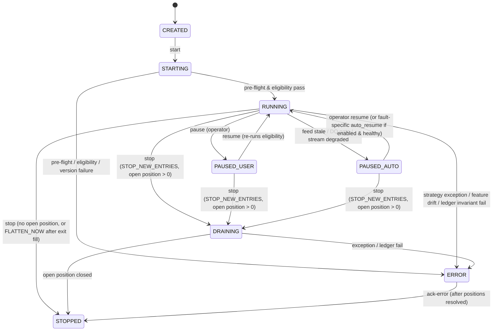

# QuantView — Paper Trading, Manual Order Ticket, Deployment Control, and Portfolio Workspace Specification

**Document ID:** `QV-SPEC-PAPER-001`  
**Version:** `v1.4 (Hardened Implementation Baseline)`  
**Release Date:** `2026-10-12`  
**Document Tier:** **Tier 4 · Specialized Contract** (`ADR-007`)  
**Status:** `DESIGNED` — authoritative subordinate specification for `/paper` (Manual Paper Trading, Strategy Deployments, Combined Portfolios, and Isolated Strategy Comparison).  
**Parent Documents:** [`ADR_REGISTER.md`](ADR_REGISTER.md) (Tier 1), [`HIGH_LEVEL_DESIGN.md`](HIGH_LEVEL_DESIGN.md) (Tier 2 — `§2`, `§4.1`, `§6`, `§7`, `§9`, `§15`, `§16`), [`LOW_LEVEL_DESIGN.md`](LOW_LEVEL_DESIGN.md) (Tier 3 — `§3.7`, `§8.5.4`, `§8.6.9–8.6.10`, `§8.8.2–8.8.6`, `§8.10.6`, `§9.5`, `§12.2–12.4`, `§13.7–13.8`, `§13.11`).  
**Governing Principles & ADRs:** `P8` (Fail safe), `P10` (Money is exact), `P13` (Risk is layered), `P14` (Durable before visible), `P15` (Accounts and ownership scopes are isolated), `P16` (Every number is inspectable), `P17` (Visualization never controls), `P18` (Portfolio and attribution honesty), `ADR-018` (Layered risk), `ADR-026` (Paper/live 3-DB isolation), `ADR-027` (Durable events: journal + outbox + checkpoints), `ADR-028` (Account kinds `PAPER_STRATEGY` vs `PAPER_MANUAL`, archival, `MARKET`-only v1, calendar-relative expiry, `EXPIRY_UNRESOLVED`), `ADR-029` (Deployment state machine, Position Guardian in `ERROR`, `auto_resume = false`), `ADR-032` (Option risk quantification `RK-22`), `ADR-038` (Account allocation modes `ISOLATED` vs `PORTFOLIO`, scoped positions, `RK-25`), `ADR-039` (`DEFERRED` — `LIMIT` order fill semantics), `ADR-041` (Canonical `UtcEpochSec` timestamps).  
**Subordination Rule:** This Tier 4 specification refines UI layout, state-machine controls, manual ticket workflows, failure-mode handling, portfolio/comparison views, and expiry resolution flows for `/paper`. It may refine `LOW_LEVEL_DESIGN.md` (`Tier 3`) but must never contradict `ADR_REGISTER.md` (`Tier 1`), `HIGH_LEVEL_DESIGN.md` (`Tier 2`), or `LOW_LEVEL_DESIGN.md` (`Tier 3`).

---

## 1. Workspace Structure, Account Segregation, and Mandatory Mode Badges (`ADR-027`, `ADR-028`, `ADR-038`, `P15`, `P18`)

The `/paper` workspace is strictly partitioned into four top-level tabs with distinct color accents, persistent mode banners, and **mandatory card/table/drawer account-mode badges** so the operator never confuses manual discretionary trades, isolated single-strategy runs, shared multi-strategy portfolios, or side-by-side analytical comparisons:

| Tab / Route | Account Kind & Allocation Mode | Mandatory Card / Table / Drawer Badge | Theme Accent | Persistent Top Banner |
|---|---|---|---|---|
| **1. Deployments (`/paper/deployments`)** | `PAPER_STRATEGY` (`ISOLATED` or `PORTFOLIO` member) | `ISOLATED STRATEGY` (or `PORTFOLIO MEMBER — <portfolio_name>`) | Amber (`#D97706`) | `PAPER — STRATEGY DEPLOYMENTS (SIMULATED)` |
| **2. Portfolios (`/paper/portfolios`)** | `PAPER_STRATEGY` (`allocation_mode = 'PORTFOLIO'`) | `COMBINED PORTFOLIO` (+ per-metric `EXACT_ACCOUNTING` or `ANALYTICAL_CONVENTION`) | Indigo (`#4F46E5`) | `PAPER — COMBINED MULTI-STRATEGY PORTFOLIO (SIMULATED)` |
| **3. Comparison (`/paper/comparison`)** | Read-only analytical comparison across `ISOLATED` accounts/deployments | `SIDE-BY-SIDE COMPARISON` | Slate/Blue (`#0284C7`) | `PAPER — ISOLATED STRATEGY COMPARISON (ANALYTICAL VIEW)` |
| **4. Manual Trading (`/paper/manual`)** | `PAPER_MANUAL` (`allocation_mode = 'MANUAL'`) | `MANUAL PAPER` | Teal (`#0D9488`) | `PAPER — MANUAL DISCRETIONARY ACCOUNT (SIMULATED)` |

**Non-Contamination & Badge Invariants (`P15`, `P18`, `T-ACC-3`, `T-ACC-4`):**
1. Every P&L summary card, open-position row/table, order/fill table, ledger view, and slide-over detail drawer in `/paper` must display its explicit account-context badge (`ISOLATED STRATEGY`, `COMBINED PORTFOLIO`, `MANUAL PAPER`, or `SIDE-BY-SIDE COMPARISON`) alongside the `account_name` and `account_id`.
2. `PAPER_MANUAL` accounts and `PAPER_STRATEGY` accounts never share cash, positions, orders, fills, ledger entries, or performance metrics (`P15`).
3. An order with `origin = 'MANUAL'` on a `PAPER_STRATEGY` account (or `origin = 'STRATEGY'` on a `PAPER_MANUAL` account) is rejected at both the service layer (`409 ACCOUNT_KIND_MISMATCH`, rule `RK-24`) and the PostgreSQL trigger layer (`LLD §9.5`).

---

## 2. Manual Paper Trading and Order Ticket (`/paper/manual`, `ADR-028`, `ADR-032`, `ADR-039`, `LLD §8.6.9, §8.8.3, §13.7`)

### 2.1 Multiple Named Manual Accounts and Non-Destructive Archival
- The owner can create multiple named `PAPER_MANUAL` accounts (`POST /api/v1/manual/accounts` with `{name, starting_equity_paise, risk_profile: "manual_default@1"}`), e.g., `"Intraday Scalp Practice"`, `"Expiry Day Practice"`.
- **Manual Independence from Strategy Sizing (`T-MAN-1`, `T-RK-31`):** Manual paper accounts are operator-sized (`lots = 1..N` chosen explicitly by the user) and **never** inherit strategy-specific position-sizing formulas, strategy indicator warm-up locks, or strategy regime gates. They are governed solely by system/account `HARD` safety rules and designated `ADVISORY` ceiling warnings (`§2.2`).
- **Account Archival (`POST /api/v1/manual/accounts/{id}/archive`):**
  - Requires `open_positions == 0` and `open_orders == 0` (otherwise rejected with `409 CONFLICT`).
  - Sets `accounts.status = 'ARCHIVED'` and `archived_at = now()`.
  - Archived accounts are removed from the active Order Ticket account selector (`RK-24` rejects any new order on an archived account) but remain permanently browsable in read-only mode in the Ledger, Trades, and Performance views (`T-MAN-9`, `T-ACC-3`). Accounts are **never** deleted (`P5`, `P10`).

### 2.2 Manual Order Ticket Flow (`MARKET`-Only v1)
1. **Ticket Controls:**
   - **Account Selector:** Lists only `ACTIVE` `PAPER_MANUAL` accounts with available cash and displays the `MANUAL PAPER` badge.
   - **Contract Selector:** Expiry (`NEAREST` / `NEXT` / monthly), Strike, Option Type (`CE` / `PE`), or auto-populated by clicking Bid/Ask in `/options` ([`OPTIONS_CHAIN_UI.md`](OPTIONS_CHAIN_UI.md) `§4`).
   - **Side:** `BUY` (entry) or `SELL` (allowed only up to existing open long position quantity on that contract in the selected manual account; `RK-01` forbids naked short option positions in v1).
   - **Quantity:** Lot spinner (`1..N` lots; displays `units = lots * lot_size` and exchange `freeze_units`). Partial exits (`lots_to_sell < open_lots`) are explicitly supported (`T-LG-19`, `T-COST-3b`).
   - **Order Type:** Locked to `MARKET` in v1 (`ADR-028`). `LIMIT` is `DEFERRED / POST-v1` (`ADR-039`, `T7.16`) and is not selectable in v1.
   - **Idempotency Token:** A fresh ULID `client_order_id` is generated when the ticket opens or resets after submission (`RK-13`, `T-MAN-3`).
2. **Live Pre-Trade Estimate Panel (`POST /api/v1/manual/orders/preview`):**
   Every change to contract, side, or lots calls `/manual/orders/preview` (pure read-only dry-run):
   - Displays live `bid`, `ask`, `spread_px`, `spread_rel %`, `bbo_age_ms`, and `bbo_source` (`WS_FULL`).
   - Displays integer-paise derived fields formatted in `₹`: `estimated_outlay_paise`, `estimated_entry_charges_paise`, `estimated_round_trip_charges_paise`, `breakeven_points`, and `cash_after_paise` (`P10`, `LLD §8.5.4`).
   - **Two-Tier Risk Evaluation (`ADR-018`, `ADR-028`, `ADR-032`, `LLD §8.6.2, §8.6.9`):**
     - **`HARD` Rules (`blocking_errors[]` — Never Bypassable):** Evaluates `RK-01` (NIFTY `CE`/`PE` long-only; no `SELL_TO_OPEN`), `RK-02` (kill switch off), `RK-04` (fresh `WS_FULL` quote `<= max_live_quote_age_s = 5s`), `RK-06` (`HARD` lot multiple & `<= freeze_units`), `RK-13` (unique `client_order_id` idempotency key), `RK-16` (ledger integrity & no `POSITION_UNMANAGED`), `RK-17` (feed/journal health & eligibility), `RK-18` (free cash sufficiency for premium + charges), `RK-22` (quantifiable worst-case loss), `RK-23` (calendar-relative expiry-day entry cutoff `expiry_entry_cutoff_minutes_before_close = 10m`), and `RK-24` (open calendar session, `origin == MANUAL`, and `status == ACTIVE`). Any `HARD` failure disables **Submit Market Order** and displays the exact rule ID and reason (`T-RK-27`).
     - **`ADVISORY` Ceiling Warnings (`advisories[]` — Non-Blocking on Manual Accounts):** Evaluates the bound `manual_default` profile's designated `CEILING` thresholds (`RK-05` max spread `4%`, `RK-26` max lots per order, `RK-07` single-trade outlay `60%`, `RK-08` stressed risk `10%`, `RK-09` max open positions `3`, `RK-10` daily trade/order counts, `RK-11` daily loss `15%`, `RK-12` consecutive losses, `RK-14` orders/min, `RK-15` expiry-day 30m buffer, `RK-20` max drawdown `25%`). Breaching an `ADVISORY` rule renders a prominent amber warning banner on the ticket (e.g., `"ADVISORY [RK-07]: Outlay is 72% of equity (advisory ceiling 60%)"`) while still permitting the owner to submit the trade (`T-RK-28…31`).
3. **Runner Liveness Check & Submission (`POST /api/v1/manual/orders`):**
   - Before writing `qv_paper.order_requests`, the API checks `paper_runner`'s heartbeat (`runner_heartbeat_stale_s = 15`). If `paper_runner` is down or stale, the API immediately returns `503 RUNNER_UNAVAILABLE` and the UI shows `"Paper Runner Offline — Start paper_runner before submitting orders"`.
   - Otherwise, the API inserts `order_requests(request_id, account_id, client_order_id, ..., expires_at = created_at + 30s, status = 'PENDING')` and returns `202 Accepted`.
   - `paper_runner` consumes the request within `< 500ms`, re-runs all `HARD` risk rules (`RK-01, 02, 04, 06, 13, 16, 17, 18, 22, 23, 24`) against its authoritative live state, and executes the simulated fill (`OPT_LIVE_BIDASK`) or rejects the order. If a request is older than `command_ttl_s = 30` when consumed, `paper_runner` transitions it to `EXPIRED` (`COMMAND_EXPIRED`) and never executes a stale manual order.

### 2.3 Manual Overnight Carry, Configurable Expiry Lifecycle, and `EXPIRY_UNRESOLVED` (`ADR-028`, `LLD §3.7, §8.8.3`)
- **Overnight Carry (`RK-19`):** Manual positions held past session close are marked at EOD (`OVERNIGHT_MARK`), pinned in the WebSocket subscription set for the next session (`ADR-022`), and re-marked at the next session open.
- **Calendar-Relative Expiry Policy (No Hard-Coded Universal Times):**
  - Expiry entry cutoff and exit timing are governed by the active `RiskProfile` relative to `Calendar.session_close(session_date)` (handling standard `15:30 IST` sessions as well as Muhurat / special exchange sessions):
    - `expiry_entry_cutoff_minutes_before_close` (default `10` min before `session_close`, `HARD` rule `RK-23`; `min_minutes_to_expiry = 30` min `ADVISORY` ceiling `RK-15`).
    - `expiry_exit_policy ∈ {"FORCE_EXIT_BEFORE_CLOSE", "HOLD_TO_EXPIRY_SETTLEMENT"}`:
      - `FORCE_EXIT_BEFORE_CLOSE` (default): at `session_close - expiry_force_exit_minutes_before_close` (default `15` min before `session_close`), `paper_runner` submits an automatic market exit (`reason = EXPIRY_FORCE_EXIT`).
      - `HOLD_TO_EXPIRY_SETTLEMENT`: holds to `session_close` and settles ITM contracts at intrinsic value (`max(0, S_close - K) * qty` for `CE`; `max(0, K - S_close) * qty` for `PE`) and OTM contracts at `0`, charging applicable exercise/settlement fees.
- **Unresolved Expiry Safeguard (`EXPIRY_UNRESOLVED`):**
  - An exit order attempt is **never** treated as a fill unless `OPT_LIVE_BIDASK` has a valid live quote that fills it (`P2`, `P8`).
  - If no valid quote exists during the force-exit window (or if authoritative `S_close` is missing for `HOLD_TO_EXPIRY_SETTLEMENT`), the position is **retained** with `status = 'EXPIRY_UNRESOLVED'` (never erased and never settled at a fabricated price).
  - The Positions table highlights `EXPIRY_UNRESOLVED` rows in red and provides an **Audit & Resolve Expiry** modal (`POST /api/v1/paper/positions/{id}/resolve-expiry`) requiring `{settlement_px, evidence_ref, reason}`, which writes an audited `EXPIRY_SETTLEMENT` ledger adjustment (`LLD §9.3`, `T-MAN-8`).

### 2.4 Operational Failure-Mode & Recovery Matrix (`LLD §8.5.4, §8.6.9, §8.8.4`, `ADR-027`, `ADR-028`)
Every manual and strategy paper-trading screen handles the six operational failure modes deterministically without silent state corruption or phantom fills:

| Failure Mode | Trigger Condition | Backend (`api` / `paper_runner`) Action | Durable State (`qv_paper` + `ws_journal`) | UI Rendering & Operator Recovery (`P14`, `P17`) | Verification Tests |
|---|---|---|---|---|---|
| **1. Runner Down** | `paper_runner` process stopped or `now() - last_heartbeat_at > 15s` (`runner_heartbeat_stale_s`) | `POST /api/v1/manual/orders` and deployment control endpoints reject immediately with `503 RUNNER_UNAVAILABLE` | No orphan `PENDING` row is written to `order_requests` | Top banner turns red: `"PAPER RUNNER OFFLINE (Heartbeat > 15s)"`; **Submit Market Order** button is disabled until heartbeat recovers | `T-MAN-6` |
| **2. Stale Market Data** | Target contract `bbo_source != "WS_FULL"` or `bbo_age_ms > max_live_quote_age_s * 1000` (`5s`, `RK-04`), or feed state is `STALE`/`DOWN` (`RK-17`) | Pre-trade preview returns `blocking_errors: ["RK-04"]`; server-side submit rejects with `409 STALE_QUOTE_REJECTED` (`RK-04`). Running strategies pause (`PAUSED_AUTO`, `reason = FEED_STALE`) after `10s` | Order recorded as `REJECTED` (`reject_code = 'RK-04_STALE_QUOTE'`); zero cash or position mutation | Ticket disables submit (or shows rejection toast if quote went stale mid-click); strategy card shows `PAUSED_AUTO — FEED STALE` | `T-CHN-11`, `T-RK-4`, `T-DEP-5` |
| **3. Duplicate Click / Network Retry** | Client submits `POST /api/v1/manual/orders` twice with the same ULID `client_order_id` | `UNIQUE (account_id, client_order_id)` constraint on `order_requests` and `orders` catches the duplicate; API returns `200 OK` with existing `request_id`/`order_id` and `idempotent_replay = true` | Exactly one `order_requests` row, one `orders` row, one `fills` row, and one ledger debit/credit sequence exist | UI reconciles to the single order without duplicate toast or double position | `T-MAN-3`, `T-IDEM-1` |
| **4. Expired Command** | `paper_runner` was busy/restarting and reads a `PENDING` `order_requests` row where `now() > expires_at` (`command_ttl_s = 30`) | `paper_runner` transitions `order_requests.status = 'EXPIRED'` (`reason = COMMAND_EXPIRED`) and emits `order_request_expired` event; never submits the order | `order_requests.status = 'EXPIRED'`; zero `orders` or `fills` rows created | Order request toast/row updates to `"EXPIRED (TTL > 30s) — Not Executed"` with a one-click **Retry Fresh Order** button (generates new `client_order_id`) | `T-MAN-7` |
| **5. Crash / Restart Across Boundaries `B1–B6`** | `paper_runner` or WebSocket client crashes at any point in the event/order lifecycle (`LLD §8.8.4`) | **B1 (pre-journal):** re-evaluated if bar still within `max_bar_eval_lag_s`. **B2 (post-journal, pre-DB):** replayed idempotently from `ws_journal`. **B3 (post-DB, pre-checkpoint):** `UNIQUE (account_id, client_order_id)` skips duplicate DB write and advances checkpoint. **B4 (post-checkpoint, pre-WS push):** `OutboxRelay` publishes uncommitted `event_outbox` rows. **B5 (WS reconnect):** client calls `GET /api/v1/events/since?after_seq=N` (or gets `410 STALE_REPLAY` and re-fetches full REST state). **B6 (corrupt checkpoint):** rebuilt from `max(ws_journal.seq, event_outbox.seq)`. | `qv_paper` ledger, `positions`, `event_outbox`, and `ws_journal` remain 100% consistent (`ledger.verify() == PASS`) | During B5/B6 recovery, UI displays `"RESYNCING DURABLE STATE…"` and replaces in-memory stores with the server-verified snapshot before re-enabling controls (`P14`) | `T-EVT-1…7`, `T-IDEM-1`, `T-ACC-10` |
| **6. Partial Fills & Multi-Tranche Exits** | Operator or strategy exits a multi-lot position in partial tranches (e.g., `BUY` 2 lots = `150` units @ `10,005`p; `SELL` #1 of 1 lot = `75` units @ `11,995`p; `SELL` #2 of 1 lot = `75` units @ `10,995`p, `LLD §8.5.4`) | Each partial exit fill allocates exact proportional entry cost (`avg_entry_price_paise * fill_qty`), computes exact integer-paise statutory charges for that tranche (`4,040`p on exit #1, `3,908`p on exit #2), appends `FILL_PROCEEDS` + `FILL_CHARGES` + `REALIZED_PNL` ledger entries, and decrements open `positions.qty` (`150 -> 75 -> 0`) | After tranche #1: `positions.qty = 75`, `avg_entry_price_paise = 10,005`, `realized_pnl_paise = +145,210` (`+₹1,452.10`). After tranche #2: `positions.qty = 0` (`CLOSED`), total net P&L = `+212,513`p (`+₹2,125.13`), ending equity = `2,212,513`p (`₹22,125.13`) | Position row shows `"OPEN (1/2 Lots Remaining — 75 Qty)"` badge after tranche #1, displays both realized P&L (`+₹1,452.10`) and live unrealized P&L on the remaining `75` units, and moves to Closed Positions after tranche #2 | `T-COST-3`, `T-LG-19` |

---

## 3. Strategy Deployment Management (`/paper/deployments`, `ADR-029`, `LLD §8.8.2, §13.8`)

### 3.1 Reconciled 8-State Deployment Lifecycle

### 3.2 Open-Position Safety and Engine-Owned Position Guardian in `ERROR`
1. **Two Explicit Stop Modes (`POST /api/v1/paper/deployments/{id}/stop`):**
   - `STOP_NEW_ENTRIES` (default): If the deployment has no open position (`qty == 0`), transitions immediately to `STOPPED`. If it holds an open position (`owner_scope_id = deployment_id`), transitions to `DRAINING`, blocking new entries while continuing to evaluate the strategy's exit rules, stops, targets, and session/expiry force-exits until the position closes (`T-DEP-3`).
   - `FLATTEN_NOW`: Requires a 2-step confirmation dialog (`confirm_token`, TTL `60s`) and submits an immediate market exit order (`reason = FLATTEN_NOW`) for **only** that deployment's open position (`owner_scope_id = deployment_id`). It transitions to `STOPPED` only after the exit fill is committed to the ledger (`T-DEP-4`). If no live quote is available, the position shows `EXIT_PENDING_NO_QUOTE` and retries on the first valid quote.
2. **Engine-Owned Position Guardian in `ERROR` (`ADR-029`, `LLD §8.8.2`):**
   - If a deployment enters `ERROR` while holding an open position:
     - **Case 1 — Ledger and position invariants valid (`RK-16` / `ledger.verify()` pass):** `StrategyRunner` halts new bar-close signal evaluation for that deployment, but the engine-owned **Position Guardian** remains active (`position_status = POSITION_GUARDED`), enforcing the position's already-stored hard stop, target, intraday force-flat, and expiry force-exit on live quotes (`T-DEP-8`).
     - **Case 2 — Ledger or position ownership invariant failed:** Automated orders for that scope halt immediately, the deployment is flagged `POSITION_UNMANAGED` (high-priority red alert banner + operator notification), and explicit operator recovery (`qv ledger reconcile` / `ack-error`) is required.
3. **No Blanket Auto-Resume (`auto_resume = false` Default in v1):**
   - Every deployment defaults to `auto_resume = false`. When a deployment enters `PAUSED_AUTO` (e.g., feed stale > `10s`), it remains paused until the operator clicks **Resume** (which re-verifies feed health, feature readiness, and risk checks).
   - Even if `auto_resume = true` is explicitly configured for a deployment in a later release, auto-resume applies only to transient `FEED_STALE` recovery after `auto_resume_after_s = 60` of verified healthy feed + feature validity + state reconciliation; sequence gaps, `STREAM_DEGRADED`, `RK-16` ledger errors, `POSITION_UNMANAGED`, and kill-switch trips **never** auto-resume (`T-DEP-5`).

---

## 4. Combined Multi-Strategy Portfolios and Isolated Comparison (`/paper/portfolios`, `/paper/comparison`, `ADR-038`, `P15`, `P18`, `LLD §8.6.10, §8.8.6, §8.10.6, §13.11`)

### 4.1 Two Explicit Strategy Account Allocation Modes
When creating a `PAPER_STRATEGY` account (`POST /api/v1/paper/accounts`), the owner selects `allocation_mode`:
1. **Allocation Mode `ISOLATED` (Default):**
   - Enforces at most **one** active deployment (`STARTING, RUNNING, PAUSED_USER, PAUSED_AUTO, DRAINING`) per account via the partial unique index `one_active_deployment_per_isolated_account`.
   - Every card, table, and drawer on this account displays the `ISOLATED STRATEGY` badge and provides 100% pure single-strategy cash, ledger, drawdown, and return attribution (`EXACT_ACCOUNTING`).
2. **Allocation Mode `PORTFOLIO` (Combined Multi-Strategy Portfolio):**
   - The `PAPER_STRATEGY` account is bound to a `Portfolio` entity (`POST /api/v1/paper/portfolios`) that hosts multiple concurrently active deployments sharing the account's cash pool and unified ledger.
   - Every portfolio screen displays the `COMBINED PORTFOLIO` badge and supports two capital-sizing models:
     - `FIXED_BUDGET`: Each member deployment `D_i` is assigned a notional sub-budget `allocated_budget_paise[D_i]` (`sum <= starting_equity_paise`) used as `D_i`'s sizing denominator.
     - `SHARED_POOL`: Each member deployment sizes against `min(available_cash_paise, portfolio_equity_paise * max_deployment_outlay_pct)`.

### 4.2 Portfolio Conflict Policies and `RK-25` Ceiling Enforcement
The Portfolio Header displays and enforces the configured `conflict_policy` (`RK-25`, `LLD §8.6.10`):
- `ALLOW_CONCURRENT` (**Default**): Multiple deployments may hold positions in the same underlying or identical option contract simultaneously, provided every individual deployment ceiling and all portfolio-level aggregate ceilings (`max_open_positions`, `max_total_outlay_pct`, `max_daily_loss_pct`, `max_drawdown_pct`, `max_gross_lots_per_contract`) pass.
- `REJECT_OPPOSITE_DIRECTION`: Rejects a new entry (`409 PORTFOLIO_CONFLICT`, rule `RK-25`) if another active deployment in the same portfolio holds an open position with the opposite directional delta on the underlying (e.g., long `CE` vs. long `PE`).
- `ONE_POSITION_PER_CONTRACT`: Rejects a new entry (`409 PORTFOLIO_CONFLICT`, rule `RK-25`) if another active deployment in the same portfolio already holds an open position in the exact same `instrument_id`.

**Deterministic Contention Ordering (`T-PRT-5`):** When multiple deployments emit entry signals on the same bar close, `PortfolioManager` sorts candidates deterministically by `(deployment.priority ASC, deployment.deployment_id ASC)` and evaluates/reserves cash sequentially so aggregate outlay never exceeds the account ceiling.

### 4.3 Scoped vs. Aggregate Position Views and Non-Interference on Stop/Flatten (`T-PRT-2`, `T-PRT-3`, `T-PRT-6`)
In `/paper/portfolios/{id}`, the Positions panel provides a segmented toggle:
1. **Scoped by Deployment (`positions` table, PK `(account_id, owner_scope_id, instrument_id)`):**
   - Lists each deployment's exact lot count, average cost, unrealized P&L, and active stop/target levels.
   - **Strict Non-Interference Guarantee (`T-PRT-2`, `T-PRT-3`, `T-PRT-6`, `T-ACC-16`):** Clicking **Pause**, **Stop (`STOP_NEW_ENTRIES`)**, or **Flatten Now (`FLATTEN_NOW`)** on Deployment `D1` affects **only** `D1` (`owner_scope_id = D1`). If Deployment `D2` in the same `PORTFOLIO` account also holds 1 lot of the exact same `OPTIDX:NIFTY50:...:CE:22400` contract, `D2`'s 1 lot, average entry cost, stop/target levels, and `RUNNING` state remain 100% untouched.
2. **Net by Contract (`account_positions_view`):**
   - Read-only aggregation across all deployments in the account showing total net units/lots and total premium outlay per `instrument_id`.

### 4.4 Attribution Honesty Badges (`P18`, `LLD §8.10.6`)
Every metric card and table column in `/paper/portfolios` carries one of two explicit badges alongside the parent `COMBINED PORTFOLIO` badge:
- **`EXACT_ACCOUNTING` (Green Badge):**
  - Account-level Cash, Reserved Cash, Total Equity, Account Drawdown, Account Daily P&L, Account Sharpe/Sortino.
  - Per-deployment Closed Gross P&L (`₹`), Itemized Charges (`₹`), and Net P&L (`₹`), which are summed directly from fills and `ledger_entries` tagged with `owner_scope_id = deployment_id`.
- **`ANALYTICAL_CONVENTION` (Indigo Badge with Formula Tooltip):**
  - Per-deployment Return `%`, Per-deployment Drawdown `%`, and Per-deployment Sharpe/Sortino inside a shared `PORTFOLIO` account, because cash is pooled at the account level. The tooltip states the exact convention denominator (`allocated_budget_paise` in `FIXED_BUDGET` mode; `portfolio_starting_equity_paise` in `SHARED_POOL` mode).

### 4.5 Isolated Strategy Comparison View (`/paper/comparison`, `T-PRT-8`)
- Displays the `SIDE-BY-SIDE COMPARISON` badge and allows selecting `2..N` isolated `PAPER_STRATEGY` accounts or deployments to compare side-by-side in a table and overlaid normalized return chart (`Indexed to 100 at start_date`).
- **Prohibition on Fake Portfolio Sums:** `/paper/comparison` **never** sums the rupee equity or cash balances of separate `ISOLATED` accounts into a synthetic "Combined Portfolio P&L" card. A persistent banner explains: *"Comparing independent isolated accounts (`SIDE-BY-SIDE COMPARISON`). To test shared capital and portfolio risk ceilings, deploy strategies into a `COMBINED PORTFOLIO` account."*

---

## 5. Verification Test Mapping

| Test ID | Description |
|---|---|
| `T-MAN-1…9` | Manual paper account isolation (`P15`), independence from strategy sizing (`T-MAN-1`, `T-RK-31`), `MARKET`-only v1 validation (`ADR-028`), ULID idempotency (`T-MAN-3`), runner-down `503 RUNNER_UNAVAILABLE` (`T-MAN-6`), command TTL expiry (`T-MAN-7`), `HARD` + `ADVISORY` preview/execution parity (`T-RK-27…31`), calendar-relative expiry handling (`EXPIRY_UNRESOLVED`, `T-MAN-8`), and non-destructive archival (`T-MAN-9`, `T-ACC-3`, `T-ACC-4`) |
| `T-COST-3`, `T-LG-19` | Multi-lot entry (`150` units @ `10,005`p) and two partial exit tranches (`75` units @ `11,995`p and `75` units @ `10,995`p) with exact integer-paise cost allocation, statutory charge deduction (`10,987`p total), net P&L (`+212,513`p), and ending equity (`2,212,513`p) |
| `T-DEP-1…8` | Deployment state machine transitions (`CREATED -> STARTING -> RUNNING`), `STOP_NEW_ENTRIES` (`DRAINING`) vs. `FLATTEN_NOW`, `auto_resume = false` default, and engine-owned Position Guardian in `ERROR` (`ADR-029`) |
| `T-EVT-1…7`, `T-IDEM-1` | Crash/restart recovery across all 6 boundaries (`B1–B6`), idempotent order replay, WebSocket `/events/since` gap recovery, and `410 STALE_REPLAY` full-snapshot resync (`ADR-027`, `T-ACC-10`) |
| `T-PRT-1…10` | Allocation mode `ISOLATED` single-deployment constraint vs. allocation mode `PORTFOLIO` multi-deployment execution, scoped position non-interference on `D1` pause/stop/flatten (`T-PRT-2`, `T-PRT-3`, `T-PRT-6`), `RK-25` conflict policies (`T-PRT-4`), deterministic priority contention (`T-PRT-5`), and `EXACT_ACCOUNTING` vs. `ANALYTICAL_CONVENTION` attribution (`T-PRT-7`, `T-PRT-8`, `T-ACC-16`) |
