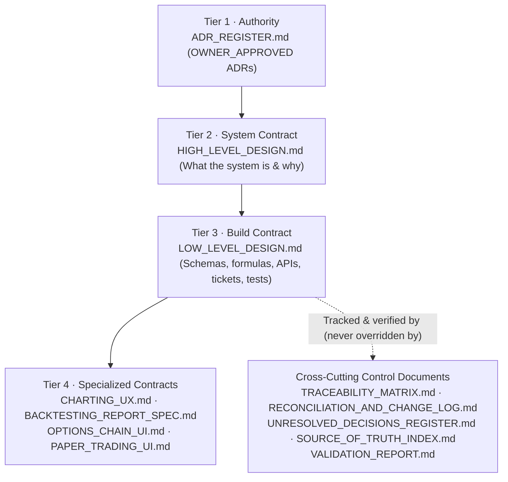

# QuantView — Source of Truth Index and Document Hierarchy (`DOCS/final/`)

**Document ID:** `QV-SOT-INDEX-001`  
**Version:** `v1.4 (Hardened Implementation Baseline)`  
**Release Date:** `2026-10-12`  
**Document Tier:** **Cross-Cutting Control Document** (`ADR-007`)  
**Status:** `ACTIVE — CANONICAL ENTRYPOINT` — authoritative document hierarchy, conflict resolution rules, and file map for the **QuantView / Algo_options** documentation baseline.  
**Parent Documents:** [`ADR_REGISTER.md`](ADR_REGISTER.md) (Tier 1), [`HIGH_LEVEL_DESIGN.md`](HIGH_LEVEL_DESIGN.md) (Tier 2), [`LOW_LEVEL_DESIGN.md`](LOW_LEVEL_DESIGN.md) (Tier 3).

---

## 1. The 4-Tier Document Hierarchy & Cross-Cutting Controls (`ADR-007`)

To prevent coding agents and engineers from treating twelve documents as twelve independent or competing sources of truth, all design, implementation, code review, testing, and phase-gate verification for **QuantView / Algo_options** must follow this strict **4-Tier Document Hierarchy** inside `c:\Algo\quantview\DOCS\final\`:

### 1.1 Six Mandatory Conflict Resolution Rules (`ADR-007`)
Whenever any apparent ambiguity or conflict arises across files, apply these six rules in exact order:
1. **Rule 1 (Tier 1 Precedence):** An ADR in [`ADR_REGISTER.md`](ADR_REGISTER.md) has **Tier 1 authority** if and only if its status is **`OWNER_APPROVED`**. `PROPOSED` (`ADR-016`) and `DEFERRED` (`ADR-039`) ADRs record pending or post-v1 items and do not authorize active v1 implementation. No lower-tier document may contradict an `OWNER_APPROVED` ADR.
2. **Rule 2 (HLD vs. LLD):** [`HIGH_LEVEL_DESIGN.md`](HIGH_LEVEL_DESIGN.md) (`Tier 2`) governs system scope, architectural principles (`P1–P18`), operating modes, package/database boundaries, and phase gates (*what the system is and why*). [`LOW_LEVEL_DESIGN.md`](LOW_LEVEL_DESIGN.md) (`Tier 3`) governs concrete schemas, SQL DDL, Parquet layouts, formulas, state machines, API contracts, build tickets (`T0.1–T9.2`), and test definitions (*how to build it*).
3. **Rule 3 (Tier 4 Subordination):** The four specialized UI and report specifications ([`CHARTING_UX.md`](CHARTING_UX.md), [`BACKTESTING_REPORT_SPEC.md`](BACKTESTING_REPORT_SPEC.md), [`OPTIONS_CHAIN_UI.md`](OPTIONS_CHAIN_UI.md), [`PAPER_TRADING_UI.md`](PAPER_TRADING_UI.md)) are **Tier 4** contracts. They may refine screen layout, component interaction, and visual state rendering, but they **must never contradict** `Tier 1` (`ADR_REGISTER.md`), `Tier 2` (`HIGH_LEVEL_DESIGN.md`), or `Tier 3` (`LOW_LEVEL_DESIGN.md`). If a Tier 4 document conflicts with `LOW_LEVEL_DESIGN.md`, `LOW_LEVEL_DESIGN.md` wins automatically.
4. **Rule 4 (Control Documents Never Override Architecture):** The five Cross-Cutting Control Documents ([`TRACEABILITY_MATRIX.md`](TRACEABILITY_MATRIX.md), [`RECONCILIATION_AND_CHANGE_LOG.md`](RECONCILIATION_AND_CHANGE_LOG.md), [`UNRESOLVED_DECISIONS_REGISTER.md`](UNRESOLVED_DECISIONS_REGISTER.md), [`SOURCE_OF_TRUTH_INDEX.md`](SOURCE_OF_TRUTH_INDEX.md), [`VALIDATION_REPORT.md`](VALIDATION_REPORT.md)) are governance, audit, and traceability indices — **not** alternative architecture specifications. They can never override `Tier 1–3`.
5. **Rule 5 (`[VERIFY]` & `UNVERIFIED_BLOCKER` Gate):** Any external regulatory, tax, exchange, or empirical provider parameter marked **`[VERIFY]`** (`VER-01..06` or `S1..S12` in [`UNRESOLVED_DECISIONS_REGISTER.md`](UNRESOLVED_DECISIONS_REGISTER.md)) carries status **`UNVERIFIED_BLOCKER`** and acts as a **hard blocker** for its dependent implementation tickets until verified with an authoritative primary-source URL/circular reference (or Phase-0 empirical script artifact) and effective date.
6. **Rule 6 (Historical Drafts Prohibition):** The files in `DOCS/person_1/` and `DOCS/person_2/` are immutable historical inputs preserved for audit provenance only. Coding agents and engineers must **never** read `DOCS/person_1/` or `DOCS/person_2/` as active specifications or revive any superseded proposal listed in [`RECONCILIATION_AND_CHANGE_LOG.md`](RECONCILIATION_AND_CHANGE_LOG.md).

---

## 2. Canonical Inventory of All 12 Documents in `DOCS/final/`

Every document in `DOCS/final/` is unified at **`Version: v1.4 (Hardened Implementation Baseline)`** and **`Release Date: 2026-10-12`**:

| Tier | File Path in `DOCS/final/` | Document ID | Version & Release Date | Authoritative Scope |
|---|---|---|---|---|
| **Tier 1 · Authority** | [`ADR_REGISTER.md`](ADR_REGISTER.md) | `QV-ADR-REG-001` | `v1.4` (`2026-10-12`) | Complete 1-to-1 catalogue of `ADR-001` through `ADR-041` (`39 OWNER_APPROVED`, `1 PROPOSED`, `1 DEFERRED`), including decision owner, approval date, rationale, rejected alternatives, affected sections/tests, canonical result types (`ADR-003`), causal availability (`ADR-008`), and deferred LIMIT orders (`ADR-039`). |
| **Tier 2 · System Contract** | [`HIGH_LEVEL_DESIGN.md`](HIGH_LEVEL_DESIGN.md) | `QV-HLD-001` | `v1.4` (`2026-10-12`) | System vision, scope (`v1` long-only NIFTY 50 options; strictly optional Phase 8 ML per `ADR-040`), Principles `P1–P18`, `[VERIFY]` constraints `C1–C10`, canonical operating modes (`RESEARCH`, `UNDERLYING_DIRECTIONAL`, `ACTUAL_OPTIONS`, `SYNTHETIC_OPTIONS_ESTIMATE`, `MANUAL_PAPER`, `STRATEGY_PAPER`, `LIVE`), allocation modes (`ISOLATED` vs `PORTFOLIO`, `ADR-038`), 5-layer paper/live isolation + Three-Lock Live Arming (`ADR-026`), 9+1 phase roadmap (`GATE-01–GATE-05`, `G0.1–G7.9`), and `ADR-001–ADR-041` summary index (`§16`). |
| **Tier 3 · Build Contract** | [`LOW_LEVEL_DESIGN.md`](LOW_LEVEL_DESIGN.md) | `QV-LLD-001` | `v1.4` (`2026-10-12`) | Package layout & import boundaries (`§1`), durable journal & consumer protocol (`§2.3`), calendar-relative expiry & session rules (`§3`), Parquet/DuckDB schemas & causal availability model (`§4`, `available_at = finalized_at = bar_end + grace_period` in live), 47-feature catalogue (`§5`), strategy DSL & Python sandbox with optional ML (`§6`), contract selector (`§7`), simulation engines, formal causal fill proof & abnormal book guards (`§8.4.2`), exact integer-paise cost model & 2-lot partial-exit worked fixture (`§8.5.4`), `RiskEngine` (`RK-01–RK-26` with `RK-06` freeze limit vs `RK-26` advisory lot ceiling), `PortfolioManager` (`ISOLATED`/`PORTFOLIO`), deployment state machine (`STARTING`, `ERROR` Position Guardian, `auto_resume = false`), 6-boundary crash/restart matrix (`B1–B6`, `§8.8.4`), Metric Inspector (`§8.10.5`), PostgreSQL DDL (`§9`), live arming (`§10`), ML pipeline (`§11`), FastAPI REST/WS contracts (`§12`), frontend architecture & canonical `UtcEpochSec` timestamp contract (`ADR-041`, `§13.2/§13.4`), operations (`§14`), test suites (`§15`), config (`§16`), build tickets `T0.1–T9.2` with vertical slice backtest runner `T1.7` & `AGENTS.md` (`§17`), and Appendices `A–C` (`CAP-01–CAP-24`). |
| **Tier 4 · Specialized Contract** | [`CHARTING_UX.md`](CHARTING_UX.md) | `QV-SPEC-CHART-001` | `v1.4` (`2026-10-12`) | Subordinate specification for `/chart`: canonical `UtcEpochSec` timestamp contract & isolated `LightweightChartsAdapter` IST conversion (`ADR-041`, `T-FE-TIME-1…5`), `DqRibbon` missing-bar gaps, provisional vs. final bar non-promotion (`T-FE-UI-2`), `underlying_ref_px` spot-axis marker anchoring, indicator explainability, and 3 causal replay modes (`CHART_REPLAY`, `EVENT_REPLAY`, `BACKTEST_REPLAY`). |
| **Tier 4 · Specialized Contract** | [`BACKTESTING_REPORT_SPEC.md`](BACKTESTING_REPORT_SPEC.md) | `QV-SPEC-REPORT-001` | `v1.4` (`2026-10-12`) | Subordinate specification for `/backtests/{run_id}`: mandatory assumptions & coverage header strip, canonical result types (`SYNTHETIC_OPTIONS_ESTIMATE`), normative metric basis table (gross vs. net, realized vs. MTM, `EXACT_ACCOUNTING` vs. `ANALYTICAL_CONVENTION`, `DEGENERATE_ZERO_VARIANCE`), click-to-explain `MetricDetail` inspector (`substitution`), stop-loss overshoot attribution, and hand-calculated 2-lot partial-exit integer-paise verification (`§3.3`). |
| **Tier 4 · Specialized Contract** | [`OPTIONS_CHAIN_UI.md`](OPTIONS_CHAIN_UI.md) | `QV-SPEC-CHAIN-001` | `v1.4` (`2026-10-12`) | Subordinate specification for `/options` (Phase 7 live chain, `G7.7`) vs. `/research/chain` (Phase 2 historical snapshot viewer, `T2.3`): independent 4-group provenance (`bbo`, `ltp`, `vol_oi`, `greeks`), zero-sentinel honesty (`P6`), on-demand WS subscriptions (`<= 6` keys, `TTL = 300s`), and mandatory server-side quote freshness re-validation on order submit (`T-CHN-11`). |
| **Tier 4 · Specialized Contract** | [`PAPER_TRADING_UI.md`](PAPER_TRADING_UI.md) | `QV-SPEC-PAPER-001` | `v1.4` (`2026-10-12`) | Subordinate specification for `/paper`: mandatory account/mode badges (`ISOLATED STRATEGY`, `COMBINED PORTFOLIO`, `MANUAL PAPER`, `SIDE-BY-SIDE COMPARISON`), multiple named manual accounts + archival, manual independence from strategy sizing, `MARKET`-only v1 ticket, `RK-26` advisory lot ceiling in preview ticket (§2.2), `HARD` + `ADVISORY` risk rules, 6-scenario operational failure-mode & `B1–B6` recovery matrix (`§2.4`), 8-state deployment controls, and scoped portfolio positions. |
| **Cross-Cutting Control** | [`TRACEABILITY_MATRIX.md`](TRACEABILITY_MATRIX.md) | `QV-TRACE-001` | `v1.4` (`2026-10-12`) | 1-to-1 bidirectional traceability across `P1–P18`, 5 Critical Release-Blocking Gates (`GATE-01–GATE-05` with `GATE-04` $\ge 10$ paper sessions and `GATE-05` $\ge 30$ paper sessions, $\le 1\text{ paise}$ tolerance), `CAP-01–CAP-24` (with `Design Status`, `Implementation Status`, `Test Execution Status`, and `Evidence Artifact`), `ADR-001–ADR-041`, and `RK-01–RK-26` (`RK-06`/`RK-26` split). |
| **Cross-Cutting Control** | [`RECONCILIATION_AND_CHANGE_LOG.md`](RECONCILIATION_AND_CHANGE_LOG.md) | `QV-REC-LOG-001` | `v1.4` (`2026-10-12`) | Owner decisions `Q1–Q6`, section-by-section reconciliation matrix (`REC-01–REC-30`) including `REC-24–REC-30` v1.4 hardening, explicit **"Superseded Proposal (Do Not Revive)"** column, and `v1.0 -> v1.4` version history. |
| **Cross-Cutting Control** | [`UNRESOLVED_DECISIONS_REGISTER.md`](UNRESOLVED_DECISIONS_REGISTER.md) | `QV-UNRES-REG-001` | `v1.4` (`2026-10-12`) | Living control register (`ACTIVE — LIVING CONTROL REGISTER`) tracking external `[VERIFY]` blockers (`VER-01–VER-06` with `VER-03` $\le 1\text{ paise}$ tolerance), Phase-0 empirical blockers (`S1–S12`) with blocked dependent tickets (`UNVERIFIED_BLOCKER`), 5 phase-boundary re-review checkpoints (`REV-01–REV-05`), and deferred post-v1 items (`DEF-01–DEF-05`). |
| **Cross-Cutting Control** | [`VALIDATION_REPORT.md`](VALIDATION_REPORT.md) | `QV-VAL-REP-001` | `v1.4` (`2026-10-12`) | Hardened implementation baseline scorecard (`8.5 / 8.5 / 6.5`), readiness verdicts (`Phase 0: GO`, `Full Build: CONDITIONAL GO`, `Live: NO-GO`), epistemic boundary disclaimers, verification of Audit Blockers `BLK-01–BLK-06` and v1.4 hardening items, and programmatic check results backed by [`validation_evidence.json`](validation_evidence.json). |
| **Cross-Cutting Control** | [`SOURCE_OF_TRUTH_INDEX.md`](SOURCE_OF_TRUTH_INDEX.md) | `QV-SOT-INDEX-001` | `v1.4` (`2026-10-12`) | This document: canonical entrypoint, 4-Tier Document Hierarchy, 6 conflict resolution rules, and domain navigation index. |

---

## 3. Disposition of Historical Input Documents (`DOCS/person_1/` and `DOCS/person_2/`)

The 10 files in `DOCS/person_1/` and `DOCS/person_2/` are preserved untouched (`SHA-256` verified in [`VALIDATION_REPORT.md`](VALIDATION_REPORT.md)) as historical design inputs. They are **superseded** for all implementation work by `DOCS/final/`:

| Historical Input Path | Original Role | Disposition in `DOCS/final/` |
|---|---|---|
| `DOCS/person_2/HIGH_LEVEL_DESIGN_PERSON_2.md` | Authoritative HLD starting point (`v1.2`) | Reconciled into [`HIGH_LEVEL_DESIGN.md`](HIGH_LEVEL_DESIGN.md) (`v1.3`, Tier 2). Original file untouched. |
| `DOCS/person_2/LOW_LEVEL_DESIGN_PERSON_2.md` | Authoritative LLD starting point (`v1.2`) | Reconciled into [`LOW_LEVEL_DESIGN.md`](LOW_LEVEL_DESIGN.md) (`v1.3`, Tier 3). Original file untouched. |
| `DOCS/person_2/CHANGE_LOG_v1.2_PERSON_2.md` | Person 2 `v1.2` change log & traceability | Consolidated into [`RECONCILIATION_AND_CHANGE_LOG.md`](RECONCILIATION_AND_CHANGE_LOG.md) and [`TRACEABILITY_MATRIX.md`](TRACEABILITY_MATRIX.md). Original file untouched. |
| `DOCS/person_1/HIGH_LEVEL_DESIGN_PERSON_1.md` | Person 1 HLD review source (`v1.2`) | Selected safety controls, 3-lock live arming, and portfolio concepts reconciled into [`HIGH_LEVEL_DESIGN.md`](HIGH_LEVEL_DESIGN.md) (`v1.3`, Tier 2). Original file untouched. |
| `DOCS/person_1/LOW_LEVEL_DESIGN_PERSON_1.md` | Person 1 LLD review source (`v1.2`) | Selected contracts (`producer_epoch`, `STALE_REPLAY`, `underlying_ref_px`, `fill_max_spread_rel`, `STARTING`, Position Guardian, `HARD`+`ADVISORY` manual profile, `substitution`, execution-semantics register, `instrument_snapshot`) reconciled into [`LOW_LEVEL_DESIGN.md`](LOW_LEVEL_DESIGN.md) (`v1.3`, Tier 3). Original file untouched. |
| `DOCS/person_1/CHARTING_UX_PERSON_1.md` | Person 1 Charting UX spec | Reconciled into [`CHARTING_UX.md`](CHARTING_UX.md) (`v1.3`, Tier 4). Original file untouched. |
| `DOCS/person_1/BACKTESTING_REPORT_SPEC_PERSON_1.md` | Person 1 Backtesting Report spec | Reconciled into [`BACKTESTING_REPORT_SPEC.md`](BACKTESTING_REPORT_SPEC.md) (`v1.3`, Tier 4). Original file untouched. |
| `DOCS/person_1/OPTIONS_CHAIN_UI_PERSON_1.md` | Person 1 Options Chain UI spec | Reconciled into [`OPTIONS_CHAIN_UI.md`](OPTIONS_CHAIN_UI.md) (`v1.3`, Tier 4). Original file untouched. |
| `DOCS/person_1/PAPER_TRADING_UI_PERSON_1.md` | Person 1 Paper Trading UI spec | Reconciled into [`PAPER_TRADING_UI.md`](PAPER_TRADING_UI.md) (`v1.3`, Tier 4). Original file untouched. |
| `DOCS/person_1/V1_2_CHANGE_LOG_AND_TRACEABILITY_PERSON_1.md` | Person 1 `v1.2` change log & traceability | Consolidated into [`RECONCILIATION_AND_CHANGE_LOG.md`](RECONCILIATION_AND_CHANGE_LOG.md) and [`TRACEABILITY_MATRIX.md`](TRACEABILITY_MATRIX.md). Original file untouched. |

---

## 4. Quick Navigation by Engineering Domain

- **Phase 0 Empirical Verification & `[VERIFY]` Blockers:** [`UNRESOLVED_DECISIONS_REGISTER.md`](UNRESOLVED_DECISIONS_REGISTER.md) `§0–§2`, [`LOW_LEVEL_DESIGN.md`](LOW_LEVEL_DESIGN.md) `§2.3, §3, §4`, Tickets `T0.1–T0.15`
- **Data Audit, Calendar, Parquet & Collectors (Phase 0 & 2):** [`LOW_LEVEL_DESIGN.md`](LOW_LEVEL_DESIGN.md) `§2.3, §3, §4`, Tickets `T0.1–T0.15, T2.1–T2.3`
- **Feature Engine & Explainability (Phase 3):** [`LOW_LEVEL_DESIGN.md`](LOW_LEVEL_DESIGN.md) `§5, App. A`, [`CHARTING_UX.md`](CHARTING_UX.md) `§3`, Tickets `T3.1–T3.7`
- **Charting, Canonical `UtcEpochSec` Timestamps & Causal Replay (Phase 1 & 3):** [`LOW_LEVEL_DESIGN.md`](LOW_LEVEL_DESIGN.md) `§13.2, §13.4, §13.5`, [`CHARTING_UX.md`](CHARTING_UX.md) `§1.1, §2, §5`, `ADR-041`, Tickets `T1.5, T3.8`
- **Strategy DSL, Python Sandbox, Optional ML Boundary & Pine Porting (Phase 4):** [`LOW_LEVEL_DESIGN.md`](LOW_LEVEL_DESIGN.md) `§6`, `ADR-040`, Tickets `T4.1–T4.6`
- **Simulation Engines (`UNDERLYING_DIRECTIONAL`, `ACTUAL_OPTIONS`, `SYNTHETIC_OPTIONS_ESTIMATE`), Integer-Paise Cost Fixture & Metric Inspector (Phase 5 & 6):** [`LOW_LEVEL_DESIGN.md`](LOW_LEVEL_DESIGN.md) `§7, §8.1–§8.5.4, §8.9–§8.15`, [`BACKTESTING_REPORT_SPEC.md`](BACKTESTING_REPORT_SPEC.md), Tickets `T5.1–T5.7, T6.1–T6.8`
- **Risk Engine, Double-Entry Ledger, 6-Boundary Crash Recovery (`B1–B6`), Manual Paper, Deployments & Combined Portfolios (Phase 7):** [`LOW_LEVEL_DESIGN.md`](LOW_LEVEL_DESIGN.md) `§8.6–§8.8.6, §9, §13.6–§13.9, §13.11`, [`PAPER_TRADING_UI.md`](PAPER_TRADING_UI.md), [`OPTIONS_CHAIN_UI.md`](OPTIONS_CHAIN_UI.md), Tickets `T7.1–T7.19`
- **Optional ML Pipeline & Holdout Governance (Phase 8):** [`LOW_LEVEL_DESIGN.md`](LOW_LEVEL_DESIGN.md) `§11`, `ADR-040`, Tickets `T8.1–T8.9`
- **Paper/Live Isolation & Phase 9 Live Readiness (`NO-GO` until `REV-05`):** [`HIGH_LEVEL_DESIGN.md`](HIGH_LEVEL_DESIGN.md) `§12`, [`LOW_LEVEL_DESIGN.md`](LOW_LEVEL_DESIGN.md) `§4.9.5, §9.5, §10.3, §10.5`, Tickets `T0.15, T1.6, T7.8, T9.1–T9.2`
