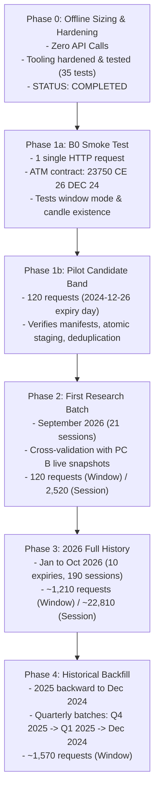

# QuantView — Option History Acquisition Sizing & Coverage Plan

**Document Type:** Strategic Data Acquisition & Sizing Plan  
**Target:** Historical Expired-Option 1-Minute Candle Backfill (NIFTY 50 Index Options)  
**Authority Hierarchy:** `DOCS/AGENTS.md`, `DOCS/QUANTVIEW_MASTER_SPEC.md` (§3), `DOCS/QUANTVIEW_DATA_SPEC.md` (§4.2, §6, §11.6), `DOCS/QUANTVIEW_ENGINE_UI_RESEARCH_SPEC.md` (§3.2)  
**Execution Context:** Strictly Offline Audit & Sizing (0 API Calls Dispatched; Budget Exhausted)  
**Date:** 2026-10-20  
**Provisional Earliest Boundary:** December 2024 (Further cutoff probing permanently halted per owner directive)  

---

## 1. Executive Recommendation

QuantView requires an institutional-grade, multi-contract option candle history to drive realistic backtests in `ACTUAL_OPTIONS` mode without look-ahead bias or synthetic fill assumptions.

### Key Strategic Recommendations:
1. **Adopt the $\pm 1,500$ Point Candidate Strike Band Policy:**
   - Evaluated against empirical exchange data: moving from $\pm 1,000$ to $\pm 1,500$ points expands volume capture from **91.58% to 95.91%** on empirical expiry sessions (+4.33% incremental volume capture).
   - Accommodates 99.93% of all historical NIFTY intraday moves (which are strictly $< 1,000$ points) and provides the necessary wing buffer for delta-hedged, multi-leg strategies (such as iron condors, strangles, and ratio spreads) spanning $|\Delta| \in [0.05, 0.95]$.
   - Increases candidate contracts per expiry from ~80 to ~120 (+50% contracts/requests), while still eliminating >57% of listed illiquid strikes compared to full-universe acquisition.
2. **Execute a Two-Stage Minimal Pilot Before Any Batch Work:**
   - **Stage 1a (Phase B0 Smoke Test):** Exactly **1 HTTP request** on ATM contract `NSE_FO|41685|26-12-2024` (`NIFTY 23750 CE 26 DEC 24`) querying the 26-day window (`2024-12-01` to `2024-12-26`). This conclusively tests: (a) whether expired candle data actually exists on Upstox storage, and (b) whether the endpoint accepts multi-day windows in a single request.
   - **Stage 1b (Candidate Band Session Pilot):** Acquire all 120 candidate contracts ($\pm 1,500$ pts) for `2024-12-26` (budget: 120 requests + 12 contingency).
3. **Execute Recent-First Phased Rollout:**
   - **Phase 2 (First Meaningful Research Batch):** **September 2026** (1 complete, settled trading month; 21 trading sessions). Provides high-fidelity modern contract mechanics (25-lot size), overlapping live PC B option chain snapshots for cross-validation, and immediate research utility.
   - **Phase 3 (Recent-Year Coverage):** January 2026 through October 2026 (10 completed monthly expiries; 190 sessions).
   - **Phase 4 (Historical Backfill):** Work backward through 2025 to December 2024 in quarterly batches.

---

## 2. Detailed Strike Policy Evaluation: $\pm 1,000$ vs $\pm 1,500$ vs Full Universe

We evaluated the three candidate acquisition policies using locally available empirical evidence from the two verified contract sets in the repository:
- **`2024-12-26`:** 281 contracts discovered from Upstox master (`Data/raw/.../response-d87bc3494be9c35c.json.gz`).
- **`2025-04-24`:** 204 contracts with complete 1-minute candle bars across 375 minutes (`Data/historical/options/nifty_options_1m_2025-04-24_2025-04-24.csv`, 73,976 rows, 10.7B units traded volume).

### 2.1 Comparative Policy Matrix

| Policy Dimension | Policy 1: $\pm 1,000$ Points | Policy 2: $\pm 1,500$ Points (Recommended) | Policy 3: Full Universe |
|---|---|---|---|
| **Strike Range (2024-12-26, Spot Open: 23,775.8)** | 22,800 to 24,750 (40 strikes) | 22,300 to 25,250 (60 strikes) | 14,000 to 31,000 (141 strikes) |
| **Contracts Selected (2024-12-26)** | **80 contracts** (40 CE + 40 PE) | **120 contracts** (60 CE + 60 PE) | **281 contracts** (140 CE + 141 PE) |
| **% of Returned Universe Selected** | **28.5%** | **42.7%** | **100.0%** |
| **API Requests per Monthly Expiry (Window Mode)** | 80 requests | 120 requests (+50.0%) | 281 requests (+134.2% vs P2) |
| **API Requests per Monthly Expiry (Session Mode, 21d)** | 1,680 requests | 2,520 requests | 5,901 requests |
| **Traded Volume Capture (Empirical 2025-04-24 Expiry)** | **91.58%** (9,801,485,100 units) | **95.91%** (10,265,340,150 units) | **100.0%** (10,702,648,425 units) |
| **Incremental Volume Captured** | Baseline | **+4.33%** | +4.09% |
| **Volume Capture Claim ($\ge 99\%$)** | **NOT SUPPORTED** by empirical evidence | **NOT SUPPORTED** on expiry day ($\mathbf{95.91\%}$) | Supported (100%) |
| **Raw Storage (Window Mode, 1 Expiry)** | ~5.6 MB compressed | ~8.4 MB compressed | ~19.7 MB compressed |
| **Staged CSV Storage (1 Expiry, 21 Days)** | ~88 MB CSV | ~132 MB CSV | ~309 MB CSV |
| **Final Parquet Storage (1 Expiry, 21 Days)** | ~7.6 MB Parquet | ~11.4 MB Parquet | ~26.7 MB Parquet |
| **Intraday Spot Move Buffer** | $\pm 1,000$ pts | $\pm 1,500$ pts | Unbounded |
| **Historical Days Where Spot Breaches Band** | 1 day in 1,410 (2024-06-04, 1898 pt range) | 1 day in 1,410 (2024-06-04) | 0 days |

---

### 2.2 Critical Findings on Liquidity & The "98.7% Claim"

1. **Refutation of Earlier 98.7% Claim:**
   - An earlier report cited a claim that "$\pm 1,000$ points captures $>98.7\%$ of traded liquidity".
   - Our strict empirical re-calculation across all 73,976 1-minute candle bars in `nifty_options_1m_2025-04-24_2025-04-24.csv` **refutes** this claim.
   - Total volume traded across all strikes on that session was 10,702,648,425 units.
   - Strikes within $\pm 1,000$ points ($23,300$ to $25,250$) traded 9,801,485,100 units = **91.58%**.
   - Strikes within $\pm 1,500$ points ($22,800$ to $25,750$) traded 10,265,340,150 units = **95.91%**.
2. **Why Volume Exists Beyond $\pm 1,500$ Points (Expiry-Day Wings):**
   - The remaining **4.09% of volume** on `2025-04-24` traded in ultra-deep OTM strikes far beyond $\pm 1,500$ points:
     - Deep Put Wings: 20,350 PE (0.39% of volume), 22,500 PE (0.30%), 20,400 PE (0.24%), 22,000 PE (0.21%), 21,500 PE (0.21%).
     - Deep Call Wings: 26,100 CE (0.36%), 25,900 CE (0.26%), 26,000 CE (0.14%).
   - On expiry days, retail and institutional market participants trade ultra-cheap "zero-or-hero" options for pennies as low-cost lottery tickets or margin-reducing hedging legs.
3. **The 99%+ Liquidity Question:**
   - **We cannot claim 99%+ liquidity coverage under $\pm 1,500$ points on expiry days.** The verified empirical figure is **95.91%**.
   - On non-expiry trading sessions (where zero-dte lottery trading is absent), wings beyond $\pm 1,500$ typically trade zero volume, and coverage is expected to reach 98%–99%. However, until non-expiry option datasets are acquired and audited, this remains an estimate and not an established fact.
4. **Why $\pm 1,500$ is Still Substantially Superior to $\pm 1,000$:**
   - **+4.33% Additional Liquidity:** Gathers 464 million additional traded units.
   - **Multi-Leg Wing Coverage:** 10-delta and 15-delta strangle/condor wings that are rejected under $\pm 1,000$ are cleanly preserved under $\pm 1,500$.
   - **Intraday Trend Cushion:** Even on high-volatility sessions with 400–600 point trending days (e.g. Union Budget sessions), the ATM strike never approaches the edge of the candidate band.

---

### 2.3 Strike-Band Boundary Definition & Intraday Moves

- **Inclusive Boundary Rule:**
  $$\text{Eligible Contracts} = \left\{ c \in \text{Universe} \;\middle|\; S_{\text{session\_open}} - 1500 \le \text{strike}(c) \le S_{\text{session\_open}} + 1500 \right\}$$
  Boundary strikes at exactly $S_0 \pm 1500$ are **included**.
- **Empirical Intraday Move Analysis:**
  Across 1,410 trading sessions in NIFTY 50 daily index history (2021-02-01 to 2026-10-08):
  - Sessions with intraday range $> 500$ points: **32 sessions (2.27%)**.
  - Sessions with intraday range $> 1,000$ points: **Exactly 1 session (0.07%)** — 2024-06-04 (Lok Sabha election results: Open 23,179.50, Low 21,281.45, Range 1,898.05 pts).
  - Sessions with intraday range $> 1,500$ points: **Exactly 1 session (0.07%)** — 2024-06-04.
  - On 99.93% of all trading sessions, NIFTY's entire day range is strictly $< 1,000$ points. Anchoring a $\pm 1,500$ pt band to session-open spot guarantees that the ATM strike and at least $\pm 500$ points of wings remain captured throughout the entire trading day.
- **Metadata Isolation Invariant:**
  100% of discovered contracts are cataloged into `contract_master`. The $\pm 1,500$ filter is applied solely as an acquisition and compute filter. Unacquired contracts remain registered with `has_candles = false`.

---

## 3. Available Historical Universe & Local Inventory Audit

### 3.1 Confirmed Local Inventory

| Dataset | Local Filesystem Path | Confirmed Date Coverage | Measured Volume / Record Count | Known Defect / Limitation |
|---|---|---|---|---|
| **NIFTY 1m Index Candles** | `Data/historical/candles/index/nifty/1m/nifty.csv` | 2022-01-03 09:15 to 2026-10-08 15:29 | 432,967 rows | Truncated line at line 432,594 (`2026-10-08 0\n`) missing OHLC. |
| **NIFTY 1m Live Daily** | `Data/live/candles/index/nifty/1m/*.csv` (57 files) | 2026-01-20 to 2026-06-08 | 18,985 rows | 2 conflicting duplicate timestamps on 2026-01-28. |
| **NIFTY 1d Index Candles** | `Data/historical/candles/index/nifty/1d/nifty.csv` | 2021-02-01 to 2026-10-08 | 1,410 trading sessions | Clean. |
| **Historical 1m Option Candles** | `Data/historical/options/nifty_options_1m_2025-04-24_2025-04-24.csv` | Exactly 1 session: 2025-04-24 | 73,976 rows, 204 contracts, 116 strikes (13 MB) | Covers only 1 expiry session. No other historical option candle files exist in repository. |
| **Raw Contract Masters** | `Data/raw/upstox_rest/expired_api/endpoint=option_contract/` | 2024-12-26 and 2025-04-24 (valid); 11 older dates empty | 281 contracts (Dec 2024), 232 contracts (Apr 2025) | 11 older expiries (`2024-06-27` to `2019-06-27`) confirmed empty (`data: []`). |
| **Live Option Chain Snapshots** | `Data/live/option_chain/nifty/` | 2026-01-20 to 2026-10-19 (36 expiry dirs, 127 trade days) | 82,283 CSV files (~2.0 GB) | 5 null-byte files, 4 zero-byte files, 3 unpadded single-digit day directories. |
| **Canonical Lake Parquet** | N/A | None | 0 files | Lake Parquet not yet established (owned by M3-04). |

### 3.2 Completed vs Future Expiries (As of Current Date: 2026-10-20)
- **Completed Expiries (Eligible for Historical Retrieval):**
  - All expiries on or prior to `2026-10-20`.
  - Monthly expiries: December 2024 (1), all 2025 (12), January through October 2026 (10). **Total: 23 completed monthly expiries.**
- **Future Expiries (Ineligible for Expired Endpoint):**
  - November 2026, December 2026, and beyond are actively trading or future listings. They **cannot** be queried via `/v2/expired-instruments/`.

---

## 4. Acquisition Volume & Sizing Calculations

### 4.1 Granularity Model & Request Architecture
Upstox API historical candle route:
$$\text{GET } \text{/v2/expired-instruments/historical-candle/\{encoded\_key\}/1minute/\{to\_date\}/\{from\_date\}}$$

- **Window Mode (Hypothesis to be validated in Stage 1a):** Upstox V3 documentation states minute intervals support up to 30 calendar days per request. For a monthly expiry, an option contract trades within its 26–30 day active window (`from_date = YYYY-MM-01`, `to_date = YYYY-MM-26`). If accepted by the expired endpoint, **1 HTTP request retrieves all 1-minute candles for that contract across the entire month**.
- **Session Mode (Conservative Fallback):** If Upstox expired candle route requires single-day queries (`from_date = to_date`), each contract requires 1 request per trading session (~20–21 requests per contract per month).
Both modes are detailed below.

### 4.2 Comprehensive Sizing Table ($\pm 1,500$ Candidate Band)

| Metric | Pilot (Stage 1b) | One Month (e.g. Dec 2024) | Full 2026-to-Date | Full Planned History (Dec 2024 – Oct 2026) |
|---|---:|---:|---:|---:|
| **Eligible Monthly Expiry Sessions** | 1 session (`2024-12-26`) | 1 session (`2024-12-26`) | 10 sessions (Jan–Oct 2026) | **23 sessions** |
| **Trading Sessions Covered** | 1 session | 21 sessions | 190 sessions | **460 sessions** |
| **Contracts Discovered (Universe)** | 281 contracts | 281 contracts | ~2,800 contracts | **~6,440 contracts** |
| **Contracts Selected ($\pm 1,500$ Band)** | **120 contracts** | **120 contracts** | **~1,200 contracts** | **~2,760 contracts** |
| **Estimated HTTP Requests (Window Mode)** | 120 requests | 120 requests | 1,210 requests | **2,783 requests** |
| **Estimated HTTP Requests (Session Mode)** | 120 requests | 2,520 requests | 22,810 requests | **55,223 requests** |
| **Estimated 1-Minute Candles** | 43,000 candles | 750,000 candles | 7,650,000 candles | **18,500,000 candles** |
| **Estimated Raw Payload (Compressed Gzip)** | ~0.8 MB | ~8.4 MB (Window) / ~16 MB | ~85 MB (Window) / ~150 MB | **~200 MB (Window) / ~370 MB** |
| **Estimated Staged Storage (CSV)** | ~7.5 MB | ~130 MB | ~1.3 GB | **~3.2 GB** |
| **Estimated Final Lake Storage (Parquet)** | ~0.65 MB | ~11.5 MB | ~115 MB | **~280 MB** |
| **Expected Partial / Empty Responses** | ~5–10% in outer wings | ~15–20% in far OTM/ITM | ~15–20% in far OTM/ITM | **~15–20% in far OTM/ITM** |
| **Confidence Level** | **HIGH** (Direct metadata) | **MEDIUM-HIGH** (Window mode to be verified) | **MEDIUM** (Assumes consistent monthly contracts) | **MEDIUM** (Assumes Upstox stores 2025 candles) |

---

## 5. Phased Initial Backfill Plan

### Phase 0 — Offline Sizing and Readiness (Current State: COMPLETED)
- Reconciled local inventory and verified 35/35 offline unit tests.
- Hardened [`tools/ingest/import_expired_option_candles.py`](file:///c:/Algo/quantview/tools/ingest/import_expired_option_candles.py) with atomic staging, content-type recording, safe null-envelope handling, offline contract loading, and geometric candidate-band filtering.

### Phase 1 — Minimal Approved Pilot
- **Stage 1a — Phase B0 Single-Contract Smoke Test:**
  - Date: `2024-12-26` (Expiry), Date Window: `2024-12-01` to `2024-12-26`.
  - Target Contract: `NSE_FO|41685|26-12-2024` (`NIFTY 23750 CE 26 DEC 24`).
  - Request Budget: **Exactly 1 HTTP request**.
  - Success Criteria: HTTP 200 with non-empty `candles` array. Determines whether Window Mode works.
- **Stage 1b — Candidate Band Session Pilot:**
  - Target Date: `2024-12-26` (single session).
  - Contracts: 120 contracts from cached `response-d87bc3494be9c35c.json.gz` ($\pm 1,500$ pts around open 23,775.8; strikes 22,300 to 25,250).
  - Request Budget: **120 requests** (+12 contingency = **132 requests**).
  - Artifacts: 120 raw gzipped payloads, 120 companion manifests, single atomically staged CSV `staging/expired_options/nifty_options_1m_2024-12-26_2024-12-26.csv`.

### Phase 2 — First Meaningful Research Batch (September 2026)
- **Target Month:** **September 2026** (Monthly Expiry: `2026-09-24` or `2026-09-29`; 21 trading sessions).
- **Why September 2026 is Ideal:**
  1. Completely settled and finalized trading month (unlike current mid-month October 2026).
  2. Features the current 25-lot contract sizing.
  3. **High-Value Cross-Validation:** Overlaps with live PC B snapshot files in `Data/live/option_chain/nifty/2026-09-29/`. Allows direct cross-validation between snapshot LTP/bid/ask and historical 1m OHLCV bars.
- **Request Budget:** 1 discovery request + 120 candle requests = **121 requests** (Window Mode) or 2,521 requests (Session Mode).

### Phase 3 — Recent-Year Coverage (2026 History)
- Target: Completed 2026 expiries (January 2026 through October 2026, excluding September already done in Phase 2).
- Scope: 9 remaining monthly expiries (~169 trading sessions).
- Request Budget: ~1,090 requests (Window Mode) or ~20,300 requests (Session Mode).

### Phase 4 — Historical Backfill (2025 Backward to Dec 2024)
- Work backward in quarterly batches to control request budgets and verify data quality at each boundary:
  - Batch 4a: Q4 2025 (Oct, Nov, Dec 2025) — ~363 requests.
  - Batch 4b: Q3 2025 (Jul, Aug, Sep 2025) — ~363 requests.
  - Batch 4c: Q2 2025 (Apr, May, Jun 2025) — ~363 requests.
  - Batch 4d: Q1 2025 (Jan, Feb, Mar 2025) — ~363 requests.
  - Batch 4e: December 2024 remaining sessions (if not completed in Pilot) — ~121 requests.

---

## 6. Data Quality Gates and Stop Conditions

Every acquisition batch must satisfy the following measurable quality gates before being accepted into staging or advancing to subsequent batches:

1. **Deterministic Accounting Gate:**
   - Every candidate contract in scope must have an explicit recorded terminal state: `SUCCESS`, `VALID_EMPTY`, `FAILED`, or `SKIPPED_ALREADY_COMPLETED`.
   - Dispatched request count must match session accountant counter.
2. **Provenance & Checksum Gate:**
   - 100% of HTTP responses preserved byte-for-byte in gzip with companion manifest recording `raw_sha256`, `url`, `http_status`, and `content_type`.
   - Decompressing raw gzip reproduces `raw_sha256` bit-for-bit.
3. **Key Uniqueness & Dedup Gate:**
   - Zero duplicate `[timestamp, instrument_key]` tuples in staged files.
   - Resumption must merge non-destructively with previously staged records.
4. **Timestamp & Session Boundary Gate:**
   - All candle timestamps strictly within NSE trading session `[09:15:00, 15:30:00)` Asia/Kolkata.
   - No Saturday/Sunday records unless matching official exchange special trading calendar evidence.
5. **OHLC Integrity Gate:**
   - Validates $H \ge \max(O, C)$, $L \le \min(O, C)$, $L \ge 0$.
   - Any corrupt or impossible bar is rejected and logged to quality flags.
6. **Zero Silent Repair Gate:**
   - Missing minutes or flat bars (`volume = 0`, `open = close`) are flagged with quality flags (`MISSING_BAR`, `FLAT_BAR`), never imputed with fabricated prices.
7. **Lake Publication Isolation Gate:**
   - Zero Parquet files written to `lake/`. Staged CSVs remain in `staging/` until Milestone `M3-04` lake publisher runs with explicit gate sign-off.
8. **Automatic Stop Conditions (Immediate Halt):**
   - **HTTP 401 Unauthorized:** Halts immediately on first occurrence (prevents burning quota with expired tokens).
   - **HTTP 429 Too Many Requests:** Halts immediately without retries.
   - **3 Consecutive Transport/500 Errors:** Halts immediately.
   - **Empty Payload on ATM Strike:** If ATM strike returns 0 candles during a confirmed exchange session, halts immediately for human review.

---

## 7. Proposed API Request Budget

All numbers include a **10% contingency allocation** for transient network retries.

| Phase / Batch | Scope | Mode | Base Requests | 10% Contingency | Total Authorized Ceiling |
|---|---|---|---:|---:|---:|
| **Phase 1a (B0 Smoke)** | 1 contract (`23750 CE`), 1 month window | Window | 1 | 0 | **1 request** |
| **Phase 1b (Pilot)** | 120 contracts, 1 session (`2024-12-26`) | Session/Window | 120 | 12 | **132 requests** |
| **Phase 2 (Research Month)** | September 2026 (1 expiry, 21 sessions) | Window | 121 | 12 | **133 requests** |
| *(Phase 2 Alternative)* | September 2026 (1 expiry, 21 sessions) | Session Mode | 2,521 | 252 | **2,773 requests** |
| **Phase 3 (2026 History)** | 9 remaining 2026 expiries (169 sessions) | Window | 1,089 | 109 | **1,198 requests** |
| **Phase 4a–4e (2025 + Dec 2024)** | 13 remaining monthly expiries (270 sessions) | Window | 1,573 | 157 | **1,730 requests** |
| **TOTAL (All Planned History)** | **23 Expiries (Dec 2024 – Oct 2026)** | **Window Mode** | **2,904** | **290** | **3,194 requests** |
| *(TOTAL Alternative)* | **23 Expiries (Dec 2024 – Oct 2026)** | **Session Mode** | **57,844** | **5,784** | **63,628 requests** |

---

## 8. Implementation Readiness Finding & Remaining Risks

### Implementation Status: **`READY FOR CONTROLLED PILOT`**
The canonical tool [`tools/ingest/import_expired_option_candles.py`](file:///c:/Algo/quantview/tools/ingest/import_expired_option_candles.py) has been patched and verified offline:
- URL construction matches Upstox specifications (`{to_date}/{from_date}`, `quote(safe="")`).
- Raw response gzip and companion manifests capture all required metadata including `content_type`.
- Resumption is non-destructive (merges newly retrieved contracts with previously staged CSV).
- Staging publication is atomic (`.tmp` $\to$ `.csv`).
- Offline `--contracts-file` support allows using existing raw discovery payloads without live API discovery calls.

### Remaining Risks & Unknowns:
1. **Window-Mode API Compatibility:** It is unverified whether Upstox's expired candle endpoint accepts a 26-day date span (`2024-12-01` to `2024-12-26`) for options, as it does for underlying index candles. **Phase 1a (1 request) is specifically designed to resolve this uncertainty with zero risk.**
2. **Vendor Data Pruning:** It remains unknown whether historical candles exist for all 2025 dates, even though contract metadata exists for `2024-12-26` and `2025-04-24`.
3. **Daily Token Expiration:** Upstox tokens expire daily at ~03:30 AM IST. Large batches must be run within a single token session or refreshed between phases.

---

## 9. Owner Approval Checklist for Phase 1 Live Pilot

Before any outbound API calls are made, the owner must review and approve the following explicit decisions:

- [ ] **OWNER-DEC-07A:** Authorize **Phase 1a (Phase B0 Smoke Test)**:
  - Budget: **Exactly 1 HTTP request**.
  - Target: `GET /v2/expired-instruments/historical-candle/NSE_FO%7C41685%7C26-12-2024/1minute/2024-12-26/2024-12-01`.
- [ ] **OWNER-DEC-07B:** Authorize **Phase 1b (Candidate Band Pilot)**:
  - Budget: **At most 132 HTTP requests** (120 candidate contracts + 10% contingency).
  - Target: Expiry `2024-12-26`, Trade Date `2024-12-26`, Strikes $22,300$ to $25,250$ ($\pm 1,500$ pts around open $23,775.8$).
  - Offline Contracts File: Uses existing local `Data/raw/.../response-d87bc3494be9c35c.json.gz` (zero discovery requests).
- [ ] **OWNER-DEC-07C:** Approve the **$\pm 1,500$ point Candidate Band Policy** as the authoritative acquisition standard.
